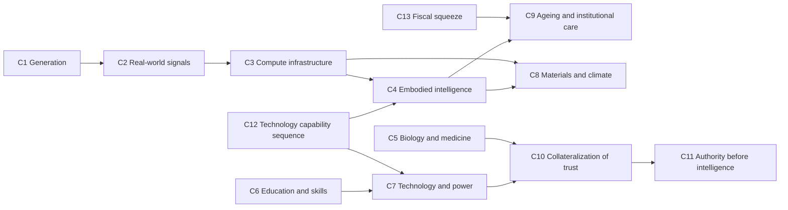

# Foresight by AI · A Future Reasoned Out, Not Imagined

[中文版](README.md)

## What this is

This is a public, reader-facing sandbox for the future, and what it reasons about is the picture of society as a whole: care, manufacturing, agriculture, logistics, and embodied robots in the physical world; attention, organizations, and capital in the information world; and population and families, power and institutions, how people work together, how people relate to AI, and meaning. It reasons from [five candidate sources held side by side](docs/en/00-method.md#1-candidate-evidence-sources-and-reasoning-starts) — supply and demand, human nature, historical regularities, technological regularities, and social regularities — none of which has axiomatic status in advance and none of which is the main axis. AI and other technical capabilities are one of the forces being reasoned about, alongside demographic structure, institutions and law, capital, physical and geographic constraints, and shifts in culture and demand; they are not the engine that drives everything. Opportunities are one destination, not the only one: ways of working together, social relationships, power, and meaning remain equally valid structural outcomes. Nor does the archive preselect a single explanatory framework: “abundance → scarcity” is an optional lens, used only when it adds explanatory power.

- **Straight into the future** → [C1 · What Becomes Unbuyable After Generation Becomes Free](docs/en/chains/10-generation-becomes-free.md): enter a concrete scene first, then follow the chain through the physical world, organizations, and institutions.
- **For readers who want to audit the method first** → [five-minute entry](#a-five-minute-entry-calibrate-first-then-follow-a-reasoning-chain): start with historical calibration, evidence boundaries, and methodology before choosing a chain.
- **Boundary first** → [what this archive can and cannot claim](#what-this-archive-can-and-cannot-claim): who decides it, what is still unmet, what the structural check proves, and which social dimensions the coverage matrix reaches — every boundary section is gathered there, none left at the foot of the page.

## What the future roughly looks like

[Population ageing and smaller households](docs/en/chains/90-aging-care-and-institutional-substitution.md) push care toward formal services and coordination layers; [fiscal and sovereign-debt pressure](docs/en/chains/130-fiscal-squeeze-who-gets-cut.md) first rearranges budgets and intergenerational distribution. Meanwhile, [embodied capability](docs/en/chains/40-embodied-intelligence.md) brings automation into physical work but first re-bundles tasks rather than erasing occupations. As [generated supply becomes abundant](docs/en/ledger/01-10.md#j-001--unit-reasoning-cost-keeps-falling), private context, accountable commitments, and validated causality may become more valuable ([J-003](docs/en/ledger/01-10.md#j-003--the-genuinely-durable-scarcity-is-ownership-of-private-context-about-you-and-its-usable-form), [J-005](docs/en/ledger/01-10.md#j-005--after-generation-becomes-abundant-value-concentrates-in-three-kinds-of-non-recombinable-input-raw-signals-accountable-commitments-and-validated-causality)). These are the directions the current cards sketch, not proven social inevitabilities.

## A five-minute entry: calibrate first, then follow a reasoning chain

This is a progressive reading path. You do not have to accept a forecast before seeing how the method is attacked: start with historical calibration, enter the future through one concrete reasoning chain, then decide whether to trace evidence, look for an action, or challenge a claim. The links below are entrances, not a second ledger; full facts, fields, and dependencies live only in the linked prose and `J-NNN` cards.

### 1. Start with method and history: how judgments are filtered

- [Retrospect](docs/en/01-retrospect.md): extracts diffusion gates from technological, political, and business history, then attacks them with successes and failures.
- [Cross-domain historical calibration evidence slice](docs/evidence/historical-calibration-2026-10-02.en.md): inspect reconstructable forecast–outcome pairs, original locations, same-metric fields, and evidence-class boundaries case by case.
- [Historical-calibration round archive (same 2+1 set as the canonical slice; do not double-count)](docs/evidence/historical-calibration-round-2026-10.en.md): retain the earlier round’s fuller narrative for `P-04`, `B-WEBVAN`, and `T-SHUTTLE` without adding it to the slice.
- [Next historical forecast–outcome evidence batch](docs/evidence/historical-calibration-next-batch-2026-10-02.en.md): inspect batch scope; its 4 records contain 3 calibration pairs (the first two carried forward from the slice, with `B-ETOYS` added in this batch) and 1 unknown candidate.
- [Social-regularity calibration (2026-10-10)](docs/evidence/social-regularity-calibration-2026-10-10.en.md): calibrates two social-regularity candidates on political successes and failures — constituency lock-in was admitted as L10 in veto form only, then refuted by a federal-estate-tax counterexample under the frozen window definition and withdrawn from the toolbox; preference-falsification cascades are not admitted because they cannot say no — and registers 4 forecast misses newly found in this round, none upgraded into the qualified count.
- [Historical Pseudo-Out-of-Sample Validation Protocol](docs/en/02-historical-validation-protocol.md): shows how cases, roles, and baselines are frozen, and what historical material cannot prove.
- [Independent Re-prediction After Historical Calibration: Current Status](docs/en/independent-reprediction-status.md): before entering future chains, check the frozen input, isolation from old documents, two re-judgement rounds, and the limits on the current result; the page also links to the Chinese counterpart.
- [Foresight Methodology](docs/en/00-method.md): defines judgment fields, parallel evidence sources, optional lenses, and the opportunity gate.
- [Judgment Evolution](docs/en/03-evolution.md): records narrowed rules, revised judgments, and the two executed rounds of the isolated re-review together with the remaining open or limited boundaries (run timestamp, round-2 output ordering, the audience-field leak, and same-model reproducibility).
- [Next Research-Gap Priorities](docs/en/06-research-gaps.md): ranks partially covered dimensions, next research actions, and evidence boundaries.

Read this step first so that the pages below are read as bounded reasoning rather than as forecasts whose fluency proves accuracy.

### 2. Choose a reasoning chain: enter the future through a concrete question

The chains are grouped by the real-world question a reader may want to follow. Each row only says where to enter and what the chain currently supports; the linked prose and ledger remain authoritative for evidence levels and limits.

#### Technology capability, generation, real-world signals, and infrastructure

| Pointer | Read first | Core direction currently supported | Evidence level and boundary |
|---|---|---|---|
| Technology order | [C12 · Technology Capability Sequence: what arrives first, and what only then becomes possible](docs/en/chains/120-technology-capability-sequence.md) · [J-001](docs/en/ledger/01-10.md#j-001--unit-reasoning-cost-keeps-falling) / [J-006](docs/en/ledger/01-10.md#j-006--reasoning-throughput-precedes-long-horizon-autonomy)–[J-016](docs/en/ledger/11-20.md#j-016--open-world-evaluation-is-the-final-gate-for-expanding-autonomy) | Capabilities arrive in order: cheaper reasoning, traceable memory, execution bounded by permissions, tools and rehearsable environments, and finally open-world evaluation; reliable use of each later capability rests on the earlier one. It is one of several parallel forces and does not decide for the other chains what becomes abundant. | Medium-low; all 12 cards are downgraded to occupational/organizational judgments (million-scale), and “which capability arrives first” is carried by no lens in L1–L9 — see the chain's head declaration. |
| Story | [What Becomes Unbuyable After Generation Becomes Free](docs/en/chains/10-generation-becomes-free.md) · [J-001](docs/en/ledger/01-10.md#j-001--unit-reasoning-cost-keeps-falling) / [J-003](docs/en/ledger/01-10.md#j-003--the-genuinely-durable-scarcity-is-ownership-of-private-context-about-you-and-its-usable-form) / [J-005](docs/en/ledger/01-10.md#j-005--after-generation-becomes-abundant-value-concentrates-in-three-kinds-of-non-recombinable-input-raw-signals-accountable-commitments-and-validated-causality) | As generated supply becomes abundant, value may move toward private context, accountable commitments, and validated causality; objective selection itself may be only a window. | Medium; “choose one from many candidates” is an occupational, million-scale boundary, not a society-wide trend. Section X's [J-103](docs/en/ledger/103-110.md#j-103--the-society-scale-ai-action-is-asking-not-deciding-hundred-million-weekly-reach-rests-on-the-free-tier) is the exception: under a measure frozen in advance, “asking a question or handing off a low-stakes task on one's own initiative” clears Gate 1 (hundred-million weekly reach; the lower bound is self-reported and unaudited). |
| Reality | [When Data Is No Longer Free: How Real-World Signals Become Contract Assets](docs/en/chains/20-real-signals-become-contracts.md) · [J-055](docs/en/ledger/51-60.md#j-055--real-world-signals-earn-a-premium-as-contract-assets-in-high-liability-tasks) | In high-liability settings, verifiable observations of the real world may become inputs to transactions and responsibility. | Medium; supports a mechanism, not universal premiums or the full time window. |
| Infrastructure | [Electrons on the Ground: The Bottleneck Moves from Chips to Grids, Land, and Permits](docs/en/chains/30-power-land-and-permits.md) · [J-057](docs/en/ledger/51-60.md#j-057--what-gets-priced-is-not-energy-but-certainty-of-delivery-date) / [J-061](docs/en/ledger/61-70.md#j-061--local-externalities-of-data-centres-become-explicit-and-social-licence-becomes-a-real-siting-constraint) / [J-063](docs/en/ledger/61-70.md#j-063--the-geography-of-compute-is-decided-by-interconnection-queues-and-permitting-speed-not-by-electricity-price) | Compute demand runs into interconnection, sites, permits, and local externalities; deliverable timing may matter more than bare electricity price. | Medium; cross-market, price, and waiting-time series remain incomplete, so a local rule cannot be written as a global trend. |

#### The physical world, care, and human capability

| Pointer | Read first | Core direction currently supported | Evidence level and boundary |
|---|---|---|---|
| Physical world | [Physical Labour and Embodied Intelligence in the Embodied World: How Care, Manufacturing, Logistics, Construction, and Agriculture Rebundle Tasks, Relationships, and Responsibility](docs/en/chains/40-embodied-intelligence.md) · [J-073](docs/en/ledger/71-80.md#j-073--embodied-intelligence-is-the-necessary-complement-for-ai-to-reach-the-physical-labour-population-not-a-sufficient-condition-for-diffusion)–[J-078](docs/en/ledger/71-80.md#j-078--construction-and-domestic-work-are-blocked-by-the-one-off-site-and-somebody-elses-home-inside-this-window-they-arrive-only-as-single-operation-equipment-and-single-task-slices); social-consequence extension: [J-099](docs/en/ledger/96-102.md#j-099--embodied-automation-re-bundles-occupational-tasks-before-it-eliminates-occupations)–[J-102](docs/en/ledger/96-102.md#j-102--embodied-productivity-gains-concentrate-first-in-complementary-assets-and-liability-carriers) | Physical labour in care, logistics, manufacturing, agriculture, construction, and domestic work is reshaped by population, wages, institutions, scene constraints, capital, and embodied systems in combination; after adoption, tasks, family roles, regional carriers, and gain distribution are rebundled rather than automatically becoming society-scale diffusion. | Medium; occupational/organizational and social-consequence inferences; deployment scale, insurance liability, unit-task costs, cross-region comparisons, and distribution series remain gaps. |
| Biomedicine | [Biology and Medicine: Answers Get Cheap Before Proof and Care Do](docs/en/chains/50-biology-medicine.md) · [J-079](docs/en/ledger/71-80.md#j-079--biomedical-candidate-generation-and-clinical-grade-causal-proof-diverge)–[J-082](docs/en/ledger/81-90.md#j-082--once-explanation-is-abundant-medical-scarcity-moves-to-authorized-intervention-and-continuity-of-care-landscape-only) | Candidate generation separates from clinical-grade causal proof, care, and responsibility. | Medium to low; cross-country deployment and long-term outcomes remain incomplete, so candidate counts are not medical outcomes. |
| Education | [Education and Skill Formation: Explanation Overflows; Mastery Must Still Leave a Trace](docs/en/chains/60-education-skill-formation.md) · [J-083](docs/en/ledger/81-90.md#j-083--personalized-explanation-becomes-abundant-before-verifiable-mastery)–[J-086](docs/en/ledger/81-90.md#j-086--the-explanation-gap-narrows-while-practice-and-verification-gaps-may-widen-landscape-only) | Explanation may become cheap, while mastery, assessment, qualification, and institutional carriers do not automatically become abundant. | Medium to low; any broad social claim must return to the card’s scale test; long-term cross-country evidence remains open. |
| Population and care | [Ageing and Institutional Care: Who Carries the Daily Physical and Coordination Work](docs/en/chains/90-aging-care-and-institutional-substitution.md) · [J-096](docs/en/ledger/96-102.md#j-096--ageing-and-smaller-households-move-part-of-care-toward-formal-and-coordination-layers) / [J-097](docs/en/ledger/96-102.md#j-097--care-assistance-stabilises-first-in-institutions-and-controlled-services-open-home-general-purpose-robots-lag) | Starting from demography, household time, and institutional carriers, this chain tests the sequence of formal care, coordination, and embodied devices without treating AI as the sole root cause. | Medium; caregiver denominators, institutional deployment retention, and household incident data remain open. |
| Authority and liability | [Authority before intelligence: agency, liability, and the human–AI relationship](docs/en/chains/110-authority-before-intelligence.md) · [J-098](docs/en/ledger/96-102.md#j-098--authority-before-intelligence-consequential-settings-form-revocable-tiered-agency-first) | Starting from agency institutions, authorisation, revocation, and liability, this chain forecasts AI entering existing human relationships as bounded tiered agency. | Medium; cross-system agency incidents, revocation success, insurance pricing, and sustained-use data remain open; it does not treat AI personhood as a conclusion. |

#### Organizations, power, materials, and trust

| Pointer | Read first | Core direction currently supported | Evidence level and boundary |
|---|---|---|---|
| Social transmission | [Technology Arrives First, Power Later](docs/en/chains/70-capability-to-social-consequences.md) · [J-087](docs/en/ledger/81-90.md#j-087--humanmachine-supervisory-units-become-mainstream-before-staffless-organizations)–[J-091](docs/en/ledger/91-95.md#j-091--demand-expansion-and-task-savings-occur-together-net-employment-cannot-be-inferred-from-the-capability-curve-alone) | Capability changes tasks and supervision inside organizations first, then transmits through labour, institutions, capital, and demand; benchmarks do not directly imply employment outcomes. | Medium; cross-country longitudinal organizational data are missing, and technology is not the only driver. |
| Upstream risk | [The Fab Before the Chip: Why Climate Risk Bites at Qualified Bottlenecks](docs/en/chains/80-fab-materials-and-climate.md) · [J-092](docs/en/ledger/91-95.md#j-092--semiconductor-resilience-spending-shifts-from-raw-stockpiles-to-pre-qualified-conversion-paths)–[J-095](docs/en/ledger/91-95.md#j-095--fab-resilience-costs-become-explicit-bargaining-over-who-pays-and-who-is-curtailed-first) | Resilience constraints may sit in qualified materials, equipment, process conversion, and utilities—not merely in a nominal second supplier. | Medium; cross-firm qualification cycles, multi-site losses, insurance, and cost-allocation series remain open. |
| Trust transactions | [Collateralization of trust: when expression no longer proves ability, who bears the outcome?](docs/en/chains/100-trust-collateralization.md) · [J-035](docs/en/ledger/31-40.md#j-035--responsibility-collateral-enters-the-transaction-structure-for-consequential-ai-output) | In high-liability, priceable organizational transactions, fulfillment records, solvency, and audits may become trust interfaces beyond one-off demonstrations. | Low to Medium; J-035 remains an occupational/organizational judgment, universal responsibility collateral is unproven, and the observation window is 2028–2035. |

### 3. Then see the social landscape: place one chain in the wider network

- [Near, mid, and far landscapes](docs/en/10-near.md): near, mid, and far are reading containers, not strict calendars.
- [C12 · Technology Capability Sequence](docs/en/chains/120-technology-capability-sequence.md): tracks capability arrival order without treating technology as the sole engine of social change.
- [Coverage matrix](#coverage-matrix-current-boundary): checks which social dimensions have entries and which remain explicit gaps.
- [C11 · Authority before intelligence](docs/en/chains/110-authority-before-intelligence.md): start from agency institutions, authority, and liability to examine the institutional entry point for human–AI relationships.
- [C13 · Fiscal Squeeze](docs/en/chains/130-fiscal-squeeze-who-gets-cut.md): start from public finance and sovereign debt, without presupposing AI, to see whom the knife falls on first when budgets tighten.
- [C14 · Ballots and Security Ledgers](docs/en/chains/140-ballots-and-security-ledgers.md): start from the 2016 UK referendum and NATO/UK defence-budget commitments, and test whether security shocks enter budgets and industrial policy before electoral rules; it does not forecast war or all states.
- [Society-scale register](docs/en/91-social-scale-register.md): start from the pass side — how many judgments currently clear Gate 1 (measured 2026-10-10: one — [J-103](docs/en/ledger/103-110.md#j-103--the-society-scale-ai-action-is-asking-not-deciding-hundred-million-weekly-reach-rests-on-the-free-tier), asking a general-purpose AI chat assistant a question or handing it a task on one's own initiative; an action that does not presuppose AI — paid work from home — was tested on the same day under the same frozen definitions and stopped at the D tier, registered as [J-104](docs/en/ledger/103-110.md#j-104--paid-work-from-home-stops-at-the-d-tier-tens-of-millions-weekly-a-plateau-since-2023-and-the-employer-decides)), where every remaining candidate is stuck, and which countable fact would have to be observed.

### 4. Finally choose action or challenge

- [Opportunity Candidates](docs/en/40-opportunities.md): lists directions with payers and hard constraints as candidates; others remain windows or landscape only. **On 2026-10-18, C4–C13 were routed back into this page: C4 adds an embodied single-task candidate, C10 reconnects to an existing candidate, C8's O-005 remains explicitly a screening direction, and every other chain records an honest no-candidate disposition without erasing structural consequences.**
- [Judgment Ledger](docs/en/90-ledger.md): tracks the single source of facts, `J-NNN` status, dependencies, sources, and gaps.
- [How to Refute a Judgment Here](CONTRIBUTING.en.md): uses a card’s own falsifier to formulate a counterexample.

## What this archive can and cannot claim

> This is the compact boundary summary: read the future-at-a-glance section first, then expand here to audit the evidence, validation, and coverage limits.

Expand the full validation, evidence, and coverage boundary

This section answers two questions: what this archive can claim today, and what it explicitly cannot. Every boundary section in this repository — some of which used to sit ahead of the reading path, the rest at the foot of the page — is gathered here, with its text unchanged.

A usable judgment must lead back to a reasoning chain and state a time window, falsifier, leading indicator, confidence, and audience boundary. External material is used for comparison and calibration, not as a substitute for independent reasoning. Insufficiently evidenced material is explicitly marked “landscape only.”

This section has seven parts and they do different jobs; none substitutes for another: **Who decides what goes in here** = authorship and authority; **Current validation status** = what has been executed and what is still unmet; **First ask whether the method has been historically calibrated** = what historical material can and cannot prove; **Current field migration and evidence boundary** = card structure and the fields still unknown; **Structural checks and the public boundary** = what `python3 scripts/check.py` can and cannot prove; **Coverage matrix (current boundary)** = which social dimensions have a reachable entry; **Current boundary** = what this round as a whole has not yet written.

### Who decides what goes in here

The name is literal. **The research scope, the selection and structure of every reasoning chain, and the content, time window, falsifier, leading indicator, confidence, and audience boundary of every judgment card are decided independently by AI.** The human maintainer supplies goals, environmental constraints, and methodological rules, decides whether to publish, and revises bilingual parity and formatting; he does not ghost-write judgments, filter conclusions to fit a position, inflate confidence, or delete unfavourable records. **Git commits are recorded under the maintainer's identity while the prose is AI-generated**; the commit author field cannot be used to infer authorship of the content. Revised or withdrawn judgments keep their original text verbatim and their identifiers are never reused (see [Judgment Evolution](docs/en/03-evolution.md)).

As an experiment, what this can claim today is method and falsifiability, **not accuracy**. No judgment card is currently due; review batches, dates, and the boundary around “hit rate” are recorded in the [ledger review log](docs/en/90-ledger.md#8-review-log). Until then, historical cases serve calibration only (see the [Historical Pseudo-Out-of-Sample Validation Protocol](docs/en/02-historical-validation-protocol.md)).

### Current validation status: keep protocol, results, and gaps separate

Readers should keep three things distinct:

- **Repository-wide archive total**: the current reconstructable `CALIBRATION` archive contains **6 pairs**—politics `P-01`, `P-02`, `P-04`, and `P-06` (4), plus business `B-WEBVAN` and `B-ETOYS` (2), with 0 qualified technology pairs. This is the only number that means “the qualified calibration archive as a whole”: **6/12**. All six were selected after their outcomes were known; they are not pseudo-out-of-sample hit-rate evidence or future accuracy.
- **Current methodology snapshot**: the methodology’s October 2026 summary covers two latest evidence records: three reconstructable `CALIBRATION` pairs (`P-04`, `B-WEBVAN`, `B-ETOYS`) and one `UNKNOWN/UNVERIFIED` technology candidate (`T-SHUTTLE`). This **3 + 1** is the scope of that snapshot, not the repository-wide total and not three new cases.
- **Conditions not yet met**: the protocol requires at least four cases in each of technology, politics, and business, and at least twelve overall. The technology candidates remain an evidence gap because their pre-T original, same-metric outcome, and observation window could not be reconstructed together. Retrospective narrative or a URL list cannot fill that gap.
- **The isolated re-review has now run twice, but independent correctness is still not established** (updated 2026-10-09; this item previously said “no verifiable evidence that the re-review has started”, which no longer holds): all 102 cards carry a blind disposition made on a record whose claim text was intact (J-103–J-107, registered afterwards, have no blind-review record), and the de-labelled bundle's input hashes plus round 1's six reviewer raw outputs are committed and recomputable ([re-audit report](docs/evidence/blind-review-reaudit-2026-10-09.en.md)). Three things are still missing or limited: the **run timestamp** was never retained as the protocol requires; round 2's three raw outputs are now committed in `docs/evidence/blind-review/raw/round2/` and byte-identical to the hashes recorded in §8 of the 90-ledger, but their ordering still rests on the owner's word; and — most importantly — **the audience field handed gate one's own prior conclusion to the reviewer** (on all 102 cards), with 12 of round 2's 15 gate-one vetoes quoting it as their reason, so those “blind verdict reproduced the existing scope limit” counts must not be read as independent reconstruction. The reviewer is also still the same model as the original author, so what it measures is reproducibility, not accuracy. A protocol that exists, mechanical checks that pass, and hashes that are complete do not add up to a validated method.

What this entrance can honestly offer today is a method archive with **partial calibration executed, unmet conditions made explicit, and the re-review obligation preserved**—not a forecasting system already shown to be accurate. See [Judgment Evolution](docs/en/03-evolution.md) for details and commit anchors.

**Public landing record (content commit, 2026-10-16)**: this content publication was verified on public `main` at `b75bf7fc736dccecbd32a7a33e4678e7dc3e9b22`, whose archive ran `python3 scripts/check.py` with exit `0`; the subsequent README explanation update was carried to public `main` by commit `3ff8eac`. This records evidence for the content commit rather than misrepresenting a later explanatory update as another content release.

#### How to read the historical-calibration numbers

The following numbers are deliberately retained because their scopes differ and they must not be substituted for one another: the **first cross-domain evidence slice** contains `2` reconstructable pairs (`P-04`, `B-WEBVAN`) + `1` unknown candidate (`T-SHUTTLE`); [historical-calibration-round-2026-10.en.md](docs/evidence/historical-calibration-round-2026-10.en.md) is an earlier archival round record of that same `P-04`, `B-WEBVAN`, `T-SHUTTLE` set, not a second sample and not additive; the **next evidence batch** contains `4` records, of which `3` are `CALIBRATION` (the first two are carried-forward records and only `B-ETOYS` is added in that batch) + `1` unknown candidate. Use the [evidence navigation](docs/en/01-retrospect.md#103-latest-cross-domain-evidence-slice-and-next-batch-classes-windows-and-metric-definitions-2026-10) for slice/batch scope; use the **6-pair** total above for the repository-wide archive.

The experiment carries its own falsifier: **if, at review, most cards' falsification conditions turn out to be undecidable, or judgments are silently rewritten to fit what already happened, then what failed is the method, not a single judgment** — and that verdict goes into the evolution record rather than into a deleted file. This check is preregistered in the [ledger review log](docs/en/90-ledger.md#8-review-log) with review date 2027-03-31.

This is research material, not investment, medical, legal, or career advice.

### First ask whether the method has been historically calibrated

The [Retrospect](docs/en/01-retrospect.md) extracts five diffusion gates from technological, political, and business history and attacks them with successes, failures, and cases from this repository. The [Historical Pseudo-Out-of-Sample Validation Protocol](docs/en/02-historical-validation-protocol.md) specifies how cases, roles, and baselines are frozen.

The evidence boundary comes first: historical cases can provide **calibration**—explain known outcomes, find counterexamples, and revise rules—but cannot be presented as future predictive power. The historical pseudo-out-of-sample holdout has **not yet been run**; genuine out-of-sample records can come only from future judgment cards reaching their review windows. We can currently report calibration, not pseudo-out-of-sample hit rates or future accuracy. The diffusion gate in protocol v1 was narrowed during calibration; the old v1 snapshot cannot substitute for an isolated review of v2. **That isolated re-review was executed in two rounds on 2026-10-09** and every registered judgment card now carries a per-card disposition made on a record whose claim text was intact — but it **only tests reproducibility** (the re-reviewer is the same model as the original author, and de-labelling cannot remove training memory), so it is not evidence of accuracy, method validity, or out-of-sample performance; only three of the protocol’s four start-evidence items are satisfied (the run timestamp is missing), and one source leak is not eliminated. See the [Historical Pseudo-Out-of-Sample Validation Protocol](docs/en/02-historical-validation-protocol.md) and the [ledger review log](docs/en/90-ledger.md#8-review-log). This evidence boundary does not reject the re-review direction or imply that the method has been falsified.

### Current field migration and evidence boundary

The public ledger's **structure, navigation, and legacy-field migration are complete**: judgment cards expose traceable reasoning chains, time windows, falsifiers, leading indicators, confidence, audience boundaries, status, and dependencies, while preserving original legacy wording, revisions, and migration notes. Although J-001–J-086 predate the standalone **Audience scale** rule, each now records that field: `KNOWN` where independent evidence exists and explicit `UNKNOWN` where it does not. A constructed ceiling in the diffusion-gate review may not fill that gap. `python3 scripts/check.py` verifies the fixed historical baseline, bilingual statuses, current cards, manifest summary, and source anchors. Structural migration **does not mean that the historical method has been validated**.

Three boundaries must remain separate:

- **Structure and navigation complete**: public entries, bilingual card locations, historical traceability, and migration notes are reachable; this only describes how information is presented.
- **Legacy field migration is closed**: J-001–J-086 now record standalone `Audience scale` values and preserve their historical status. `UNKNOWN` is an explicit evidence state and may not be replaced with an unverified magnitude.
- **Evidence and method boundaries remain open**: some audience denominators, cross-system comparisons, long-run outcomes, deployment scales, and price series remain explicitly unknown, unverified, or open. Historical calibration, the retained re-review, and future due-date checks have separate conditions. Complete fields do not establish forecast accuracy or show that the method has passed validation.

Read structure migration, evidence boundaries, and validation status separately. For any card's actual claim, limitation, and current state, use the card text in the ledger as the authority. The checker fails on missing fields, bilingual-status drift, historical-anchor drift, or magnitude/capability claims smuggled into `UNKNOWN`; a passing result proves the structural contract, not forecast accuracy.

To audit how the legacy cards entered the current structure, read the [Chinese legacy-card migration inventory](docs/evidence/legacy-ledger-migration.md) together with its [English counterpart](docs/evidence/legacy-ledger-migration.en.md). The two files are public bilingual projections of the same J-001–J-095 historical anchors: they share judgment identifiers and must be updated in the same commit. The ledger text remains the file-level source of truth for judgment fields, but that rule refers to the stable ledger files, not to either language. Any Chinese–English mismatch is therefore a bilingual synchronization defect to fix in the same commit, not a reason to assign authority to one language. The inventory preserves historical traceability, unknown/unverified fields, the migration scope, and the J-096 starting boundary; those structural facts are not evidence that the method has been validated.

### Structural checks and the public boundary

The repository provides a structural check command, `python3 scripts/check.py`, to detect mechanical inconsistencies such as bilingual identifiers, internal links, and required fields. It does not judge the quality of the reasoning, the sufficiency of historical evidence, or forecast accuracy, and it does not mean that the project is complete or fit for release. Public readers should use the methodology, judgment cards, evidence boundaries, and research gaps—not a green structural check—as the basis for evaluating the archive.

**Release-verification boundary**: public `main` file access and desktop GitHub rendering have been checked; **GitHub narrow/mobile rendering: unverified**. Desktop evidence therefore must not be read as verification for every viewport.

This entry does not promise a fixed judgment-card total: cards will grow, be revised, and sometimes be migrated as the research develops. **The current snapshot is 121 judgment cards and 20 independent reasoning chains**; this is not a permanent promise and may change with the next revision. For a current snapshot, use the [Judgment Ledger](docs/en/90-ledger.md) and its shard navigation. The full inventory, per-card status, historical calibration status, source boundaries, and gaps are maintained in the ledger and protocols rather than copied here.

### Coverage matrix (current boundary)

Narrow-screen readers do not need to begin with a wide comparison table: enter a chain by theme first, then expand the full matrix below when a wide view is useful. These grouped links are navigation only; each chain page and the ledger remain authoritative for status, evidence, and gaps.

- **Physical world and life**: [Embodied labour and intelligence](docs/en/chains/40-embodied-intelligence.md) · [Biology and medicine](docs/en/chains/50-biology-medicine.md) · [Ageing and family care](docs/en/chains/90-aging-care-and-institutional-substitution.md)
- **Technology and infrastructure**: [Compute, energy, and physical infrastructure](docs/en/chains/30-power-land-and-permits.md) · [Materials and climate](docs/en/chains/80-fab-materials-and-climate.md) · [Technology capability sequence](docs/en/chains/120-technology-capability-sequence.md)
- **Organizations, institutions, and distribution**: [Technology and social consequences](docs/en/chains/70-capability-to-social-consequences.md) · [Authority before intelligence](docs/en/chains/110-authority-before-intelligence.md) · [Boundaries Before Capability](docs/en/chains/200-law-property-liability-and-geopolitics.md) · [Fiscal squeeze](docs/en/chains/130-fiscal-squeeze-who-gets-cut.md) · [Ballots and security ledgers](docs/en/chains/140-ballots-and-security-ledgers.md) · [Income, wealth, and inequality](docs/en/chains/180-income-wealth-inequality.md)
- **Relationships, culture, and everyday life**: [Education and skill formation](docs/en/chains/60-education-skill-formation.md) · [Three clocks of the household](docs/en/chains/150-households-three-clocks.md) · [Culture, climate, and everyday carrying capacity](docs/en/chains/160-culture-climate-mobility.md) · [Religion and belief](docs/en/chains/170-religion-and-belief.md)
- **Information, trust, and safety**: [Generation becomes free](docs/en/chains/10-generation-becomes-free.md) · [Real-world signals as contract assets](docs/en/chains/20-real-signals-become-contracts.md) · [Collateralization of trust](docs/en/chains/100-trust-collateralization.md) · [Public safety and crime](docs/en/chains/190-public-safety-and-crime.md)

Expand the full matrix (best for wide-screen comparison)

This table lists only dimensions with an entry, but it no longer hides the rest of the landscape: the complete social-dimension list is the matrix together with the adjacent [dimensions with no entry yet](#dimensions-with-no-entry-yet) table, and the two must match section 6 of the ledger row by row. **Covered** means at least one reachable chain page and one judgment card (when the card is marked “landscape only,” that boundary is stated here too); **Partially covered** means a thematic entry and judgment exist, or an explicit landscape-only entry exists, while key institutional, scale, or longitudinal evidence remains open; **No entry yet** means no chapter takes the dimension as its subject, so this table states only why it belongs in a whole-society landscape and makes no forecast. The linked prose and ledger remain authoritative for full fields, dependencies, and falsifiers.

Two independently judgeable propositions must remain separate here: the **entry proposition** is that every social dimension listed currently has at least one reachable thematic entry; the **completion proposition** is that the whole-society landscape is complete. The current evidence supports only the first proposition, not the second. The boundaries still marked “Partially covered” are geopolitics and institutions; law, property, and liability; collaboration between people; relationships between people and AI; evolution of social relationships; upstream materials and climate coupling of compute; population ageing and family care; culture, entertainment, and leisure; climate and the environment; and transport and everyday mobility. The “What remains open” cell in each row continues to define the unresolved scope. The table currently has no dimension marked “No entry yet”; that means entries have been added, not that the partially covered evidence, country range, long-run outcomes, or social consequences are complete.

| Social dimension | Status | Reachable entry and minimum evidence | What remains open |
|---|---|---|---|
| Physical-world labour and embodied intelligence | Covered | [C4 Embodied Intelligence](docs/en/chains/40-embodied-intelligence.md); [J-073](docs/en/ledger/71-80.md#j-073--embodied-intelligence-is-the-necessary-complement-for-ai-to-reach-the-physical-labour-population-not-a-sufficient-condition-for-diffusion)–J-078; social-consequence extension [J-099](docs/en/ledger/96-102.md#j-099--embodied-automation-re-bundles-occupational-tasks-before-it-eliminates-occupations)–[J-102](docs/en/ledger/96-102.md#j-102--embodied-productivity-gains-concentrate-first-in-complementary-assets-and-liability-carriers) | Care deployment scale, cross-scene costs, insurance liability, cross-region comparisons, and gain-distribution series remain open |
| Biology and medicine | Covered | [C5 Biology and Medicine](docs/en/chains/50-biology-medicine.md); [J-079](docs/en/ledger/71-80.md#j-079--biomedical-candidate-generation-and-clinical-grade-causal-proof-diverge)–J-082 (J-082 is explicitly “landscape only”) | Cross-country deployment scale and long-term outcomes |
| Education and skill formation | Covered | [C6 Education and Skill Formation](docs/en/chains/60-education-skill-formation.md); [J-083](docs/en/ledger/81-90.md#j-083--personalized-explanation-becomes-abundant-before-verifiable-mastery)–J-086 (J-086 is explicitly “landscape only”) | Long-term cross-country trials and credential recognition |
| Compute, energy, and physical infrastructure | Covered | [C3 Compute Infrastructure](docs/en/chains/30-power-land-and-permits.md); J-056–J-064 (J-062 and J-064 are explicitly “landscape only”) | Comparable series for cross-market queues, permits, and utility costs |
| Organizations, employment, and firm boundaries | Covered | [C7 Technology and Social Consequences](docs/en/chains/70-capability-to-social-consequences.md); J-087–J-091 | Cross-country longitudinal organizational data; net employment direction cannot be inferred from capability curves alone |
| Attention and trust | Covered | [C1 What Becomes Unbuyable After Generation Becomes Free](docs/en/chains/10-generation-becomes-free.md); J-035–J-036 | Cross-region evidence on repeated behaviour and allocation of credible credentials |
| Capital and power | Covered | [C7 Technology and Social Consequences](docs/en/chains/70-capability-to-social-consequences.md); J-039–J-040 | Long-run data on financing, distribution of returns, and concentration or diffusion of power |
| Human needs, meaning, and embodied presence | Covered | [Far-term landscape, section 6](docs/en/30-far.md#6-human-needs-meaning-and-embodied-presence-scarcity-may-move-from-objects-to-responsibility); J-042 and J-053–J-054 (all explicitly “landscape only”) and J-029 (scope-downgraded 2026-10-09) | Social-scale evidence on changing needs, meaning structures, and shared experience |
| Geopolitics and institutions | Partially covered | [C3 Compute Infrastructure](docs/en/chains/30-power-land-and-permits.md); J-059–J-060 (J-060 is explicitly “landscape only”); [C13 Fiscal Squeeze](docs/en/chains/130-fiscal-squeeze-who-gets-cut.md); [C14 Ballots and Security Ledgers](docs/en/chains/140-ballots-and-security-ledgers.md); [C20 Boundaries Before Capability](docs/en/chains/200-law-property-liability-and-geopolitics.md); [J-105](docs/en/ledger/103-110.md#j-105--under-fiscal-squeeze-current-recipients-nominal-pensions-are-the-hardest-to-cut-the-knife-falls-first-on-those-not-yet-drawing)–[J-108](docs/en/ledger/103-110.md#j-108--security-commitments-become-budgets-and-industrial-policy-first-electoral-rule-change-is-not-the-first-response); [J-121](docs/en/ledger/120-121.md#j-121--cross-border-institutions-will-zone-around-critical-dependencies-global-rules-will-not-converge-automatically) | A four-country entry on security budgets and institutional response is now available; C20 adds cross-border licensing, procurement, standards, and critical-dependency boundaries; war, battlefield operations, nuclear deterrence, migration, energy geopolitics, and cross-country polarisation remain open, and C14 does not extrapolate local evidence to society-wide trends |
| Law, property, and liability | Partially covered | [C2 Real-World Signals](docs/en/chains/20-real-signals-become-contracts.md); [C11 Authority before intelligence](docs/en/chains/110-authority-before-intelligence.md); [C20 Boundaries Before Capability](docs/en/chains/200-law-property-liability-and-geopolitics.md); [J-098](docs/en/ledger/96-102.md#j-098--authority-before-intelligence-consequential-settings-form-revocable-tiered-agency-first); [J-120–J-121](docs/en/ledger/120-121.md) | Full boundaries of data ownership, model-output licensing, cross-system agency incidents, and liability regimes remain open; C20’s cross-jurisdiction rules and incident denominators still need registration |
| Collaboration between people | Partially covered | [Far-term landscape, section 4](docs/en/30-far.md#4-collaboration-between-people-from-doing-steps-together-to-choosing-commitments-together) and [section 4.1](docs/en/30-far.md#41-a-different-starting-point-after-one-forced-mass-experiment-collaboration-settled-on-hybrid); [J-104](docs/en/ledger/103-110.md#j-104--paid-work-from-home-stops-at-the-d-tier-tens-of-millions-weekly-a-plateau-since-2023-and-the-employer-decides) (does not presuppose AI; tens of millions); J-049–J-050 remain “landscape only”, and each card states what it lacks | Concrete institutions, organizational cases, and observable repeated action; “jointly bearing an irreversible commitment” has no countable unit yet |
| Relationships between people and AI | Partially covered | [C11 Authority before intelligence](docs/en/chains/110-authority-before-intelligence.md); [J-098](docs/en/ledger/96-102.md#j-098--authority-before-intelligence-consequential-settings-form-revocable-tiered-agency-first); [far-term section 3.1](docs/en/30-far.md#31-a-different-starting-point-the-humanai-relationship-that-has-reached-society-scale-is-asking) and [J-103](docs/en/ledger/103-110.md#j-103--the-society-scale-ai-action-is-asking-not-deciding-hundred-million-weekly-reach-rests-on-the-free-tier) (“asking” clears Gate 1); far-term J-047–J-048 remain “landscape only”, and each card states what it lacks | Cross-system cases and longitudinal product evidence for authorization, exit, and limited agency status |
| Evolution of social relationships | Partially covered | [Far-term section 7](docs/en/30-far.md#7-social-relationships-family-care-as-the-case-what-changes-first-is-who-does-the-work-not-whether-the-relationship-remains); [J-096](docs/en/ledger/96-102.md#j-096--ageing-and-smaller-households-move-part-of-care-toward-formal-and-coordination-layers), [J-100](docs/en/ledger/96-102.md#j-100--embodied-care-reallocates-family-roles-before-it-removes-care-relationships) (family care roles, tens of millions), J-041; J-042 remains “landscape only”, and the card states what it lacks | Section 7 takes only family care as its case; courtship and marriage, friendship, community and intergenerational relationships are not yet covered; qualifying weekly carer measures for China, Japan, India and others; no historical control group yet for the sub-rule that strong ties do not multiply as communication gets cheaper |
| Upstream materials and climate coupling of compute | Partially covered | [C8 Materials and Climate](docs/en/chains/80-fab-materials-and-climate.md); J-092–J-095 | Cross-firm qualification cycles, multi-site climate losses, insurance, and cost allocation |
| Social consequences of the technology capability sequence | Covered | [C7 Technology and Social Consequences](docs/en/chains/70-capability-to-social-consequences.md); J-087–J-091 | Cross-country longitudinal organizational data remain an evidence gap |
| Order of technology-capability arrival | Covered | [C12 Technology Capability Sequence](docs/en/chains/120-technology-capability-sequence.md); [J-001](docs/en/ledger/01-10.md#j-001--unit-reasoning-cost-keeps-falling), J-006–J-016, and [J-114–J-116](docs/en/ledger/114-116.md) | “Which capability arrives first” is carried by no lens in L1–L9 (see the [mapping table's “Technology regularities” row](docs/en/00-method.md#mapping-the-five-starting-points-to-l1l9)); arrival is not adoption, and adoption and social consequences are carried by C7 and C4 |
| Population ageing and family care | Partially covered | [C9 Ageing and Institutional Care](docs/en/chains/90-aging-care-and-institutional-substitution.md); [J-096](docs/en/ledger/96-102.md#j-096--ageing-and-smaller-households-move-part-of-care-toward-formal-and-coordination-layers)–J-097; [C15 Three Clocks of the Household](docs/en/chains/150-households-three-clocks.md); J-109–J-111 | Deduplicated caregiver denominator, institutional deployment and retention, household incidents and maintenance cost; C15 adds a first housing, migration, and fertility entry, while specific cities, religion, wealth distribution, and refugee migration remain open |
| Urbanization and housing | Covered | [C15 Three Clocks of the Household](docs/en/chains/150-households-three-clocks.md); [J-109](docs/en/ledger/109-111.md#j-109--housing-costs-will-keep-delaying-household-formation-into-later-life-and-fewer-affordable-places) | Cross-country series for urban housing permits, rent burden, and family formation; C15 does not fill in the effects of specific city projects |
| Migration and population movement | Covered | [C15 Three Clocks of the Household](docs/en/chains/150-households-three-clocks.md); [J-110](docs/en/ledger/109-111.md#j-110--migration-is-a-labour-and-care-shock-absorber-not-a-reversal-of-population-ageing) | Long-run series for internal migration, refugees and irregular migration, credential recognition, and political integration remain open |
| Fertility and family formation | Covered | [C15 Three Clocks of the Household](docs/en/chains/150-households-three-clocks.md); [J-111](docs/en/ledger/109-111.md#j-111--fertility-policy-is-more-likely-to-change-timing-and-gaps-than-restore-replacement-fertility-across-the-oecd) | Religion and marriage norms, wealth distribution, and causal evaluation of specific policies remain open; C15 does not write policy bundles as a guaranteed return to replacement fertility |
| Culture, entertainment, and leisure | Partially covered | [C16 Culture, Climate, and Everyday Carrying Capacity](docs/en/chains/160-culture-climate-mobility.md); [J-112](docs/en/ledger/112-113.md#j-112--leisure-culture-consumption-is-constrained-by-time-budgets-and-access) | Comparable city series for offline participation, streaming substitution, and time use remain open; no platform or genre winner is forecast |
| Religion and belief | Covered | [C17 Religion and Belief](docs/en/chains/170-religion-and-belief.md); [J-117](docs/en/ledger/117-119.md#j-117--religion-differentiates-and-recombines-before-it-synchronously-declines-with-modernisation) | Independent entry separates affiliation, practice, institutional carriers, and normative identity; comparable long-run series on practice, transmission, and institutional functions remain open |
| Income, wealth distribution, and inequality | Covered | [C18 Income, Wealth, and Inequality](docs/en/chains/180-income-wealth-inequality.md); [J-118](docs/en/ledger/117-119.md#j-118--productivity-growth-first-differentiates-claims-then-determines-whether-income-diffuses) | How gains pass through asset ownership, bargaining power, taxation, housing, and public services into households; comparable long-run distributional panels remain open |
| Public safety and crime | Covered | [C19 Public Safety and Crime](docs/en/chains/190-public-safety-and-crime.md); [J-119](docs/en/ledger/117-119.md#j-119--risk-recombines-before-public-safety-improves-no-single-technology-produces-safety-automatically) | Personal and property safety, visible violence, online fraud, identity theft, and governance legitimacy now have an independent entrance; cross-country victim denominators and recovery/appeal series remain open |
| Climate and the environment | Partially covered | [C16 Culture, Climate, and Everyday Carrying Capacity](docs/en/chains/160-culture-climate-mobility.md); [J-113](docs/en/ledger/112-113.md#j-113--climate-shocks-first-widen-inequality-through-insurance-adaptation-and-travel-disruption) | Longitudinal grouped series on exposure, insurance, adaptation investment, and travel disruption remain open; no particular disaster is forecast as certain |
| Transport and everyday mobility | Partially covered | [C16 Culture, Climate, and Everyday Carrying Capacity](docs/en/chains/160-culture-climate-mobility.md); an independent problem entrance and landscape-only boundary exist, but no independent judgment card yet | Comparable city data on mode, reliability, affordability, and care trips with a common household denominator; next step is an independent card |

The matrix deliberately keeps “partially covered” in the status column rather than promoting it to “covered”: an existing entry is not full landscape closure, and missing national-security, institutional-boundary, long-term-outcome, credential-recognition, insurance, cost-allocation, and family-care-denominator evidence is not filled by adjacent cards — each of those is itemized in the “what remains open” column of the rows above, rather than signalled by a grade no row occupies.

> **Correction, 2026-10-10**: the earlier wording said “Those two are the only grades here … the gaps that genuinely have no entry yet live in two other places … the ledger … is the single source of truth for gaps.” That excluded whole-society dimensions with no entry from the reader entry point and made the README/ledger boundary misleading. The matrix and the table below now present them together, with the ledger's section 6 checked row by row.

#### Dimensions with no entry yet

This table makes no forecast. It states why each dimension belongs in a whole-society landscape and where existing prose only touches it. Together with the matrix above, it defines the coverage boundary; `scripts/check.py` checks names, grades, and order against ledger section 6.

This round established an [independent C19 entrance](docs/en/chains/190-public-safety-and-crime.md) and [J-119 judgment card](docs/en/ledger/117-119.md#j-119--risk-recombines-before-public-safety-improves-no-single-technology-produces-safety-automatically) for public safety and crime, and an [independent C20 entrance](docs/en/chains/200-law-property-liability-and-geopolitics.md) with [J-120–J-121](docs/en/ledger/120-121.md) for law, property, liability, and geopolitical institutions. No dimension currently remains in “No entry yet”—this means only that every social dimension listed in the tables now has at least one reachable entrance; it does not mean the full landscape is complete. The “Partially covered” statuses in the matrix and the evidence, country, and longitudinal gaps listed in the next paragraph remain in force. A future gap should be registered here when found.

This is an expanding public archive, not a claim that the full landscape is complete. C3, C4, C5, C6, C7, and C8 provide first-round coverage; C11 adds a non-technical starting point from agency institutions, legal liability, and revocation rights; C13 adds a non-AI starting point from public finance and sovereign debt; C14 adds a narrow entry from electoral results and security budgets, but it covers only institutional responses in four countries, not war, polarisation, or political forecasts for all states; C20 puts data, model outputs, cross-border agent incidents, and critical-infrastructure bargaining into one institutional chain, while cross-jurisdiction rules, actual incidents, and execution denominators remain open. Data property, model-output licensing, cross-country longitudinal organisational data, long-term medical outcomes, education credential recognition, and cross-firm qualification, climate-loss, insurance, and cost-allocation data in the chip upstream remain explicit gaps. Collaboration between people still relies mainly on the far-term landscape; relationships between people and AI now have an institutional chain and J-098, but cross-system cases and long-run product boundaries still need work. Every gap remains in the ledger; a readable chain is not evidentiary closure.

## A non-AI starting point: where the current probe stands

The archive does not derive every social change from AI. The probe now starts with **population ageing × smaller households—not with AI or L1 “abundance → scarcity”**; it is expanded into [C9 Ageing and Institutional Care](docs/en/chains/90-aging-care-and-institutional-substitution.md), with testable judgments carried by [J-096–J-097](docs/en/ledger/96-102.md). It first defines the repeat action—an adult providing hands-on or coordinated elder care weekly—then checks institutional carriers and the intersection with AI; but C9's `depends-on` still includes upstream diffusion and technology judgments, so a demographic starting point does not mean every step survives deletion of AI unchanged. Specifically, J-096's `depends-on` includes J-073, and J-073 is explicitly the AI judgment that embodied intelligence is the necessary complement for AI to reach the physical-labour population; this edge is C9's load-bearing AI intersection and must not be hidden by the phrase “non-AI starting point”. Japan and Sweden remain calibration and comparison material, not evidence of a global caregiver denominator or household-robot penetration rate.

The point is not to prove an ageing forecast. It is to put a testable principle in view: population and household mechanisms can define the problem before AI enters, but the chain must disclose its AI intersections step by step rather than write AI as the sole root cause. The probe connects to C7’s transmission chain without being swallowed by C1’s cost curve.

[C11 Authority before Intelligence](docs/en/chains/110-authority-before-intelligence.md) likewise has a **non-technical entrance through agency institutions, liability, and revocation rights**, but its ledger depends on AI-related upstream cards J-009, J-031, J-055, J-065, and J-070; it therefore proves that the entrance is not “model capability first”, not that the entire chain is independent of AI. Trace the remaining judgments through the `depends-on` graph.

The second chain that can delete the AI premise at chain level is [C13 Fiscal Squeeze](docs/en/chains/130-fiscal-squeeze-who-gets-cut.md), and it is also the first chain to start from politics and public finance: three bills — interest, ageing, and defence — compete for one budget. The independence test for [J-105–J-107](docs/en/ledger/103-110.md#j-105--under-fiscal-squeeze-current-recipients-nominal-pensions-are-the-hardest-to-cut-the-knife-falls-first-on-those-not-yet-drawing) states card by card that J-105 and J-106 survive deletion of J-001 and every AI/compute-premised card; J-107 still depends on J-066 and J-067 (diffusion criteria, not AI premises). Paid weekly work at 65+ remains C · D tier under the definitions frozen in advance and does not clear Gate 1.

The third non-AI-premised chain is [C14 Ballots and Security Ledgers](docs/en/chains/140-ballots-and-security-ledgers.md): it uses the 2016 UK referendum and NATO/UK defence-budget arrangements to calibrate two institutional channels, then makes one falsifiable “budgets and industrial policy before electoral-rule change” judgment for the UK, France, Germany, and Italy. It explicitly leaves war, nuclear deterrence, migration, energy geopolitics, and cross-country political polarisation in the uncovered list, rather than packaging local institutional evidence as a society-wide trend.

## How to read the full archive

- **Whole landscape**: start with the [near-term landscape](docs/en/10-near.md), then [mid-term](docs/en/20-mid.md), then [far-term](docs/en/30-far.md). Near, mid, and far are reading containers rather than strict calendars; each card’s time window supplies precision. Read the far term as landscape, not as a high-confidence forecast.
- **Trace a chain backward**: read a chain, click a `J-NNN`, and follow its `depends-on` links upstream. Chains carry narrative and causal development; the ledger carries the single source of facts, falsifiers, and status.
- **Find opportunities**: read [Opportunity Candidates](docs/en/40-opportunities.md). An opportunity must answer who pays, what hard constraint protects it, and whether the same force that creates the scarcity can automate it away. Without a hard constraint, it remains a window.
- **Challenge a judgment**: read [How to Refute a Judgment Here](CONTRIBUTING.en.md) and use the card’s own falsifier rather than only saying that the conclusion feels wrong.

### Reading relationship map (navigation projection)

The diagram below is a **local relationship sketch / navigation projection**: it extracts only a few recommended reading relationships between chains. It is **not** the complete C1–C20 chain-dependency graph, and an unshown chain or edge should not be read as absent. For the complete [C1–C20 chain registry](#chain-registry), use the registry as the authority; for complete causal dependencies between judgments, use the [`depends-on` graph in the Judgment Ledger](docs/en/90-ledger.md#3-the-depends-on-graph).

The arrows are local reading entrances, not claims that the linked judgments must hold, and not a claim to cover the complete dependency structure. To trace causal dependence, enter through a chain, open a `J-NNN`, and follow the ledger’s `depends-on` field upstream; the complete chain list remains in the [chain registry](#chain-registry).

Full cards, status, dependency graph, external sources, history, and uncovered dimensions live in the [Judgment Ledger](docs/en/90-ledger.md). It is the maintenance area; this README does not duplicate its statistics or facts. Terms are in the [bilingual glossary](docs/glossary.zh-en.md).

## Document map

| English | 中文 | What you get |
|---|---|---|
| [Foresight Methodology](docs/en/00-method.md) | [推演方法论](docs/zh/00-method.md) | Required fields, nine current lenses (L10 withdrawn), the opportunity-durability gate, and three exits |
| [Retrospect](docs/en/01-retrospect.md) | [历史回顾](docs/zh/01-retrospect.md) | Five diffusion gates and their counterexamples |
| [Judgment Evolution](docs/en/03-evolution.md) | [判断演化记录](docs/zh/03-evolution.md) | Rule narrowing, scope/status changes, the J-043 audit, and the two executed rounds of the isolated re-review with the remaining open or limited boundaries (run timestamp, round-2 output ordering, the audience-field leak, and same-model reproducibility) |
| [Historical Pseudo-Out-of-Sample Validation Protocol](docs/en/02-historical-validation-protocol.md) | [历史伪样本外验证协议](docs/zh/02-historical-validation-protocol.md) | Calibration, holdout, baselines, and leakage boundaries |
| [Independent Re-prediction After Historical Calibration: Current Status](docs/en/independent-reprediction-status.md) | [历史校准后的独立重新预测：当前状态](docs/zh/independent-reprediction-status.md) | Frozen input, procedural isolation, two re-review rounds, and limits still unproven |
| [Project Map and Capability Declaration](docs/en/04-project-map.md) | [项目地图与能力声明](docs/zh/04-project-map.md) | Public entry roles, current boundaries, and the real boundary of the `ship:` structural placeholder |
| [Next Research-Gap Priorities](docs/en/06-research-gaps.md) | [下一研究缺口优先级](docs/zh/06-research-gaps.md) | Ranking of partially covered dimensions, next research actions, and evidence boundaries not to cross |
| [Chain registry](#chain-registry) | [推演链登记](README.md#推演链登记) | Nineteen parallel reasoning chains, C1–C20 (including C12, the Technology Capability Sequence: capability arrival order without importing social conclusions early; C13 Fiscal Squeeze and C14 Ballots and Security Ledgers are political/institutional chains that do not presuppose AI; C19 Public Safety and Crime separates victimisation, records, perceived safety, and governance responsibility); identifiers and the criterion for what counts as a chain live only in the registry |
| [Near / mid / far landscapes](docs/en/10-near.md) · [mid](docs/en/20-mid.md) · [far](docs/en/30-far.md) | [近期](docs/zh/10-near.md) · [中期](docs/zh/20-mid.md) · [远期](docs/zh/30-far.md) | Cross-cutting landscape narratives and linked judgments |
| [Opportunity Candidates](docs/en/40-opportunities.md) | [商机候选](docs/zh/40-opportunities.md) | Candidates and windows |
| [Judgment Ledger](docs/en/90-ledger.md) | [判断台账](docs/zh/90-ledger.md) | Single source of facts, status, sources, and gaps |
| [Judgment-card query tool](docs/en/judgment-query.md) | [判断卡查询器](docs/zh/judgment-query.md) | Combine chain, status, confidence, or time-window filters over bilingual `J-NNN` cards, recomputed from card text each run |
| [Glossary](docs/glossary.zh-en.md) | same file | Bilingual terminology |

## Chain registry

Identifiers are allocated here; this table is navigation only, while chain prose and the ledger carry the facts. **What counts as a chain**: (1) it advances dependencies vertically around one question (“what arrives first → what does that make possible”), rather than summarizing horizontally by time layer — which is why the [near / mid / far landscapes](docs/en/10-near.md), although they are also the source of some cards, are reading containers and not chains; (2) its testable judgments are written on `J-NNN` cards whose “Source” field points back to the chain's prose; (3) its page opens with a lens declaration for the chain. Only prose meeting all three receives an identifier; no text missing from this table is a chain. **Evidence maturity is not forecast accuracy and is not the result of a structural check**: `Calibration support` means only that the mechanism has historical comparison material; it does not mean the future judgment has passed validation. `Written but evidence remains open` means a readable chain and judgment entry exist, while evidence boundaries still need to be read card by card. `Landscape only / evidence open` means the material remains a scenario or mechanism hypothesis. Each row links to the relevant evidence note or judgment cards; gaps are not hidden behind `Written but evidence remains open`.

Enter the chains by theme (best for narrow screens):

- **Generation, reality, and compute**: [C1 Generation becomes free](docs/en/chains/10-generation-becomes-free.md) · [C2 Real-world signals as contract assets](docs/en/chains/20-real-signals-become-contracts.md) · [C3 Compute infrastructure](docs/en/chains/30-power-land-and-permits.md)
- **Embodied world, life, and skills**: [C4 Embodied intelligence](docs/en/chains/40-embodied-intelligence.md) · [C5 Biology and medicine](docs/en/chains/50-biology-medicine.md) · [C6 Education and skill formation](docs/en/chains/60-education-skill-formation.md)
- **Organizations, materials, and trust**: [C7 Technology and social consequences](docs/en/chains/70-capability-to-social-consequences.md) · [C8 Materials and climate](docs/en/chains/80-fab-materials-and-climate.md) · [C10 Collateralization of trust](docs/en/chains/100-trust-collateralization.md)
- **Care, authority, and capability order**: [C9 Ageing and institutional care](docs/en/chains/90-aging-care-and-institutional-substitution.md) · [C11 Authority before intelligence](docs/en/chains/110-authority-before-intelligence.md) · [C12 Technology capability sequence](docs/en/chains/120-technology-capability-sequence.md)
- **Politics, households, and public life**: [C13 Fiscal squeeze](docs/en/chains/130-fiscal-squeeze-who-gets-cut.md) · [C14 Ballots and security ledgers](docs/en/chains/140-ballots-and-security-ledgers.md) · [C15 Three clocks of the household](docs/en/chains/150-households-three-clocks.md) · [C16 Culture, climate, and everyday carrying capacity](docs/en/chains/160-culture-climate-mobility.md) · [C17 Religion and belief](docs/en/chains/170-religion-and-belief.md) · [C18 Income, wealth, and inequality](docs/en/chains/180-income-wealth-inequality.md) · [C19 Public safety and crime](docs/en/chains/190-public-safety-and-crime.md) · [C20 Boundaries Before Capability](docs/en/chains/200-law-property-liability-and-geopolitics.md)

Expand the full C1–C20 registry (best for wide-screen comparison)

| ID | Topic | Evidence maturity (current boundary) | Files and evidence notes |
|---|---|---|---|
| C1 | What becomes unbuyable after generation becomes free | **Calibration support**: historical mechanism comparisons; future judgments unvalidated | [English](docs/en/chains/10-generation-becomes-free.md) · [中文](docs/zh/chains/10-generation-becomes-free.md) · [Calibration boundary](docs/en/02-historical-validation-protocol.md) · [J-001–J-005](docs/en/ledger/01-10.md) · [J-103](docs/en/ledger/103-110.md#j-103--the-society-scale-ai-action-is-asking-not-deciding-hundred-million-weekly-reach-rests-on-the-free-tier) |
| C2 | When data is no longer free: how real-world signals become contract assets | **Written but evidence remains open**: mechanism and external-material entry points exist; price, cross-market, and longitudinal evidence remain open | [English](docs/en/chains/20-real-signals-become-contracts.md) · [中文](docs/zh/chains/20-real-signals-become-contracts.md) · [J-055](docs/en/ledger/51-60.md#j-055--real-world-signals-earn-a-premium-as-contract-assets-in-high-liability-tasks) |
| C3 | Electrons on the ground: the bottleneck moves from chips to grids, land, and permits | **Written but evidence remains open**: queue, permitting, and infrastructure evidence exists; cross-market price and waiting-time series remain open | [English](docs/en/chains/30-power-land-and-permits.md) · [中文](docs/zh/chains/30-power-land-and-permits.md) · [J-056–J-064](docs/en/ledger/51-60.md) |
| C4 | Physical Labour and Embodied Intelligence in the Embodied World: How Care, Manufacturing, Logistics, Construction, and Agriculture Rebundle Tasks, Relationships, and Responsibility | **Calibration support**: historical diffusion gates and case comparisons; deployment scale, liability, and cost unvalidated | [English](docs/en/chains/40-embodied-intelligence.md) · [中文](docs/zh/chains/40-embodied-intelligence.md) · [Five diffusion gates](docs/en/01-retrospect.md#3-the-five-gates) · [J-073–J-078](docs/en/ledger/71-80.md) · [J-099–J-102](docs/en/ledger/96-102.md) |
| C5 | Biology and medicine: answers get cheap before proof and care do | **Calibration support**: historical comparison of information expansion versus real-world proof; cross-country deployment and long-term outcome evidence remain open | [English](docs/en/chains/50-biology-medicine.md) · [中文](docs/zh/chains/50-biology-medicine.md) · [J-079–J-082](docs/en/ledger/71-80.md) |
| C6 | Education and skill formation: explanation overflows; mastery must still leave a trace | **Calibration support**: historical comparisons from print, correspondence, and MOOCs; long-term cross-country evidence remains open | [English](docs/en/chains/60-education-skill-formation.md) · [中文](docs/zh/chains/60-education-skill-formation.md) · [J-083–J-086](docs/en/ledger/81-90.md) |
| C7 | Technology arrives first, power later: how capability sequence passes through organizations before becoming social consequence | **Calibration support**: historical comparisons of general-purpose technology and organizational transmission; employment and distribution outcomes unvalidated | [English](docs/en/chains/70-capability-to-social-consequences.md) · [中文](docs/zh/chains/70-capability-to-social-consequences.md) · [Retrospect](docs/en/01-retrospect.md) · [J-087–J-090](docs/en/ledger/81-90.md) · [J-091](docs/en/ledger/91-95.md) |
| C8 | The fab before the chip: why climate risk bites at qualified bottlenecks | **Written but evidence remains open**: upstream materials, utilities, and risk mechanisms have evidence; cross-firm sequences and cost allocation remain open | [English](docs/en/chains/80-fab-materials-and-climate.md) · [中文](docs/zh/chains/80-fab-materials-and-climate.md) · [J-092–J-095](docs/en/ledger/91-95.md) |
| C9 | Ageing and institutional care: who carries the daily physical and coordination work | **Calibration support**: Japan, Sweden, and related institutional cases serve calibration; global denominators and household-device evidence remain open | [English](docs/en/chains/90-aging-care-and-institutional-substitution.md) · [中文](docs/zh/chains/90-aging-care-and-institutional-substitution.md) · [Historical prior](docs/en/chains/90-aging-care-and-institutional-substitution.md) · [J-096–J-097](docs/en/ledger/96-102.md) |
| C10 | Collateralization of trust: when expression no longer proves ability, who bears the outcome? | **Landscape only / evidence open**: a mechanism extension anchored in J-035; universal responsibility collateral remains unproven | [English](docs/en/chains/100-trust-collateralization.md) · [中文](docs/zh/chains/100-trust-collateralization.md) · [J-035](docs/en/ledger/31-40.md#j-035--responsibility-collateral-enters-the-transaction-structure-for-consequential-ai-output) · [Evidence boundary](docs/en/chains/100-trust-collateralization.md) |
| C11 | Authority before intelligence: agency, liability, and the human–AI relationship | **Calibration support**: historical priors for delegated authority and responsibility; cross-system incidents, revocation, and insurance data remain open | [English](docs/en/chains/110-authority-before-intelligence.md) · [中文](docs/zh/chains/110-authority-before-intelligence.md) · [Evidence boundary](docs/en/chains/110-authority-before-intelligence.md) · [J-098](docs/en/ledger/96-102.md#j-098--authority-before-intelligence-consequential-settings-form-revocable-tiered-agency-first) |
| C12 | Technology Capability Sequence: what arrives first, and what only then becomes possible | **Written but evidence remains open**: the capability order has external comparisons; the original 12 AI cards were all downgraded to occupational/organizational judgments in the Gate 1 review, and three non-AI technology-ordering cards are now added; “which capability arrives first” is carried by no lens in L1–L9 (see the head-of-page lens declaration) | [English](docs/en/chains/120-technology-capability-sequence.md) · [中文](docs/zh/chains/120-technology-capability-sequence.md) · [J-001](docs/en/ledger/01-10.md#j-001--unit-reasoning-cost-keeps-falling) · [J-006–J-010](docs/en/ledger/01-10.md) · [J-011–J-016](docs/en/ledger/11-20.md) · [J-114–J-116](docs/en/ledger/114-116.md) |
| C13 | Fiscal Squeeze: Who Gets Cut First | **Written but evidence remains open**: precedents from the UK, the US, Japan, Italy, France and others serve only as narrative comparisons; the only 2+2-calibrated lens, L10 (veto form only), was refuted by a counterexample and withdrawn on 2026-10-10; every step is now marked in place as carried by no lens; none of the three cards clears Gate 1, and paid weekly work at 65+ is judged C · D tier under the frozen definitions | [English](docs/en/chains/130-fiscal-squeeze-who-gets-cut.md) · [中文](docs/zh/chains/130-fiscal-squeeze-who-gets-cut.md) · [J-105–J-107](docs/en/ledger/103-110.md#j-105--under-fiscal-squeeze-current-recipients-nominal-pensions-are-the-hardest-to-cut-the-knife-falls-first-on-those-not-yet-drawing) · [Freeze record](docs/evidence/older-workers-freeze-2026-10-10.en.md) · [Verdict and check log](docs/evidence/older-workers-verdict-2026-10-10.en.md) |
| C14 | Ballots and Security Ledgers: institutions absorb shocks before society becomes uniform | **Written but evidence remains open**: the UK referendum, UK defence/ODA reshuffle, and NATO commitments provide historical/political calibration; J-108 compares the four countries’ A/B institutional responses only within 365 days of each country’s qualifying national trigger, while war, polarisation, and all-state generalisation remain open | [English](docs/en/chains/140-ballots-and-security-ledgers.md) · [中文](docs/zh/chains/140-ballots-and-security-ledgers.md) · [J-108](docs/en/ledger/103-110.md#j-108--security-commitments-become-budgets-and-industrial-policy-first-electoral-rule-change-is-not-the-first-response) · [External sources EXT-96, EXT-105, EXT-116](docs/en/90-ledger.md#9-external-comparison-sources-for-this-round) |
| C15 | Three Clocks of the Household: how housing, migration, and fertility rework society | **Written but evidence remains open**: OECD material and historical comparisons provide an entry for housing, migration, and fertility; J-109–J-111 are institutional judgments, while specific cities, internal migration, religion, and wealth distribution remain open | [English](docs/en/chains/150-households-three-clocks.md) · [中文](docs/zh/chains/150-households-three-clocks.md) · [J-109–J-111](docs/en/ledger/109-111.md) · [External sources EXT-117–EXT-119](docs/en/90-ledger.md) |
| C16 | Culture, Climate, and Everyday Carrying Capacity: six social entrances | **Written but evidence remains open**: culture/leisure and climate/environment each have one full card; transport is landscape only; public safety and crime has moved to C19, while income and wealth distribution now has an independent C18 entrance | [English](docs/en/chains/160-culture-climate-mobility.md) · [中文](docs/zh/chains/160-culture-climate-mobility.md) · [J-112–J-113](docs/en/ledger/112-113.md) · [EXT-120–EXT-121](docs/en/90-ledger.md) |
| C17 | Religion and Belief: community does not disappear in lockstep with modernisation | **Written but evidence remains open**: the independent entry separates affiliation, practice, institutional carriers, and normative identity; J-117's cross-country long-run practice, transmission, and institutional-function comparisons remain open | [English](docs/en/chains/170-religion-and-belief.md) · [中文](docs/zh/chains/170-religion-and-belief.md) · [J-117](docs/en/ledger/117-119.md#j-117--religion-differentiates-and-recombines-before-it-synchronously-declines-with-modernisation) |
| C18 | Income, Wealth, and Inequality: how productivity gains pass through claims into households | **Written but evidence remains open**: begins with a candidate set of historical cases about productivity, asset ownership, inheritance, taxation, and public services; J-118 judges that gains first differentiate claims and institutions determine diffusion, while the four macro cases are not yet a reproducible calibration and comparable long-run distributional panels remain open | [English](docs/en/chains/180-income-wealth-inequality.md) · [中文](docs/zh/chains/180-income-wealth-inequality.md) · [J-118](docs/en/ledger/117-119.md#j-118--productivity-growth-first-differentiates-claims-then-determines-whether-income-diffuses) |
| C19 | Public Safety and Crime: Safety Is Not Automatically Produced by One Technology | **Written but evidence remains open**: the independent entrance separates victimisation, reports, records, perceived safety, and governance; J-119 judges that visible violence and online losses differentiate, while cross-country victim denominators and recovery/appeal series remain open | [English](docs/en/chains/190-public-safety-and-crime.md) · [中文](docs/zh/chains/190-public-safety-and-crime.md) · [J-119](docs/en/ledger/117-119.md#j-119--risk-recombines-before-public-safety-improves-no-single-technology-produces-safety-automatically) |
| C20 | Boundaries Before Capability: how law, property, liability, and geopolitical institutions decide who can act | **Written but evidence remains open**: the independent entrance separates use rights, claims on returns, liability, and adjudication; J-120–J-121 cover data and model outputs, cross-system agent incidents, critical infrastructure, and cross-border institutional zones, while cross-jurisdiction rules, incident samples, and actual execution denominators remain to be registered | [English](docs/en/chains/200-law-property-liability-and-geopolitics.md) · [中文](docs/zh/chains/200-law-property-liability-and-geopolitics.md) · [J-120–J-121](docs/en/ledger/120-121.md) |

> The registry answers only “what evidence boundary can a reader see now.” Historical calibration, holdout re-review, and future due-date review are separate questions; no chain's existence or a passing `python3 scripts/check.py` run means that the forecasting method has been validated. For full status, falsifiers, and gaps, use the [Judgment Ledger](docs/en/90-ledger.md) and each chain's source text.

## License

Original text, diagrams, and foresight material in this repository are released under the [Creative Commons Attribution 4.0 International (CC BY 4.0)](LICENSE). You may copy, translate, adapt, and use them commercially, provided that you retain attribution, link to the license, and indicate changes. Third-party quotations, external sources, and their original materials are not automatically covered by this license; follow their respective license or source requirements.

## Git and maintenance discipline

Run `python3 scripts/check.py` before committing. It checks mechanical invariants only; it does not judge forecast quality and is not a release gate. Keep Chinese and English synchronized in one commit, and leave evidence and status changes traceable in the commit message and ledger log.
