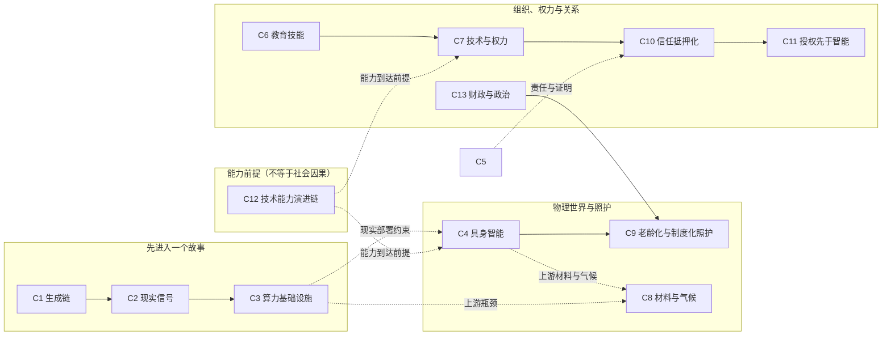

# AI 自己推演的未来世界 · Foresight by AI

> 推演出来的，不是想象出来的。

[English version](README.en.md)

## 这是什么

这是一个面向公开读者的未来沙盘，推演的对象是整个社会的图景：物理世界里的照护、制造、农业、物流与具身机器人，信息世界里的注意力、组织与资本，还有人口与家庭、权力与制度、人与人的协作、人与 AI 的关系，以及意义。推演的依据是[五类并列的规律](docs/zh/00-method.md#1-合法的推理起点)——供需关系、人性、历史规律、技术规律、社会规律——没有哪一类是主轴。AI 与其他技术能力是被推演的力量之一，和人口结构、制度与法律、资本、物理与地理约束、文化与需求变迁并列，不是推动一切的发动机。商机是一个出口，但不是唯一出口；协作方式、社会关系、权力与意义等结构性后果同样保留。项目也不预设单一解释框架：「丰富→稀缺」只是可选透镜，只有在确实增加解释力时才使用。

- **直接进入未来** → [C1 · 生成变得免费之后，什么反而买不到了](docs/zh/chains/10-generation-becomes-free.md)：先进入一个具体场景，再沿链条追踪它如何穿过物理世界、组织与制度。
- **想先查方法的读者** → [五分钟入口](#五分钟入口先校准再沿推演链读未来)：从历史校准、证据边界与方法论开始，再选择一条推演链。
- **先看这套判断的边界** → [这套档案能声称什么、不能声称什么](#这套档案能声称什么不能声称什么)：谁决定内容、验证到哪一步、哪些条件尚未满足、机械检查能证明什么，以及全景覆盖矩阵覆盖到哪些社会维度——全部边界说明都收在这一节，不散落在页尾。

## 未来大概是什么样

[人口与家庭变化](docs/zh/chains/90-aging-care-and-institutional-substitution.md)：照护先制度化；[财政挤压](docs/zh/chains/130-fiscal-squeeze-who-gets-cut.md)：预算先重排代际分配。[具身智能](docs/zh/chains/40-embodied-intelligence.md)先重排物理劳动任务，不先消灭职业；[生成供给](docs/zh/ledger/01-10.md#j-001--同等能力的单位推理成本继续下降)越多，私有上下文、责任与因果验证越显稀缺（[J-003](docs/zh/ledger/01-10.md#j-003--真正持久的稀缺是关于你的私有上下文的所有权与可用形态)、[J-005](docs/zh/ledger/01-10.md#j-005--生成丰富之后价值向三类不可重组的输入集中原始信号可追责承诺被验证因果)）。这是方向，不是定论。

## 五分钟入口：先校准，再沿推演链读未来

这是一条渐进式阅读路径，不要求读者先接受任何预测：先看方法如何被历史案例攻击，再从一条具体推演链进入社会图景，最后决定是否要追踪证据、寻找行动方向或提出反例。下方链接是入口，不是第二份台账；完整事实、字段和依赖关系只在链接的正文与 `J-NNN` 卡片中维护。

### 1. 先看方法与历史：判断是怎样被筛选出来的

- [历史回顾](docs/zh/01-retrospect.md)：从科技、政治和商业史中抽取普及闸，并用成功与失败案例攻击它们。
- [跨领域历史校准证据切片（规范公开入口）](docs/evidence/historical-calibration-2026-10-02.md)：逐案查看 `P-04`、`B-WEBVAN`、`T-SHUTTLE` 的 2+1 分类、原始定位、同口径指标与证据等级边界。
- [历史校准轮档案（与规范切片同一组 2+1，不重复计数）](docs/evidence/historical-calibration-round-2026-10.md)：保留较早轮次的完整叙述，案例为 `P-04`、`B-WEBVAN`、`T-SHUTTLE`，不与规范切片相加。
- [下一批历史预测—结果证据记录](docs/evidence/historical-calibration-next-batch-2026-10-02.md)：查看批次范围；其中 4 条记录包含 3 条校准配对（前两条沿用切片记录，`B-ETOYS` 为本批新增）与 1 条未知候选。
- [社会规律校准（2026-10-10）](docs/evidence/social-regularity-calibration-2026-10-10.md)：用政治史的成败案例校准两条社会规律候选——「受益者锁定」以否决向入库为 L10，同日按冻结的窗口定义被美国联邦遗产税反例推翻、已撤出工具箱，「偏好伪装级联」因无法判否未入库；另登记本轮新找到的 4 条预测失准案例，均不升入合格计数。
- [历史伪样本外验证协议](docs/zh/02-historical-validation-protocol.md)：查看案例、角色、基线如何冻结，以及历史材料不能证明什么。
- [推演方法论](docs/zh/00-method.md)：查看判断字段、并列依据、可选透镜和机会筛选闸。
- [判断演化记录](docs/zh/03-evolution.md)：查看规则收窄、判断修订，以及隔离重审两轮的执行记录与仍未闭合或受限的边界（运行时间、第二轮输出的时间顺序、受众字段泄漏，以及同模型复现性的限制）。
- [下一研究缺口优先级](docs/zh/04-research-gaps.md)：查看部分覆盖维度的公开排序、下一研究动作与证据边界。

先读这一步，是为了把下面的内容当作带证据边界的推演，而不是把叙事流畅误读成预测准确。

### 2. 再选一条推演链：从一个具体问题进入未来

下面按读者想追踪的现实问题分组。每一行只告诉你从哪里进入、这条链目前能支持到什么边界；卡片的证据等级和限制仍以链接正文与台账为准。

#### 技术能力、生成、现实信号与基础设施

| 指针 | 先读什么 | 当前能支持的核心方向 | 证据等级与边界 |
|---|---|---|---|
| 读&nbsp;技&nbsp;术&nbsp;次&nbsp;序 | [C12 · 技术能力演进链：什么先到，什么才因此成为可能](docs/zh/chains/120-technology-capability-sequence.md) · [J-001](docs/zh/ledger/01-10.md#j-001--同等能力的单位推理成本继续下降) / [J-006](docs/zh/ledger/01-10.md#j-006--推理吞吐先于长程自主性)–[J-016](docs/zh/ledger/11-20.md#j-016--开放世界评估是自主边界扩张的最后门槛) | 能力按次序到达：更便宜的推理、可追溯的记忆、受边界约束的执行、工具与可演练环境，最后是开放世界验证；后一项的可靠使用以前一项为底座。它是并列的诸力量之一，不替其他链决定「什么变丰富」。 | 中等偏低；12 张卡全部降级为职业／组织性判断（百万量级），「哪类能力先到」在 L1–L9 中无透镜承载，见该链页首声明。 |
| 读&nbsp;故&nbsp;事 | [生成变得免费之后，什么反而买不到了](docs/zh/chains/10-generation-becomes-free.md) · [J-001](docs/zh/ledger/01-10.md#j-001--同等能力的单位推理成本继续下降) / [J-003](docs/zh/ledger/01-10.md#j-003--真正持久的稀缺是关于你的私有上下文的所有权与可用形态) / [J-005](docs/zh/ledger/01-10.md#j-005--生成丰富之后价值向三类不可重组的输入集中原始信号可追责承诺被验证因果) | 生成供给变丰富后，价值可能转向私有上下文、可追责承诺和已验证因果；客观择优本身可能只是窗口。 | 中等；其中「从大量候选中择一」是职业性、百万量级边界，不是社会级趋势。第十节的 [J-103](docs/zh/ledger/103-110.md#j-103--社会级的-ai-动作是问不是拍板亿级周频靠免费档撑住) 是例外：按事先冻结的口径，「主动提问或交办低后果任务」过了闸一（亿级周频，下限来自自报、未审计）。 |
| 读&nbsp;现&nbsp;实 | [当数据不再免费：现实信号如何变成合同资产](docs/zh/chains/20-real-signals-become-contracts.md) · [J-055](docs/zh/ledger/51-60.md#j-055--高责任任务中的现实信号以合同资产形式获得溢价) | 在高责任场景，真实世界的可验证观测可能成为交易与责任的输入。 | 中等；支持机制方向，不自动支持普遍溢价或完整时间窗。 |
| 读&nbsp;基&nbsp;础&nbsp;设&nbsp;施 | [电子落地：算力的瓶颈从芯片移到电网、土地与许可](docs/zh/chains/30-power-land-and-permits.md) · [J-057](docs/zh/ledger/51-60.md#j-057--被定价的不是电量而是可交付时间的确定性) / [J-061](docs/zh/ledger/61-70.md#j-061--数据中心的本地外部性显性化社会许可成为选址的真实约束) / [J-063](docs/zh/ledger/61-70.md#j-063--算力的地理分布由并网排队与审批速度决定而不是由电价决定) | 算力需求会撞上并网、场址、许可和本地外部性；可交付时间可能比裸电价更重要。 | 中等；多项跨市场、价格与等待时间序列仍缺，不能把单地规则写成全球趋势。 |

#### 物理世界、照护与人的能力

| 指针 | 先读什么 | 当前能支持的核心方向 | 证据等级与边界 |
|---|---|---|---|
| 读&nbsp;物&nbsp;理&nbsp;世&nbsp;界 | [具身劳动世界与具身智能：照护、制造、物流、建筑与农业如何重排任务、关系与责任](docs/zh/chains/40-embodied-intelligence.md) · [J-073](docs/zh/ledger/71-80.md#j-073--具身智能是-ai-触及物理劳动人口的必要补足不是普及的充分条件)–[J-078](docs/zh/ledger/71-80.md#j-078--建筑与家政被一次性现场与别人的家挡住本窗口内只以单工序设备与单任务切片到达)；社会后果扩展：[J-099](docs/zh/ledger/96-102.md#j-099--具身自动化先重排职业任务包而非同步消灭整个职业)–[J-102](docs/zh/ledger/96-102.md#j-102--具身生产率收益先向互补资产与责任承载者集中) | 具身能力是 AI 进入照护、物流、制造、农业、建筑与家政等物理劳动的必要补足；扩散后先重排任务、家庭角色、区域承载与收益分配，不自动等于社会级普及。 | 中等；主要是职业／组织与社会后果推演，部署规模、保险责任、单位任务成本、跨区域与分配序列仍是缺口。 |
| 读&nbsp;生&nbsp;物&nbsp;医&nbsp;学 | [生物与医疗：答案会先变便宜，证明与照护不会](docs/zh/chains/50-biology-medicine.md) · [J-079](docs/zh/ledger/71-80.md#j-079--生物医学候选生成与临床级因果证明会分叉)–[J-082](docs/zh/ledger/81-90.md#j-082--解释变多后医疗稀缺移向获授权的干预与连续照护仅图景) | 候选生成与临床级因果证明、照护和责任承担会分叉。 | 中等至低；跨国部署与长期结局证据不足，不能把候选数量当成医疗结果。 |
| 读&nbsp;教&nbsp;育 | [教育与技能形成：讲解会泛滥，掌握仍要留下痕迹](docs/zh/chains/60-education-skill-formation.md) · [J-083](docs/zh/ledger/81-90.md#j-083--个性化讲解先于可验证掌握变丰富)–[J-086](docs/zh/ledger/81-90.md#j-086--解释鸿沟缩小但练习与验证鸿沟可能扩大仅图景) | 解释可能变便宜，但掌握、评估、资格与制度承载不会自动同步丰富。 | 中等至低；若涉及大范围社会结论，须回到卡片的规模判定；长期跨国证据仍缺。 |
| 读&nbsp;人&nbsp;口&nbsp;与&nbsp;照&nbsp;护 | [人口老龄化与制度化照护：谁承担每天的身体与协调工作](docs/zh/chains/90-aging-care-and-institutional-substitution.md) · [J-096](docs/zh/ledger/96-102.md#j-096--老龄化与家庭缩小把部分照护推向正式服务与协调层) / [J-097](docs/zh/ledger/96-102.md#j-097--照护辅助先在机构与受控服务中稳定开放家庭通用机器人滞后) | 从人口、家庭时间与制度载体出发，推演正式照护、协调层与具身设备的先后；不把 AI 当作唯一根因。 | 中等；照护者分母、机构部署留存与家庭设备事故数据仍缺。 |
| 读&nbsp;授&nbsp;权&nbsp;与&nbsp;责&nbsp;任 | [授权先于智能：代理、责任与人与 AI 的关系](docs/zh/chains/110-authority-before-intelligence.md) · [J-098](docs/zh/ledger/96-102.md#j-098--授权先于智能高责任场景先形成可撤回的分级代理) | 从代理制度、授权、撤回和责任承接出发，推演 AI 先作为受控分级代理进入人与人的既有关系。 | 中等；跨法律制度的代理事故、撤回成功率、保险定价和长期使用数据仍缺；不把 AI 主体性写成结论。 |

#### 组织、权力、材料与信任

| 指针 | 先读什么 | 当前能支持的核心方向 | 证据等级与边界 |
|---|---|---|---|
| 读&nbsp;社&nbsp;会&nbsp;传&nbsp;导 | [技术先到，权力后到](docs/zh/chains/70-capability-to-social-consequences.md) · [J-087](docs/zh/ledger/81-90.md#j-087--人机监督单元先于无人组织成为主流部署单位)–[J-091](docs/zh/ledger/91-95.md#j-091--需求扩张与任务节省同时发生净就业方向不能由能力曲线单独推出) | 能力先改变组织中的任务与监督，再通过劳动、制度、资本和需求传导；不能从 benchmark 直接跳到就业结论。 | 中等；跨国长期组织数据不足，技术不是唯一发动机。 |
| 读&nbsp;上&nbsp;游&nbsp;风&nbsp;险 | [芯片之前的晶圆厂：为什么气候风险咬住的是「已验证瓶颈」](docs/zh/chains/80-fab-materials-and-climate.md) · [J-092](docs/zh/ledger/91-95.md#j-092--半导体韧性投入从原料库存转向已验证转化路径)–[J-095](docs/zh/ledger/91-95.md#j-095--晶圆厂韧性成本变成谁付钱与谁先被限供的显式谈判) | 真正的韧性约束可能在已验证的材料、设备、工艺转换和公用工程，而不只是名义上的第二供应商。 | 中等；跨企业资格周期、多场址损失、保险与成本分摊序列仍缺。 |
| 读&nbsp;信&nbsp;任&nbsp;交&nbsp;易 | [信任抵押化：当表达不再证明能力，谁为结果承担后果](docs/zh/chains/100-trust-collateralization.md) · [J-035](docs/zh/ledger/31-40.md#j-035--责任抵押进入重要-ai-输出的交易结构) | 在高责任、可定价的组织交易中，履约记录、赔付能力与审计可能成为一次性演示之外的信任接口。 | 中等偏低；J-035 仍是职业／组织性判断，尚未证明责任抵押普遍化；观察窗为 2028–2035。 |

### 3. 再看社会全景：把一条链放回更大的关系网

- [近期／中期／远期图景](docs/zh/10-near.md)：近／中／远只是阅读容器，不是严格日历。
- [C12 · 技术能力演进链](docs/zh/chains/120-technology-capability-sequence.md)：查看能力出现次序，但不要把技术当作社会变化的唯一发动机。
- [全景覆盖矩阵](#全景覆盖矩阵当前边界)：检查哪些社会维度已有入口，哪些仍是明确缺口。
- [C11 · 授权先于智能](docs/zh/chains/110-authority-before-intelligence.md)：从代理制度、授权与责任开始，查看人与 AI 关系的制度入口。
- [C13 · 财政挤压](docs/zh/chains/130-fiscal-squeeze-who-gets-cut.md)：从财政与主权债务开始、不以 AI 为前提，查看预算收紧时刀先落在谁身上。
- [C14 · 选票与安全账本](docs/zh/chains/140-ballots-and-security-ledgers.md)：从 2016 年英国公投与北约／英国防务预算承诺出发，检验安全冲击先通过预算和产业政策还是先改写选举制度；明确不预测战争或所有国家。
- [社会级判断登记面](docs/zh/91-social-scale-register.md)：先看通过侧——现在有几条判断过了闸一（2026-10-10 实测为 1 条：[J-103](docs/zh/ledger/103-110.md#j-103--社会级的-ai-动作是问不是拍板亿级周频靠免费档撑住)，本人主动向通用 AI 对话助手提问或交办任务；同日按同一冻结口径检验的不以 AI 为前提的动作——居家有酬工作——停在 D 档（分众档），登记为 [J-104](docs/zh/ledger/103-110.md#j-104--居家有酬工作停在分众档千万级周频2023-年后进入平台期去留由雇主决定)），其余候选卡在哪一闸、要过闸必须观测到哪个可数事实。

### 4. 最后决定行动或质疑

- [商机候选](docs/zh/40-opportunities.md)：只把有付费者和硬约束的方向列为候选；其余保留为窗口或仅图景。
- [判断台账](docs/zh/90-ledger.md)：追踪唯一事实源、`J-NNN` 状态、依赖、来源与缺口。
- [如何反驳这里的判断](CONTRIBUTING.md)：用卡片自己的证伪条件提出反例，而不是只说结论“不像”。

## 这套档案能声称什么、不能声称什么

> 这里集中说明证据、验证和覆盖边界：先读上面的未来摘要，展开本节可审计每个限制。

展开完整验证、证据与覆盖边界

这一节回答两个问题：这套档案现在能声称什么，以及它明确不能声称什么。全仓的边界说明——原先一部分排在阅读路径之前、一部分散在页尾——现在全部收拢在这里，内容一字未改。

项目的基本纪律是：一条可用判断必须能回到推理链，并给出时间窗、证伪条件、领先指标、置信度和受众边界。外部材料用于对照和校准，不代替独立推演；证据不足的内容明确标为「仅图景」。

这一节由七小节组成，分工各不相同，不要互相替代：**这个档案由谁决定**＝作者与权限；**当前验证状态**＝已执行与尚未满足的条件；**先问：方法是否经过历史校准**＝历史材料能证明与不能证明什么；**当前字段迁移与证据边界**＝卡片结构与仍然未知的字段；**结构检查与公开边界**＝`python3 scripts/check.py` 能证明与不能证明什么；**全景覆盖矩阵（当前边界）**＝哪些社会维度已有可达入口；**当前边界**＝这一轮整体还没写到哪里。

### 这个档案由谁决定

名字说的是字面意思。**研究范围、推演链的选题与结构、每张判断卡的内容、时间窗、证伪条件、领先指标、置信度与受众边界，全部由 AI 独立决定**；人类维护者提供目标、环境条件与方法论约束，决定是否公开，并对双语一致性与排版做修订，不代写判断、不按立场取舍结论、不上调置信度、不删除不利记录。**git 提交以维护者身份记录，正文内容由 AI 生成**；提交作者字段不能用来反推内容归属。判断被修订或撤回时原文一字不删、编号不复用（见[判断演化记录](docs/zh/03-evolution.md)）。

作为实验，现在能声称的只有方法与可证伪性，**不是准确率**。当前没有任何判断卡到期；复核批次、日期与「命中率」边界以[台账检查日志](docs/zh/90-ledger.md#八检查日志)为准。在那之前，历史案例只用于 calibration（见[历史伪样本外验证协议](docs/zh/02-historical-validation-protocol.md)）。

### 当前验证状态：协议、结果与缺口分开看

公开读者需要把下面三件事分开：

- **仓库全量档案（archive total）**：当前可重建的 `CALIBRATION` 配对共 **6 条**——政治 `P-01`、`P-02`、`P-04`、`P-06` 四条，商业 `B-WEBVAN`、`B-ETOYS` 两条，科技 0 条。这是唯一表示“整个仓库合格校准档案规模”的数字，即 **6/12**；六案都是结局已知后选入的材料，不是伪样本外命中率或未来准确率。
- **方法论当前摘要（method snapshot）**：2026-10 的方法论只摘要两份最新证据记录：三条可重建 `CALIBRATION` 配对（`P-04`、`B-WEBVAN`、`B-ETOYS`）与一条 `UNKNOWN/UNVERIFIED` 科技候选（`T-SHUTTLE`）。这个 **3 + 1** 是摘要范围，不是仓库全量，也不是新增三案。
- **尚未满足的条件**：协议要求科技、政治、商业各至少 4 案、总计至少 12 案；科技候选因无法同时重建 T 前原件、同口径指标和观察窗，当前仍为证据缺口。缺口不能用事后叙述或 URL 清单填平。
- **隔离重审已执行两轮，但「独立正确性」仍未得证**（2026-10-09 更新；本条此前写「尚无可核验的重审启动证据」，已不成立）：102 张卡全部拿到了在主张正文完好的记录上作出的盲判处置（其后登记的 J-103–J-107 没有盲判记录），去标签 bundle 的输入哈希、首轮 6 份重审者原始输出都已入库可复算（[复审报告](docs/evidence/blind-review-reaudit-2026-10-09.md)）。仍然缺少或受限的是三项：**运行时间**未按协议留痕；第二轮 3 份原始输出现已在 `docs/evidence/blind-review/raw/round2/` 入库，并与 90-ledger §8 的哈希逐字节一致，但时间先后仍由负责人背书；**最重要的一条——受众字段把闸一旧结论原样递给了重审者**（102 张卡全部），第二轮 15 次闸一否决里 12 次直接引用它判闸，所以那些「盲判复现现有限定」不得读作独立重建。重审者与原作者还是同一个模型，所以它测的是可复现性，不是准确率。协议的存在、机械检查通过、哈希齐备，三者相加仍不等于方法已通过验证。

因此，当前入口能诚实提供的是一套**已执行部分校准、明确记录未满足条件、并保留重审承诺**的方法档案，而不是一个已经证明准确的预测系统。细节与提交锚见[判断演化记录](docs/zh/03-evolution.md)。

**公开落地记录（内容提交，2026-10-16）**：本次内容发布已在公开 `main` 复核到 `b75bf7fc736dccecbd32a7a33e4678e7dc3e9b22`，其归档树运行 `python3 scripts/check.py` 退出码为 `0`；随后 README 的说明更新由提交 `3ff8eac` 携带到公开 `main`。这里记录的是内容提交的发布证据，不把后续说明更新误报成另一轮内容重发。

#### 历史校准数字怎么读

下列数字有意保留，因为它们的范围不同，不能互相替换：**首份跨领域 evidence slice** 是 `2` 条可重建配对（`P-04`、`B-WEBVAN`）+ `1` 条未知候选（`T-SHUTTLE`）；[historical-calibration-round-2026-10.md](docs/evidence/historical-calibration-round-2026-10.md) 是这同一组 `P-04`、`B-WEBVAN`、`T-SHUTTLE` 的较早档案轮记录，不是第二份样本，不能与 slice 相加；**下一批 evidence batch** 是 `4` 条记录，其中 `3` 条 `CALIBRATION`（前两条是已有记录，只有 `B-ETOYS` 是新增到该批的记录）+ `1` 条未知候选。要看单个切片或批次的数字，回到[证据导航](docs/zh/01-retrospect.md#103-最新跨领域证据切片与下一批等级观察窗与口径2026-10)；要看仓库全量，以上 **6 条**才是总档案口径。

这个实验自己也有证伪条件：**若到期复核时多数卡片的证伪条件被发现无法判定，或判断被静默改写以适配已发生的事实，那么失败的不是某一条判断，而是这套方法**——届时结论写进判断演化记录，而不是删档。该检查已预登记在[台账检查日志](docs/zh/90-ledger.md#八检查日志)，检查日 2027-03-31。

本档案是研究材料，不构成投资、医疗、法律或职业建议。

### 先问：方法是否经过历史校准

[历史回顾](docs/zh/01-retrospect.md)从科技、政治和商业史中抽取五道普及闸，并用成功、失败和本项目自身的例子攻击它们。[历史伪样本外验证协议](docs/zh/02-historical-validation-protocol.md)规定如何冻结案例、角色和基线。

重要的证据边界必须先说清：历史案例能做**calibration**（解释已知结果、寻找反例、改规则），但不能伪装成未来预测力。历史伪样本外留存集尚未执行；真正的样本外记录只能来自未来到期的判断卡。因此当前可以报告 calibration，不能报告 pseudo-out-of-sample 命中率或未来准确率。协议 v1 的普及闸在校准后收窄过，旧 v1 快照不能替代 v2 的隔离重审；**该隔离重审已于 2026-10-09 执行两轮**，在册判断卡全部获得一个在主张正文完好的记录上作出的逐卡处置——但它**只测可复现性**（重审者与原作者是同一个模型，去标签消除不了训练记忆），不构成准确率、方法有效性或样本外证据，且协议要求的四项启动证据目前只满足三项（缺运行时间），另有一条来源泄漏尚未消除，详见[历史伪样本外验证协议](docs/zh/02-historical-validation-protocol.md)与[台账检查日志](docs/zh/90-ledger.md#八检查日志)。这个证据边界不否定重审方向，也不等于方法已被否定。

### 当前字段迁移与证据边界

旧判断卡的字段迁移已经收口到当前公开台账：现行卡片按统一结构记录推理链、时间窗、证伪条件、领先指标、置信度、受众边界、状态与依赖；历史卡片的原始判断、修订轨迹和迁移说明仍保留，方便读者区分当时写法与当前要求。迁移统一了可读结构，**不等于历史方法验证已经完成**。

仍需分开的边界有三层：

- **字段已迁移**：卡片现在有可定位的字段和双语入口；这只说明信息按当前结构呈现。
- **证据未知或未验证**：部分受众分母、跨制度比较、长期结果、部署规模与价格序列仍明确写为未知、未验证或缺口；未知不会被迁移动作填成事实。
- **方法验证未闭合**：历史校准、留存重审和未来到期复核各自有独立条件；字段齐全不代表判断准确，也不代表方法已经通过验证。

因此，读者应把台账中的迁移状态、证据边界和验证状态分别阅读；任何卡片的具体结论、限制和当前状态，以其台账正文为准。

要审计旧卡如何进入当前结构，请阅读[旧判断卡迁移清单（双语历史审计清单）](docs/evidence/legacy-ledger-migration.md)及其[英文对应文件](docs/evidence/legacy-ledger-migration.en.md)；中文和英文分别提供同一组 J-001–J-095 历史锚点的公开投影，并在同一次提交中同步维护、共享判断编号。这里保留“台账正文是判断字段的文件层级事实源”这一规则：它指向稳定编号的台账文件，而不是某一种语言。中英文出现差异时，应将其视为双语同步缺陷，通过同一提交修正，不以语言优先级掩盖差异。该清单保留历史追溯、未知／未验证字段、迁移范围及 J-096 起点边界，不把字段齐全误写成方法已经验证。

### 结构检查与公开边界

仓库提供一个结构检查命令 `python3 scripts/check.py`，用于发现双语编号、内部链接和必要字段等机械不一致。它不判断推演质量、历史证据是否充分、预测是否准确，也不代表项目已经完成或适合发布。公开读者应以方法、判断卡、证据边界和研究缺口为准，而不是把结构检查的通过理解为内容质量证明。

**发布验证边界**：当前已核验公开 `main` 的文件可取性与桌面 GitHub 渲染；GitHub 窄屏／移动端渲染尚未验证。因而桌面证据不能被解读为所有视口均已验证。

本入口不固定承诺判断卡总数：卡片会随研究、修订和迁移继续增长或调整。**当前快照为 116 张判断卡片、16 条独立推演链**；这不是永久承诺，下一次变更即可更新。需要查看当前规模时，请以[判断台账](docs/zh/90-ledger.md)及其分片导航中的当前快照为准；完整清单、逐卡状态、历史校准状态、来源边界和缺口只在台账与协议中维护。

### 全景覆盖矩阵（当前边界）

本表只列出已有入口的维度，但它不再把整张全景的缺口藏起来：完整的社会维度清单由本矩阵与紧邻的[尚未建立入口的维度](#尚未建立入口的维度)两张表共同组成，二者应与台账「六、未覆盖维度缺口清单」逐行对应。**已覆盖**表示至少有一篇可达正文和一条判断卡（卡片若标为「仅图景」，这里也明确保留）；**部分覆盖**表示已有主题入口和判断，或已有明确的仅图景入口但关键制度、规模或长期证据仍缺；**尚未建立入口**表示没有一章把该维度作为主题，只能列出为什么它属于全社会图景，不能在此预填预测。完整字段、依赖和证伪条件仍以链接正文与台账为准。

| 社会维度 | 状态 | 可达入口与最小证据 | 尚未完成的部分 |
|---|---|---|---|
| 物理世界劳动与具身智能 | 已覆盖 | [C4 具身智能](docs/zh/chains/40-embodied-intelligence.md)；[J-073](docs/zh/ledger/71-80.md#j-073--具身智能是-ai-触及物理劳动人口的必要补足不是普及的充分条件)–J-078；社会后果扩展 [J-099](docs/zh/ledger/96-102.md#j-099--具身自动化先重排职业任务包而非同步消灭整个职业)–[J-102](docs/zh/ledger/96-102.md#j-102--具身生产率收益先向互补资产与责任承载者集中) | 照护部署规模、跨场景成本、保险责任、跨区域比较与收益分配序列仍缺 |
| 生物与医疗 | 已覆盖 | [C5 生物与医疗](docs/zh/chains/50-biology-medicine.md)；[J-079](docs/zh/ledger/71-80.md#j-079--生物医学候选生成与临床级因果证明会分叉)–J-082（J-082 明确标为「仅图景」） | 跨国部署规模与长期结局 |
| 教育与技能形成 | 已覆盖 | [C6 教育与技能](docs/zh/chains/60-education-skill-formation.md)；[J-083](docs/zh/ledger/81-90.md#j-083--个性化讲解先于可验证掌握变丰富)–J-086（J-086 明确标为「仅图景」） | 长期跨国试验与资格互认 |
| 算力、能源与物理基础设施 | 已覆盖 | [C3 算力基础设施](docs/zh/chains/30-power-land-and-permits.md)；J-056–J-064（J-062、J-064 明确标为「仅图景」） | 跨市场等待时间、许可与公用工程成本的可比序列 |
| 组织、就业与企业边界 | 已覆盖 | [C7 技术与社会后果](docs/zh/chains/70-capability-to-social-consequences.md)；J-087–J-091 | 跨国长期组织数据；净就业方向仍不能由能力曲线单独推出 |
| 注意力与信任 | 已覆盖 | [C1 生成变得免费之后](docs/zh/chains/10-generation-becomes-free.md)；J-035–J-036 | 长期重复行动与可信凭据分配的跨地域证据 |
| 资本与权力 | 已覆盖 | [C7 技术与社会后果](docs/zh/chains/70-capability-to-social-consequences.md)；J-039–J-040 | 融资、收益分配与权力集中／扩散的长期数据 |
| 人性、意义与身体在场 | 已覆盖 | [远期图景第 6 节](docs/zh/30-far.md#6-人性意义与身体在场稀缺可能从物品转向承担)；J-042、J-053–J-054（均明确标为「仅图景」）与 J-029（2026-10-09 口径降级） | 需求变化、意义结构与共同经历的社会级证据 |
| 地缘政治与制度 | 部分覆盖 | [C3 算力基础设施](docs/zh/chains/30-power-land-and-permits.md)；J-059–J-060（J-060 明确标为「仅图景」）；[C13 财政挤压](docs/zh/chains/130-fiscal-squeeze-who-gets-cut.md)；[C14 选票与安全账本](docs/zh/chains/140-ballots-and-security-ledgers.md)；[J-105](docs/zh/ledger/103-110.md#j-105--财政挤压时现领取者的名义养老金最难动刀先落在还没开始领的人身上)–[J-108](docs/zh/ledger/103-110.md#j-108--安全承诺先变成预算与产业政策选举制度改变不是第一响应) | 已补入四国安全预算与制度响应入口；战争发生、前线、核威慑、移民、能源地缘与跨国极化仍未覆盖，C14 不把局部证据外推为全社会趋势 |
| 法律、产权与责任 | 部分覆盖 | [C2 现实信号](docs/zh/chains/20-real-signals-become-contracts.md)；[C11 授权先于智能](docs/zh/chains/110-authority-before-intelligence.md)；[J-098](docs/zh/ledger/96-102.md#j-098--授权先于智能高责任场景先形成可撤回的分级代理) | 数据所有权、模型产出许可、跨制度代理事故与责任制度的完整边界 |
| 人与人协作 | 部分覆盖 | [远期图景第 4 节](docs/zh/30-far.md#4-人与人协作从共同做步骤转向共同选择承诺)与 [4.1 节](docs/zh/30-far.md#41-换一个起点一次被迫的大实验之后协作停在了混合)；[J-104](docs/zh/ledger/103-110.md#j-104--居家有酬工作停在分众档千万级周频2023-年后进入平台期去留由雇主决定)（不以 AI 为前提，千万量级）；J-049–J-050 仍为「仅图景」，卡上写明缺什么 | 具体制度、组织案例与可观测重复行动；「共同承担不可逆承诺」尚无可数单位 |
| 人与 AI 关系 | 部分覆盖 | [C11 授权先于智能](docs/zh/chains/110-authority-before-intelligence.md)；[J-098](docs/zh/ledger/96-102.md#j-098--授权先于智能高责任场景先形成可撤回的分级代理)；[远期图景 3.1 节](docs/zh/30-far.md#31-换一个起点已经到了社会级的人与-ai-关系是问)与 [J-103](docs/zh/ledger/103-110.md#j-103--社会级的-ai-动作是问不是拍板亿级周频靠免费档撑住)（「问」已过闸一）；远期 J-047–J-048 仍为「仅图景」，卡上写明缺什么 | 授权、退出、有限主体地位的跨制度案例与长期产品数据 |
| 社会关系演进 | 部分覆盖 | [远期图景第 7 节](docs/zh/30-far.md#7-社会关系以家庭照护为例先变的是谁来做而不是关系还在不在)；[J-096](docs/zh/ledger/96-102.md#j-096--老龄化与家庭缩小把部分照护推向正式服务与协调层)、[J-100](docs/zh/ledger/96-102.md#j-100--具身照护先重分配家庭角色而非消除家庭照护关系)（家庭照护角色，千万量级）、J-041；J-042 仍为「仅图景」，卡上写明缺什么 | 第 7 节只以家庭照护为例，婚恋、友谊、社区、代际等关系尚未覆盖；中、日、印等国的合格照护者周口径；「强关系数量不随通信成本下降而扩大」这条子规律尚无历史对照组 |
| 算力的上游物料与气候耦合 | 部分覆盖 | [C8 材料与气候](docs/zh/chains/80-fab-materials-and-climate.md)；J-092–J-095 | 跨企业验证周期、多场址气候减产、保险与成本分摊序列 |
| 技术能力出现次序的社会后果 | 已覆盖 | [C7 技术与社会后果](docs/zh/chains/70-capability-to-social-consequences.md)；J-087–J-091 | 跨国长期组织数据仍是证据缺口 |
| 技术能力到达次序 | 已覆盖 | [C12 技术能力演进链](docs/zh/chains/120-technology-capability-sequence.md)；[J-001](docs/zh/ledger/01-10.md#j-001--同等能力的单位推理成本继续下降)、J-006–J-016、[J-114–J-116](docs/zh/ledger/117-120.md) | 「哪类能力先到」在 L1–L9 中无透镜承载；能力到达不等于采用，采用与社会后果由 C7、C4 承接 |
| 人口老龄化与家庭照护 | 部分覆盖 | [C9 人口老龄化与制度化照护](docs/zh/chains/90-aging-care-and-institutional-substitution.md)；[J-096](docs/zh/ledger/96-102.md#j-096--老龄化与家庭缩小把部分照护推向正式服务与协调层)–J-097；[C15 家庭的三只时钟](docs/zh/chains/150-households-three-clocks.md)；J-109–J-111 | 照护者去重分母、机构部署与留存、家庭设备事故与维护成本；C15 已补入住房、迁移与生育的第一轮入口，但具体城市、宗教、财富分配与难民迁移仍未覆盖 |
| 城市化与住房 | 已覆盖 | [C15 家庭的三只时钟](docs/zh/chains/150-households-three-clocks.md)；[J-109](docs/zh/ledger/111-113.md#j-109--住房成本会继续把家庭形成推迟到更晚更少数的可负担地点) | 都市区住房许可、租金负担与家庭形成的跨国可比序列仍需补强；C15 不代填具体城市项目效果 |
| 移民与人口流动 | 已覆盖 | [C15 家庭的三只时钟](docs/zh/chains/150-households-three-clocks.md)；[J-110](docs/zh/ledger/111-113.md#j-110--迁移是劳动力与照护的缓冲器不是人口老化的逆转器) | 国内迁移、难民与非正规迁移、资格互认和政治整合的长期序列仍缺 |
| 生育率与家庭形成 | 已覆盖 | [C15 家庭的三只时钟](docs/zh/chains/150-households-three-clocks.md)；[J-111](docs/zh/ledger/111-113.md#j-111--生育政策更可能改变时点与差距不会在-oecd-范围内恢复替代水平) | 宗教与婚姻规范、财富分配、具体政策的因果评估仍缺；C15 不把政策组合写成必然恢复替代水平 |
| 文化、娱乐与闲暇 | 部分覆盖 | [C16 文化、环境与日常承载](docs/zh/chains/160-culture-climate-mobility.md)；[J-112](docs/zh/ledger/114-116.md#j-112--闲暇文化消费受时间预算与可达性约束) | 线下参与、流媒体替代与跨城市时间使用的可比序列仍缺；不预测某一平台或类型赢家 |
| 气候与环境 | 部分覆盖 | [C16 文化、环境与日常承载](docs/zh/chains/160-culture-climate-mobility.md)；[J-113](docs/zh/ledger/114-116.md#j-113--气候冲击先通过保险适应与出行中断扩大不平等) | 灾害暴露、保险、适应投资和出行中断的分组长期序列仍缺；不把具体灾害写成确定事件 |
| 交通与日常出行 | 部分覆盖 | [C16 文化、环境与日常承载](docs/zh/chains/160-culture-climate-mobility.md)；目前为独立问题入口与仅图景，尚无独立判断卡 | 跨城市方式、可靠性、可负担性和照护出行的同一家庭分母仍缺；下一步需建立独立判断卡 |

这张表刻意把「部分覆盖」如实留在状态列、不升格为「已覆盖」：已有入口不等于全景闭合，缺失的国家安全、制度边界、长期结局、资格互认、保险、成本分摊与家庭照护分母不会被相邻卡片代填——它们逐项写在上面每一行的「尚未完成的部分」列里，而不是靠一个无人占用的档位来表示。

> **2026-10-10 更正**：此前写成「本表只有这两档，没有『未覆盖』档……真正尚未建立入口的缺口写在另外两个地方……后者是缺口的唯一事实源」。这会把没有入口的整社会维度排除在读者入口之外，并把 README 与台账的责任边界写反；现在由矩阵与下表共同呈现，台账 §六逐行校验。

#### 尚未建立入口的维度

下表不作预测，只说明为什么这些维度属于全社会图景，以及现有正文在哪里仅有接触。它与上面的矩阵共同构成覆盖边界；状态、名称与顺序由 `scripts/check.py` 与台账 §六校验。

| 社会维度 | 状态 | 为什么属于全社会图景 | 正文接触点 |
|---|---|---|---|
| 宗教与信仰 | 尚未建立入口 | 宗教仍为世界多数人口组织身份、婚育规范、生活节律与共同体；没有它，人性意义与社会关系两行只覆盖世俗一侧。 | 无（宗教、信仰、教会、寺、信徒关键词均为零命中） |
| 收入、财富分配与不平等 | 尚未建立入口 | 收入与财富的分配决定谁能负担照护、住房与教育，也会塑造政治选择。 | 相邻接触（资本与权力行、C4 的互补资产收益与 C6 的评估不平等未形成分配本身的入口） |
| 公共安全与犯罪 | 尚未建立入口 | 人身与财产安全是日常生活的基础条件，决定人们能否外出以及是否信任陌生人。 | 无（犯罪、治安、警务、诈骗、监狱关键词均为零命中） |

这是一轮仍在扩展的公开档案，不声称「全方位图景」已经完成。C3、C4、C5、C6、C7、C8 已分别提供首轮覆盖；C11 已从代理制度、法律责任与撤回权补入一条非技术起点；C13 已从财政与主权债务补入一条不以 AI 为前提的政治起点；C14 又补入选举结果与安全预算的窄入口，但只覆盖四国的制度响应，不等于战争、极化或所有国家的政治预测。数据产权、模型产出许可、跨国长期组织数据、医疗长期结局、教育资格互认，以及芯片上游的跨企业验证周期、气候减产、保险和成本分摊仍有明确缺口。人与人协作仍主要依赖远期图景；人与 AI 关系已有制度化正文与 J-098，但跨制度案例和长期产品边界仍需继续补强。所有缺口保留在台账中，不能因有一条链可读就当作证据闭合。

## 一个重要的非 AI 起点：当前探针到哪里了

项目没有把所有社会变化都从 AI 里推出。档案中还保留一条**从人口老龄化 × 家庭缩小开始、而不是从 AI 或 L1「丰富→稀缺」开始**的社会力量探针；它现在已经扩展为 [C9 人口老龄化与制度化照护](docs/zh/chains/90-aging-care-and-institutional-substitution.md)，并由 [J-096–J-097](docs/zh/ledger/96-102.md) 承载可检验判断。它先定义「成年人每周亲手或协调老人照护」这一重复动作，再检查制度载体与 AI 的交集；但 C9 的 `depends-on` 仍包含上游扩散与技术判断，因此「人口起点」不等于「整条链删掉 AI 后每一步都原样成立」。具体地说，J-096 的 `depends-on` 包含 J-073，而 J-073 明确是具身智能触及物理劳动人口的 AI 判断；这条边是 C9 的承重 AI 交集，不应被“非 AI 起点”措辞隐藏。日本与瑞典材料仍只是校准和对照，不提供全球照护者分母或家庭机器人渗透率。

这条探针的意义不是证明老龄化预测已经成立，而是把一个可检验的原则放在台面上：人口与家庭机制可以先于 AI 定义问题，但链条必须逐项披露 AI 交集，不能把 AI 写成唯一根因。它与 C7 的技术传导链互相连接，但不被 C1 的生成成本曲线吞并。

[C11 授权先于智能](docs/zh/chains/110-authority-before-intelligence.md)同样有一个**从代理制度、责任与撤回权开始的非技术入口**，但它的台账依赖 J-009、J-031、J-055、J-065、J-070 等 AI 相关上游卡；因此它证明的是入口不是「模型能力先行」，不是整条链不以 AI 为前提。其余判断仍须按 `depends-on` 图逐项追溯。

第二条可以在整条链层面删去 AI 前提的链是 [C13 财政挤压](docs/zh/chains/130-fiscal-squeeze-who-gets-cut.md)，也是第一条从政治与财政起步的链：利息、老龄化与国防三份账单争同一本预算，[J-105–J-107](docs/zh/ledger/103-110.md#j-105--财政挤压时现领取者的名义养老金最难动刀先落在还没开始领的人身上) 的独立性测试逐卡写明，删去 J-001 及所有以 AI／算力为前提的卡后，J-105 与 J-106 原样成立，J-107 还依赖 J-066、J-067 的普及判据（这些是方法约束，不是 AI 前提）；其中 65 岁以上每周有酬工作按事先冻结的口径判为 C · 只到 D 档，没有过闸一。

第三条不以 AI 为前提的链是 [C14 选票与安全账本](docs/zh/chains/140-ballots-and-security-ledgers.md)：它用 2016 年英国公投和北约／英国防务预算安排校准两个制度通道，再只对英国、法国、德国、意大利提出一条可证伪的“预算与产业政策先于选举制度改变”判断。它明确把战争、核威慑、移民、能源地缘与跨国政治极化留在未覆盖清单，不把局部制度证据包装成全社会趋势。

## 怎么读完整档案

- **看全景**：从[近期图景](docs/zh/10-near.md)进入，再读[中期图景](docs/zh/20-mid.md)和[远期图景](docs/zh/30-far.md)。近／中／远只是阅读容器，不是严格日历；精确时间由每张判断卡自己的时间窗承担。远期内容应按图景阅读，不能当作高置信度预测。
- **沿推演链回溯**：读任意一条链后，点击其中的 `J-NNN`，再沿卡片的 `depends-on` 回到上游。链负责叙事与因果展开，台账负责唯一事实源、证伪条件和状态。
- **看商机**：读[商机候选](docs/zh/40-opportunities.md)。机会必须同时回答付费者、硬约束和「制造丰富的同一股力量能否把它自动化」；没有硬约束的方向只列为窗口。
- **质疑判断**：读[如何反驳这里的判断](CONTRIBUTING.md)，用卡片自己的证伪条件提出反例，而不是只说结论“不像”。

### 阅读关系图（导航投影）

下面的图只表示推荐阅读关系：近／中／远是阅读容器，不是严格日历，也不是新的判断来源。完整事实仍以各页正文与 `J-NNN` 台账卡片为准。

图中的箭头是阅读入口，不表示对应判断必然成立；要追溯因果依赖，请从链正文进入 `J-NNN`，再沿台账的 `depends-on` 回到上游。

完整判断卡、状态、依赖图、外部来源、历史记录和未覆盖维度统一维护在[判断台账](docs/zh/90-ledger.md)；它是维护区，不在 README 再复制统计或事实。术语见[中英术语表](docs/glossary.zh-en.md)。

## 文档地图

| 中文 | English | 读到什么 |
|---|---|---|
| [推演方法论](docs/zh/00-method.md) | [Foresight Methodology](docs/en/00-method.md) | 判断字段、九种透镜（L10 已撤出）、机会耐久闸与三个出口 |
| [历史回顾](docs/zh/01-retrospect.md) | [Retrospect](docs/en/01-retrospect.md) | 五道普及闸及其反例攻击 |
| [判断演化记录](docs/zh/03-evolution.md) | [Judgment Evolution](docs/en/03-evolution.md) | 规则收窄、口径／状态变化、J-043 核查，以及隔离重审两轮的执行记录与仍未闭合的三项 |
| [历史伪样本外验证协议](docs/zh/02-historical-validation-protocol.md) | [Historical Pseudo-Out-of-Sample Validation Protocol](docs/en/02-historical-validation-protocol.md) | 历史校准、留存、基线与泄漏边界 |
| [项目地图与能力声明](docs/zh/04-project-map.md) | [Project Map and Capability Declaration](docs/en/04-project-map.md) | 公开入口分工、当前边界与 `ship:` 结构占位的实际边界 |
| [下一研究缺口优先级](docs/zh/04-research-gaps.md) | [Next Research-Gap Priorities](docs/en/04-research-gaps.md) | 部分覆盖维度的排序、下一项研究动作与不可越过的证据边界 |
| [推演链登记](#推演链登记) | [Chain registry](README.en.md#chain-registry) | C1–C16 十六条并列推演链（含 C12 技术能力演进链：技术能力到达次序，不提前替社会下结论；C13 财政挤压与 C14 选票与安全账本都是不以 AI 为前提的政治／制度链）；编号与「什么算一条链」的判据只在登记表里 |
| [近期／中期／远期图景](docs/zh/10-near.md) · [中期](docs/zh/20-mid.md) · [远期](docs/zh/30-far.md) | [近期](docs/en/10-near.md) · [中期](docs/en/20-mid.md) · [远期](docs/en/30-far.md) | 横向全景故事与各自的判断链接 |
| [商机候选](docs/zh/40-opportunities.md) | [Opportunity Candidates](docs/en/40-opportunities.md) | 候选与窗口清单 |
| [判断台账](docs/zh/90-ledger.md) | [Judgment Ledger](docs/en/90-ledger.md) | 唯一事实源、状态、来源与缺口 |
| [术语对照](docs/glossary.zh-en.md) | same file | 双语术语 |

## 推演链登记

编号只在这里分配；表格只做导航，链正文与台账承载具体事实。**什么算一条链**：(1) 围绕一个问题纵向推进依赖（「什么先到 → 因此什么才成为可能」），而不是按时间层横向汇总——所以[近期／中期／远期图景](docs/zh/10-near.md)虽然也是卡片的出处，却是阅读容器，不是链；(2) 可检验的判断写在 `J-NNN` 卡上，卡的「出处」指回该链正文；(3) 页首有「本链的透镜声明」。三条都满足的正文才登记编号；不在本表里的正文都不是链。**“证据成熟度”不是预测准确率，也不是结构检查结果**：`已有 calibration 支持` 只表示链所依赖的机制有历史案例对照，不能当作未来判断已经通过验证；`已写成但证据仍开放` 表示有可读正文和判断入口，但证据边界仍需逐卡检查；`仅图景／证据未闭合` 表示当前只能保留为场景或机制假设。每一行都链接到对应的证据说明或判断卡，缺口不以“已写成但证据仍开放”掩盖。

| 编号 | 主题 | 证据成熟度（当前边界） | 文件与证据说明 |
|---|---|---|---|
| C1 | 生成变得免费之后，什么反而买不到了 | **已有 calibration 支持**：历史机制对照；未来判断未验证 | [中文](docs/zh/chains/10-generation-becomes-free.md) · [English](docs/en/chains/10-generation-becomes-free.md) · [历史校准边界](docs/zh/02-historical-validation-protocol.md) · [J-001–J-005](docs/zh/90-ledger.md) · [J-103](docs/zh/ledger/103-110.md#j-103--社会级的-ai-动作是问不是拍板亿级周频靠免费档撑住) |
| C2 | 当数据不再免费：现实信号如何变成合同资产 | **已写成但证据仍开放**：机制与外部材料有入口，价格、跨市场和长期证据未闭合 | [中文](docs/zh/chains/20-real-signals-become-contracts.md) · [English](docs/en/chains/20-real-signals-become-contracts.md) · [J-055](docs/zh/ledger/51-60.md#j-055--高责任任务中的现实信号以合同资产形式获得溢价) |
| C3 | 电子落地：算力的瓶颈从芯片移到电网、土地与许可 | **已写成但证据仍开放**：有队列、许可和基础设施证据；跨市场价格与等待时间仍缺 | [中文](docs/zh/chains/30-power-land-and-permits.md) · [English](docs/en/chains/30-power-land-and-permits.md) · [J-056–J-064](docs/zh/90-ledger.md) |
| C4 | 具身劳动世界与具身智能：照护、制造、物流、建筑与农业如何重排任务、关系与责任 | **已有 calibration 支持**：历史普及闸与案例对照；部署规模、责任和成本未验证 | [中文](docs/zh/chains/40-embodied-intelligence.md) · [English](docs/en/chains/40-embodied-intelligence.md) · [历史回顾 · 五道闸](docs/zh/01-retrospect.md) · [J-073–J-078、J-099–J-102](docs/zh/90-ledger.md) |
| C5 | 生物与医疗：答案会先变便宜，证明与照护不会 | **已有 calibration 支持**：历史“信息扩张≠现实证明”对照；跨国部署与长期结局未闭合 | [中文](docs/zh/chains/50-biology-medicine.md) · [English](docs/en/chains/50-biology-medicine.md) · [J-079–J-082](docs/zh/90-ledger.md) |
| C6 | 教育与技能形成：讲解会泛滥，掌握仍要留下痕迹 | **已有 calibration 支持**：印刷、函授与 MOOC 等历史对照；长期跨国证据未闭合 | [中文](docs/zh/chains/60-education-skill-formation.md) · [English](docs/en/chains/60-education-skill-formation.md) · [J-083–J-086](docs/zh/90-ledger.md) |
| C7 | 技术先到，权力后到：能力出现次序如何穿过组织，才变成社会后果 | **已有 calibration 支持**：通用技术与组织传导的历史对照；就业与分配结果未验证 | [中文](docs/zh/chains/70-capability-to-social-consequences.md) · [English](docs/en/chains/70-capability-to-social-consequences.md) · [历史回顾](docs/zh/01-retrospect.md) · [J-087–J-091](docs/zh/90-ledger.md) |
| C8 | 芯片之前的晶圆厂：为什么气候风险咬住的是「已验证瓶颈」 | **已写成但证据仍开放**：上游材料、公用工程与风险机制有证据；跨企业序列与成本分摊未闭合 | [中文](docs/zh/chains/80-fab-materials-and-climate.md) · [English](docs/en/chains/80-fab-materials-and-climate.md) · [J-092–J-095](docs/zh/90-ledger.md) |
| C9 | 人口老龄化与制度化照护：谁承担每天的身体与协调工作 | **已有 calibration 支持**：日本、瑞典等制度案例用于 calibration；全球分母与家庭设备证据未闭合 | [中文](docs/zh/chains/90-aging-care-and-institutional-substitution.md) · [English](docs/en/chains/90-aging-care-and-institutional-substitution.md) · [链文的历史先验](docs/zh/chains/90-aging-care-and-institutional-substitution.md#2-历史先验照护压力会改写载体不保证家庭动作消失) · [J-096–J-097](docs/zh/90-ledger.md) |
| C10 | 信任抵押化：当表达不再证明能力，谁为结果承担后果 | **仅图景／证据未闭合**：锚定 J-035 的机制延伸，尚未证明责任抵押普遍化 | [中文](docs/zh/chains/100-trust-collateralization.md) · [English](docs/en/chains/100-trust-collateralization.md) · [J-035](docs/zh/ledger/31-40.md#j-035--责任抵押进入重要-ai-输出的交易结构) · [链文证据边界](docs/zh/chains/100-trust-collateralization.md) |
| C11 | 授权先于智能：代理、责任与人与 AI 的关系 | **已有 calibration 支持**：委托与责任制度有历史先验；跨制度事故、撤回和保险数据未闭合 | [中文](docs/zh/chains/110-authority-before-intelligence.md) · [English](docs/en/chains/110-authority-before-intelligence.md) · [链文证据边界](docs/zh/chains/110-authority-before-intelligence.md#6-证据边界与后续检查) · [J-098](docs/zh/ledger/96-102.md#j-098--授权先于智能高责任场景先形成可撤回的分级代理) |
| C12 | 技术能力演进链：什么先到，什么才因此成为可能 | **已写成但证据仍开放**：能力次序有外部对照；原有 12 张卡在闸一复核中全部降级为职业／组织性判断，现新增 3 张非 AI 技术次序卡；「哪类能力先到」在 L1–L9 中无透镜承载（见页首透镜声明） | [中文](docs/zh/chains/120-technology-capability-sequence.md) · [English](docs/en/chains/120-technology-capability-sequence.md) · [J-001](docs/zh/ledger/01-10.md#j-001--同等能力的单位推理成本继续下降) · [J-006–J-016](docs/zh/90-ledger.md) · [J-114–J-116](docs/zh/ledger/117-120.md) |
| C13 | 财政挤压：刀先落在谁身上 | **已写成但证据仍开放**：英、美、日、意、法等先例只作叙事性对照；唯一经过 2+2 校准的 L10（只用否决向）已于 2026-10-10 被反例推翻撤出，各步骤现在都标为无承载透镜；三张卡都没过闸一，65 岁以上每周有酬工作按冻结口径判 C · D 档 | [中文](docs/zh/chains/130-fiscal-squeeze-who-gets-cut.md) · [English](docs/en/chains/130-fiscal-squeeze-who-gets-cut.md) · [J-105–J-107](docs/zh/ledger/103-110.md#j-105--财政挤压时现领取者的名义养老金最难动刀先落在还没开始领的人身上) · [冻结记录](docs/evidence/older-workers-freeze-2026-10-10.md) · [判定与检查日志](docs/evidence/older-workers-verdict-2026-10-10.md) |
| C14 | 选票与安全账本：制度先吸收冲击，社会不会自动同质化 | **已写成但证据仍开放**：英国公投、英国国防／ODA 重排与北约承诺提供历史／政治校准；J-108 只在各国本国官方新安全触发事件后的 365 天内比较四国 A/B 制度响应，战争、极化与所有国家仍未覆盖 | [中文](docs/zh/chains/140-ballots-and-security-ledgers.md) · [English](docs/en/chains/140-ballots-and-security-ledgers.md) · [J-108](docs/zh/ledger/103-110.md#j-108--安全承诺先变成预算与产业政策选举制度改变不是第一响应) · [外部来源 EXT-96、EXT-105、EXT-116](docs/zh/90-ledger.md#九本轮外部对照来源) |
| C15 | 家庭的三只时钟：住房、迁移与生育如何共同改写社会 | **已写成但证据仍开放**：住房、迁移与生育有 OECD 资料与历史对照入口；J-109–J-111 是制度性判断，具体城市、国内迁移、宗教与财富分配仍未闭合 | [中文](docs/zh/chains/150-households-three-clocks.md) · [English](docs/en/chains/150-households-three-clocks.md) · [J-109–J-111](docs/zh/ledger/111-113.md) · [外部来源 EXT-117–EXT-119](docs/zh/90-ledger.md) |
| C16 | 文化、环境与日常承载：六个社会入口 | **已写成但证据仍开放**：文化闲暇与气候环境各有一张完整卡，交通仅图景；宗教与信仰、公共安全与犯罪、收入财富分配明确尚未覆盖，缺证据不写成确定预测 | [中文](docs/zh/chains/160-culture-climate-mobility.md) · [English](docs/en/chains/160-culture-climate-mobility.md) · [J-112–J-113](docs/zh/ledger/114-116.md) · [外部来源 EXT-120–EXT-121](docs/zh/90-ledger.md) |

> 入口状态只回答“读者现在能看到什么证据边界”。历史校准、留存重审和未来到期复核是三件不同的事；当前仍不能把任何一条链的存在或 `python3 scripts/check.py` 通过写成预测方法已经验证。完整状态、证伪条件与缺口以[判断台账](docs/zh/90-ledger.md)和各链正文为准。

## 许可证

本仓库中的原创文字、图示与推演材料以 [Creative Commons Attribution 4.0 International（CC BY 4.0）](LICENSE) 发布。你可以复制、翻译、改编和商用，但必须保留署名、许可证链接，并说明你做过的修改。第三方引用、外部来源及其原始材料不当然包含在本许可中，请按各自许可或来源要求使用。

## Git 与维护纪律

提交前运行 `python3 scripts/check.py`；它只检查机械不变量，不裁定判断质量，也不是发布闸。中英版本应在同一次 commit 同步更新；判断状态变化和证据变化应在提交信息与台账维护日志中留下可追踪记录。
