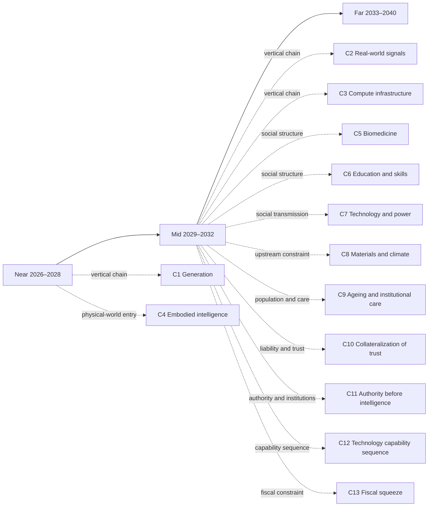

# Near-term landscape: 2026–2028

[中文版](../zh/10-near.md)

[Back to README / document map](../../README.en.md)

> On a Monday morning in March 2027, a cold-chain inspection company has eleven people and serves more than two hundred stores. Over the weekend the system ran four hundred–odd comparisons by itself and narrowed the procedure for issuing an inspection verdict down to seven candidate versions—nobody worked late for it, and nobody thinks it worth mentioning. What takes the whole morning is three other things: the largest client renews next week and this time wants to see, not the accuracy claims in the brochure, but how long each “verdict within three hours” actually took over the past two years; the supermarket downstream has a new head of procurement whose first question is “who signs this report”; and the batch of samples the system flags as “someone has to go look at this in person” stays there no matter how the thresholds are tuned. Not one of the eleven still writes reports by hand, yet each of them makes the same decision every day: what may be released automatically, and what someone has to answer for personally.
>
> That is roughly the shape of these three years: the generating, comparing, and screening side becomes cheap and abundant fast, while the “whose field, whose promise, whose liability” side is priced separately for the first time. The six dimensions below take that apart—but this does not treat “abundance → scarcity” as a conclusion. It treats it as a hypothesis to test: some scarcity will be absorbed by the same generative force, while some is blocked by physics, ownership, liability, trust, or embodied presence. Each of the six dimensions asks all three questions.
>
> This layer spreads one time window out horizontally. To follow a single causal line vertically instead, read [C1 · What Becomes Unbuyable After Generation Becomes Free](chains/10-generation-becomes-free.md).

> **Methodological re-entry (decision 950)**: The old version used “L1 abundance → scarcity × AI output” as a single skeleton; this page is now organized by each section’s actual starting point. L1 is an optional lens, not the default starting point; see [method §2 “Toolbox of lenses”](00-method.md#2-toolbox-of-lenses).

> **Page**: Starting-point boundary for this layer: The six top-level sections mainly discuss AI entering information, organizations, and demand. Non-AI starting points—population, physical labour, and fiscal pressure—appear in the C4, C9, and C13 passages below. They are not promoted to standalone top-level sections here; that absence is not a claim that those dimensions do not exist, and this page does not invent society-wide judgments for symmetry.

## Reading navigation map (relationship projection)

This map provides reading entrances among the near/mid/far pages and the reasoning chains. It adds no judgment and does not replace the `J-NNN` ledger. Time layers are coarse reading containers; causal dependencies live in the ledger’s `depends-on` fields.

> This is a reading aid, not a new source of facts. Arrows indicate recommended entrances, not necessary causality.

## 1. One answer becomes a batch of attempts

> **Starting point**: This section starts from **technical regularity**, with AI capability as a premise: first ask how falling unit reasoning cost changes replicable steps, then test the boundary of real-world action.

> **Lens choice**: This section explicitly selects L1: whether parallel generation shifts judgment pressure toward irreversible action is a testable inversion between supply and complementary constraints.

As unit reasoning cost falls, systems will generate, compare, and revise in parallel rather than deliver one answer. [J-018](ledger/11-20.md#j-018--parallel-reasoning-before-long-horizon-autonomy) is the near-term spine; its direction is consistent with common expectations, but the reasoning here is about how many attempts the same budget buys, not whether models “can think.”

- **More abundant:** equivalent reasoning calls, candidate plans, and automated tests.
- **More scarce:** worthwhile task boundaries, private context, and judgment before irreversible action.
- **Third question:** objective selection will be automated by the same force and is a window; private context faces ownership/privacy constraints, while irreversible action faces physical and legal/liability constraints, so neither is simply copyable.
- **Who should change behavior now:** replace “generate more” with “generate—compare—verify,” and preserve isolation, approval, and rollback for real actions.

[J-019](ledger/11-20.md#j-019--token-saving-is-a-window) adds that saving tokens itself is only a window, not durable scarcity. I stake more on [J-018](ledger/11-20.md#j-018--parallel-reasoning-before-long-horizon-autonomy) and less on [J-019](ledger/11-20.md#j-019--token-saving-is-a-window). The strongest opposing mechanism is energy, chip supply, or service queues locking cost reductions inside single calls; if parallelism does not rise, this section must be revisited.

> **Scope tag · Gate 1**: The cited J-018, J-019 are occupational/organizational judgments; their audience ceiling is defined by the cited cards, so this passage makes no society-wide trend claim. See [Historical retrospective · Gate 1](01-retrospect.md#7-running-these-gates-on-what-we-ourselves-have-written) for the criterion and the [ledger review log](90-ledger.md#8-review-log) for card-level evidence.

## 2. Finding things becomes more expensive than making them

> **Starting point**: This section starts from **technical regularity**, with AI capability as a premise: the arrival of synthesis changes the supply of reproducible content first, then field facts must be tested.

> **Lens choice**: This section explicitly selects L1: whether the changing supply of reproducible content explains value moving toward field signals must be tested against ownership, presence, and liability.

Code, images, video, and copy will become easier to synthesize. [J-020](ledger/11-20.md#j-020--reproducible-content-keeps-falling-in-price) tests an answer that is easy to overstate: objective quality selection will mostly be built into generation, rather than remain a permanent independent market.

- **More abundant:** format-correct, stylistically similar, reproducible content.
- **More scarce:** unrecorded observation, explicit context, and accountable factual sources.
- **Third question:** models can remove formal errors but cannot create a new field observation by recombination; physical presence, ownership, and liability are hard constraints, so this residual scarcity cannot be made abundant by the same force alone.
- **Who should change behavior now:** publishers should put source, time, observation conditions, and uncertainty beside the output rather than display only the finished artifact.

[J-021](ledger/21-30.md#j-021--first-hand-field-signals-earn-a-premium-first) judges that first-hand signals will earn a premium earlier than second-hand expression. This is consistent with the common direction that content will become abundant, but the project makes the more specific bet on unrecorded field reality rather than abstract “quality.” The strongest opposing mechanism is high-fidelity simulation becoming widely accepted as a substitute for observation; if buyers stop distinguishing field reality from recombination, downgrade [J-021](ledger/21-30.md#j-021--first-hand-field-signals-earn-a-premium-first).

> **Scope tag · Gate 1**: The cited J-020, J-021 are occupational/organizational judgments; their audience ceiling is defined by the cited cards, so this passage makes no society-wide trend claim. See [Historical retrospective · Gate 1](01-retrospect.md#7-running-these-gates-on-what-we-ourselves-have-written) for the criterion and the [ledger review log](90-ledger.md#8-review-log) for card-level evidence.

## 3. Being seen is not being believed

> **Starting point**: This section starts from **human nature and social regularity**, with AI capability as a premise: as signals become easier to forge, attention seeks relationships and liability that are harder to forge.

When everyone can receive personalized content, attention is no longer only about whether content exists; it is about who deserves time. [J-022](ledger/21-30.md#j-022--forgable-signals-drive-credential-upgrades) judges that forgable signals will push selection toward more expensive credentials. The direction is consistent with the consensus that trust will matter more, but the mechanism and time window are this project’s own bet.

**Result from this starting point**: the old version placed “personalized messages, recommendations, and apparently authentic interaction” first; this page now treats it as a result rather than a starting premise, with pressure landing on “consistent identity, accountable commitments, and long relationships”. **Automation boundary**: a generator can copy surface signals but cannot create years of repeated exchange in one step; trust, relationships, and liability are hard constraints that more tokens cannot fill. **Action boundary**: organizations should track fulfilled commitments rather than exposure; people should move important judgments from “who sounds right” toward “who bears the consequences.”

[J-023](ledger/21-30.md#j-023--attention-shifts-toward-fulfilled-commitments) says attention will move from expression toward relationships and commitments. [J-024](ledger/21-30.md#j-024--credentials-re-layer-landscape-only) remains a weaker landscape only: credentials may be re-layered, but the institutional destination is unclear. The strongest opposing mechanism is a platform internalizing reliable identity and liability so completely that users need no new credential layer; if screening costs keep falling after that internalization, [J-023](ledger/21-30.md#j-023--attention-shifts-toward-fulfilled-commitments) must be rewritten.

> **Scope tag · Gate 1**: The cited J-022, J-023, J-024 are occupational/organizational judgments; their audience ceiling is defined by the cited cards, so this passage makes no society-wide trend claim. See [Historical retrospective · Gate 1](01-retrospect.md#7-running-these-gates-on-what-we-ourselves-have-written) for the criterion and the [ledger review log](90-ledger.md#8-review-log) for card-level evidence.

## 4. Fewer people do the steps; more coordination is required

> **Starting point**: This section starts from **social regularity**, with AI capability as a premise: organizations first rearrange steps, authority, and responsibility rather than inferring social consequences from headcount.

AI first lowers the cost of documents, scheduling, translation, and plans, then moves the bottleneck to authorization, review, and responsibility. [J-025](ledger/21-30.md#j-025--small-team-output-rises) bets that small teams will produce more verifiable output. This is consistent with the common direction of knowledge-work automation, but it does not mean people disappear from companies.

**Result from this starting point**: the old version placed “outsourceable, automatable, and monitorable knowledge-work steps” first; this page now treats it as a result rather than a starting premise, with pressure landing on “people who define goals, allocate permissions, handle exceptions, and answer for outcomes”. **Automation boundary**: workflow orchestration can be automated; legal responsibility and organizational trust cannot be borne by generated text, so positions of responsibility will not become abundant at the same rate. **Action boundary**: rewrite roles from “produce documents” toward “define boundaries, inspect evidence, and own decisions.”

[J-026](ledger/21-30.md#j-026--responsibility-boundaries-remain) judges that responsibility boundaries will not disappear along with production capacity. It is a structural consequence, not a forecast of headcount. The strongest opposing mechanism is regulation assigning all responsibility to platforms, leaving organizations without a need to redesign boundaries; if high-value use cases routinely transfer all liability to platforms, reduce confidence in [J-026](ledger/21-30.md#j-026--responsibility-boundaries-remain).

> **Scope tag · Gate 1**: The cited J-025, J-026 are occupational/organizational judgments; their audience ceiling is defined by the cited cards, so this passage makes no society-wide trend claim. See [Historical retrospective · Gate 1](01-retrospect.md#7-running-these-gates-on-what-we-ourselves-have-written) for the criterion and the [ledger review log](90-ledger.md#8-review-log) for card-level evidence.

## 5. Compute gets cheap; access points remain expensive

> **Starting point**: This section starts from **supply and demand plus technical regularity**, with AI capability as a premise: capability diffusion does not mean energy, access, and loss-bearing capacity diffuse at the same speed.

> **Lens choice**: This section explicitly selects L1: whether more compute supply raises the value of complementary energy, access, and liability assets is the section’s core testable hypothesis.

Falling reasoning cost will not distribute gains evenly. [J-027](ledger/21-30.md#j-027--rented-compute-spreads-capability) judges that rented compute will spread capability. This is consistent with the common expectation that model capability will diffuse, but it does not imply that power diffuses at the same time.

- **More abundant:** rentable compute and generation for small organizations.
- **More scarce:** stable energy, proprietary data, user access, and balance sheets able to absorb losses.
- **Third question:** compute calls can be copied; energy, ownership, liability, and distribution relationships cannot be copied at the same speed. This residue is therefore not infinitely manufacturable by software alone.
- **Who should change behavior now:** evaluate AI projects by asking who controls inputs, exits, and accident losses—not only by asking how capable the model is.

[J-028](ledger/21-30.md#j-028--access-becomes-a-bargaining-node-landscape-only) says data, distribution, and liability access may become new bargaining nodes, but it remains a weak landscape and should not directly become an opportunity. The strongest opposing mechanism is complete commoditization of models, energy, and distribution, eliminating access rents; if access prices lose their structural premium, [J-028](ledger/21-30.md#j-028--access-becomes-a-bargaining-node-landscape-only) fails.

> **Scope tag · Gate 1**: The cited J-027, J-028 are occupational/organizational judgments; their audience ceiling is defined by the cited cards, so this passage makes no society-wide trend claim. See [Historical retrospective · Gate 1](01-retrospect.md#7-running-these-gates-on-what-we-ourselves-have-written) for the criterion and the [ledger review log](90-ledger.md#8-review-log) for card-level evidence.

## 6. More choices do not automatically create new desires

> **Starting point**: This section starts from **human nature and supply and demand**; AI is an intervention in that demand structure, not the section’s only engine.

[J-029](ledger/21-30.md#j-029--demand-side-anchors-persist) treats status, certainty, embodied presence, and responsibility as demand-side anchors rather than using “human nature is eternal” as proof. It is compatible with the conservative consensus that technology changes tools without automatically changing every need.

> **Scope label · downgrade (2026-10-09 isolated blind re-review)**: J-029, cited in this section, was the only card entering the re-review still licensed for society-level voice. The blind review (round 1 `R1-65`, original not recognised) vetoed it at Gate 2 — it is a demand-side anchor judgment that replaces no existing action — and the disposition is a **scope downgrade**: the card's status is now `REVISED`, with its claim, falsifier and check date unchanged. Read this section only as an institutional / human-nature-constant judgment, not as a society-wide trend claim, and derive no society-level consequence from it. See the [J-029 card](ledger/21-30.md#j-029--demand-side-anchors-persist) and [section 5 of the isolated blind re-review](../evidence/blind-review-reaudit-2026-10-09.en.md#5-the-one-new-downgrade-j-029).

**Result from this starting point**: the old version placed “identities, works, and life plans to try” first; this page now treats it as a result rather than a starting premise, with pressure landing on “relationships willing to share consequences, real experiences, and witnessed commitments”. **Automation boundary**: surface expression can be generated; shared experience, embodied presence, and repeated trust face physical, relational, and bodily constraints, and cannot be fully replaced by the same generative force. **Action boundary**: do not confuse more options with more meaning; reserve time for irreplaceable presence and commitment.

[J-030](ledger/21-30.md#j-030--ai-mediates-coordination-not-shared-experience-landscape-only) extends the picture: AI can mediate coordination but cannot mediate shared experience. This is a weaker but useful structural landscape. The strongest opposing mechanism is a generational shift that treats persistent AI interaction as sufficiently real reciprocal relationship; if longitudinal behavior shows agent-mediated relationships reliably replacing shared experience, rewrite [J-030](ledger/21-30.md#j-030--ai-mediates-coordination-not-shared-experience-landscape-only).

> **Scope tag · Gate 1**: The cited J-030 are occupational/organizational judgments; their audience ceiling is defined by the cited cards, so this passage makes no society-wide trend claim. See [Historical retrospective · Gate 1](01-retrospect.md#7-running-these-gates-on-what-we-ourselves-have-written) for the criterion and the [ledger review log](90-ledger.md#8-review-log) for card-level evidence.

## The other ten chains in the same time window: C4–C13 in 2026–2028

The six sections above cut horizontally across [C1](chains/10-generation-becomes-free.md), beginning from “generation becomes cheap.” The ten chains registered later each start elsewhere—physical labour, bodies and proof, skill formation, organizations, materials, population, delegated institutions, capability sequence, and fiscal pressure—and this places their 2026–2028 slice together. Each passage gives only narrative and links: audience scale and diffusion-gate conclusions stay on the ledger cards, so they are not repeated here and no society-wide voice is used; where a chain has no judgment in these three years, that is stated explicitly.

### C4 · Embodied Intelligence: the first tasks that balance are milking, pallets, and fixed workstations

The six sections above dealt with AI that can move information only. [C4 · Embodied Intelligence](chains/40-embodied-intelligence.md) supplies the missing denominator for this layer: when AI can move information only, it reaches only the part of the population whose work surface is a screen; to reach labour in warehouses, farms, workshops, and care homes, it needs a device that can move mass and touch bodies in the real world—and having a body unlocks only the first gate, while the next four do not open automatically with model capability ([J-073](ledger/71-80.md#j-073--embodied-intelligence-is-the-necessary-complement-for-ai-to-reach-the-physical-labour-population-not-a-sufficient-condition-for-diffusion)). So what actually diffuses in 2026–2028 is only the “first stretch” of C4’s sequence: structured handling, pallet work, and goods-to-person operations ([J-075](ledger/71-80.md#j-075--warehousings-bottleneck-has-moved-from-moving-to-grasping-unstructured-picking-arrives-first-and-door-to-door-delivery-does-not-hold-inside-this-window)), handling and welding rigid parts ([J-076](ledger/71-80.md#j-076--manufacturings-one-real-scaling-passed-through-gate-4s-local-closed-loop-flexible-assembly-and-high-mix-low-volume-are-still-outside-the-gate)), and automated milking ([J-077](ledger/71-80.md#j-077--in-agriculture-what-crossed-is-milking-not-harvesting-seasonality-and-fragmentation-hold-cost-per-task-above-labour)). Their shared condition is not that machines are smarter, but that actions repeat daily, locations are fixed, failure is controllable, and one farmer, plant manager, or warehouse owner can decide alone. Care already has devices too, but they stop at non-contact assistance such as delivery, monitoring, and reminders ([J-074](ledger/71-80.md#j-074--contact-transfer-in-care-crosses-inside-institutions-first-and-homes-reach-no-society-level-diffusion-inside-this-window)); contact transfer, unstructured single-item picking, and open-ended domestic work do not belong to these three years. What matters is not a demonstration video but whether per-item or per-acre contracts appear—only when vendors are willing to price long-tail failure does this cell truly balance.

Convergence: this is the physical version of Section 4—information work first loses steps, while physical work first loses only the most structured actions; the care category with the most urgent need and the hardest entry for devices appears again below in C9.

### C5 · Biology and Medicine: summaries, coding, and scheduling become routine first

In these three years, [C5 · Biology and Medicine](chains/50-biology-medicine.md) first becomes routine through [J-080](ledger/71-80.md#j-080--low-liability-medical-workflows-diffuse-before-autonomous-care-without-professional-review): summaries, coding, scheduling, and review-oriented decision support arrive before autonomous care without professional review. At the same time, the split described by [J-079](ledger/71-80.md#j-079--biomedical-candidate-generation-and-clinical-grade-causal-proof-diverge) begins to appear: generating and ranking biomedical candidates gets cheaper, while clinical-grade causal proof still has to pass through real samples, follow-up time, and participant protection, and does not accelerate in the same proportion; more candidates entering the lab does not mean a proportional increase in approved drugs ([J-081](ledger/81-90.md#j-081--more-drug-candidates-do-not-proportionally-shorten-human-trial-time)). The emergency physician at 3 a.m. who opens C5 still faces the same missing thing: if the answer is wrong, who can notice, stop it, and bear the consequences?

Convergence: this is Section 2’s “finding things becomes more expensive than making them” brought down onto bodies—explanations can be generated without limit, but interventions on bodies cannot; it is also one of the earliest high-liability settings for the tiered authority described in [C11 · Authority before intelligence](chains/110-authority-before-intelligence.md).

### C6 · Education and Skill Formation: explanation becomes abundant first; mastery does not keep up

Both near-term cards for [C6 · Education and Skill Formation](chains/60-education-skill-formation.md) have opened a window. [J-083](ledger/81-90.md#j-083--personalized-explanation-becomes-abundant-before-verifiable-mastery) says explanations, examples, and immediate feedback generated to an individual’s level become routine, while verifiable mastery does not grow at the same rate—explanations can be copied, but practice still requires attention, time, and changed behaviour after feedback. [J-084](ledger/81-90.md#j-084--ai-tutoring-enters-teacher-and-institutional-workflows-before-replacing-schools) says AI tutoring first diffuses steadily through teacher assignment, curriculum alignment, and institutional oversight, rather than replacing schools, because schools also carry identity, curriculum, peers, evaluation, and credentials. C6 opens with the picture of these three years: a student submits perfect homework but cannot answer the next question.

Convergence: this is the same mechanism as Section 3, “being seen is not being believed”—once finished artifacts can be outsourced, selection moves toward process evidence that is harder to outsource; [J-085](ledger/81-90.md#j-085--take-home-artifact-signals-weaken-while-controlled-performance-and-process-evidence-gain-weight) picks this up in the mid-term.

### C7 · Technology Arrives First, Power Later: the work unit is reorganized first

[C7 · Technology Arrives First, Power Later](chains/70-capability-to-social-consequences.md) divides the social consequences after capability arrives into five transmission stages; these three years show the beginning of the first stages. Organizations adopting generation and tool calls first split work into machine-default execution, human exception handling, and a responsible person setting boundaries, rather than becoming staffless organizations ([J-087](ledger/81-90.md#j-087--humanmachine-supervisory-units-become-mainstream-before-staffless-organizations)). Before AI that can continuously call tools receives high-liability autonomy, identity, permissions, logs, pause controls, audits, and appeals first enter core production systems ([J-089](ledger/81-90.md#j-089--permission-audit-and-appeal-control-planes-become-production-infrastructure-before-broad-autonomous-authority)). Both are internal reorganizations, not forecasts of total job counts.

Convergence: this is the load-bearing structure behind Section 4, “fewer people do the steps; more coordination is required”; it opens at the same time as C11’s tiered agency, one written from inside the organization and the other from the institution of delegation.

### C8 · The Fab Before the Chip: resilience shifts from stockpiling to validation

[C8 · The Fab Before the Chip](chains/80-fab-materials-and-climate.md) looks upstream from compute: before advanced chips come fabs, and before fabs come refining, chemicals, equipment services, and a bundle of utilities. Two cards open in the near term. [J-092](ledger/91-95.md#j-092--semiconductor-resilience-spending-shifts-from-raw-stockpiles-to-pre-qualified-conversion-paths) says resilience spending for advanced semiconductors shifts from adding raw-material and finished-goods inventories toward pre-validating substitute refining, electronic-grade conversion, equipment services, recipes, and process-transfer paths—full warehouses do not prevent a shutdown if no substitute path has been validated. [J-093](ledger/91-95.md#j-093--advanced-fab-siting-is-priced-as-a-bundle-of-firm-power-water-quality-and-discharge-capacity) says advanced-fab siting and public support are increasingly priced as a bundle of firm power, power quality, intake-water quality, water reuse, discharge, and climate adaptation, rather than by comparing land, tax rates, and average utility prices separately.

Convergence: Section 5 says “compute gets cheap; access points remain expensive”; C8 pushes the access point one layer further upstream, where it meets [C3 · Electrons on the Ground](chains/30-power-land-and-permits.md) on the same grid and in the same permitting window.

### C9 · Ageing and Institutional Care: some care begins to move out of the household

[C9 · Ageing and Institutional Care](chains/90-aging-care-and-institutional-substitution.md) does not begin with AI but with demography: longer lives increase care demand, while smaller households reduce the people available to provide hands-on care at home. The window for [J-096](ledger/96-102.md#j-096--ageing-and-smaller-households-move-part-of-care-toward-formal-and-coordination-layers) opens in 2027: some care moves from an implicit household obligation toward formal services, insurance or public payment, and cross-institution coordination, but family hands-on care does not exit. What can be seen near term is only the beginning: long-term-care insurance, home-care agencies, and remote alarms already exist; whether their share keeps rising will become visible only in the mid-term.

Convergence: C4’s care devices only provide non-contact assistance in these three years, so near-term care pressure falls almost entirely on people and institutions, not machines; how much formal payment can carry also depends on the budget arithmetic in C13 below.

### C10 · Collateralization of trust: no dedicated judgment at this layer, only a prelude

There is no dedicated judgment at this layer because the sole judgment anchor for [C10 · Collateralization of trust](chains/100-trust-collateralization.md), [J-035](ledger/31-40.md#j-035--responsibility-collateral-enters-the-transaction-structure-for-consequential-ai-output), starts its time window in 2028, while the chain page’s observation window is 2028–2035; these three years reach the door of the window at most. The near-term counterpart is the procurement eve at the opening of C10: the supplier’s demonstration is flawless, but the buyer asks, “If the report is wrong, who pays?” That question replaces the persuasive force of a one-off expression with accountable performance and compensation; turning it into a priceable contract term belongs to the mid-term page.

Convergence: the question presupposes the credential upgrade described in Section 3 by [J-022](ledger/21-30.md#j-022--forgable-signals-drive-credential-upgrades): the easier expression is to forge, the more expensive the credential screening must become.

### C11 · Authority before intelligence: revocable agency begins to take shape

[C11 · Authority before intelligence](chains/110-authority-before-intelligence.md) also begins not with AI but with the institution of agency: corporations, trustees, and high-risk industries have long allowed “someone else to act in your name,” provided authority can be revoked and someone takes the liability. The window for [J-098](ledger/96-102.md#j-098--authority-before-intelligence-consequential-settings-form-revocable-tiered-agency-first) opens in 2027: in consequential settings, relationships between people and AI first stabilize as tiered agency under the responsibility of an individual, organization, or public institution, with authorization, revocation, logs, and appeals becoming visible interfaces; AI broadly recognized as an independent bearer of liability is not in this window. What to watch in these three years is whether liability for agent incidents and insurance exclusions begin to be listed separately.

Convergence: the boundary recorded by [J-103](ledger/103-108.md#j-103--the-society-scale-ai-action-is-asking-not-deciding-hundred-million-weekly-reach-rests-on-the-free-tier)—people ask general assistants and delegate low-consequence tasks, but do not let them decide to spend money on their behalf—is this chain’s everyday version; C7’s J-089 writes the same point inside organizations.

### C12 · Technology Capability Sequence: throughput, context, and checkable tools arrive first

[C12 · Technology Capability Sequence](chains/120-technology-capability-sequence.md) asks “which capabilities arrive first.” This near-term slice is its first half: reasoning throughput precedes long-horizon autonomy ([J-006](ledger/01-10.md#j-006--reasoning-throughput-precedes-long-horizon-autonomy)), resumable context precedes reliable long-term memory ([J-007](ledger/01-10.md#j-007--resumable-context-precedes-reliable-long-term-memory)), executable formal verification precedes open-world evaluation ([J-015](ledger/11-20.md#j-015--formal-verification-precedes-open-world-evaluation)), and continuous execution in constrained workflows plus checkable tool calls begin to mature ([J-009](ledger/01-10.md#j-009--continuous-execution-in-constrained-workflows-matures-first), [J-013](ledger/11-20.md#j-013--checkable-tool-calls-precede-open-environment-action)). Section 1, “one answer becomes a batch of attempts,” stands on this slice. C12 says only when capabilities become reliable, not who uses them or how much: after capability arrives, it must pass through organization, authority, and cost accounting before becoming social consequence—that is C7 and C4’s question.

Convergence: C4’s first counterpoint is that model capability follows a software curve, while actuators, gearboxes, and batteries follow industrial-manufacturing curves; this slice of C12 has no same-speed counterpart in the physical world.

### C13 · Fiscal Squeeze: the knife falls first on the line with no domestic periodic recipients

[C13 · Fiscal Squeeze](chains/130-fiscal-squeeze-who-gets-cut.md) begins with budget arithmetic: more people draw public pensions, contributors grow more slowly, and defence objectives rise; this chain does not presuppose AI. The first thing these three years can test is [J-106](ledger/103-108.md#j-106--aid-gives-way-to-defence-the-budget-with-no-domestic-periodic-recipients-is-squeezed-out-first): budgets with no domestic periodic recipients are squeezed out first—aid gives way to defence, to be rechecked against 2028 data published in 2029. The window for [J-105](ledger/103-108.md#j-105--under-fiscal-squeeze-current-recipients-nominal-pensions-are-the-hardest-to-cut-the-knife-falls-first-on-those-not-yet-drawing) is open too: current recipients’ nominal pensions are hardest to cut, so the knife falls first on those not yet drawing; [J-107](ledger/103-108.md#j-107--paid-weekly-work-at-65-stops-at-the-d-tier-tens-of-millions-short-of-a-hundred-million) counts one side of delayed claiming: people aged 65 and over who still do paid work every week.

Convergence: if the productivity gains described by C7 really lift the growth rate, the squeeze eases; if gains first concentrate among a small group of asset owners ([J-090](ledger/81-90.md#j-090--productivity-gains-first-concentrate-with-scarce-complementary-asset-owners-competition-and-institutions-decide-whether-they-spread)), the tax base need not expand at the same time—either direction changes the squeeze’s intensity, not the order in which the knife falls.

## Boundary of this layer

Biomedicine (C5), education and qualifications (C6), physical labour (C4), and population and care (C9) are now written into the body of this layer under its time window. The layer’s prose still does not develop energy infrastructure, geopolitical institutions, law and property rights, or intimate human–AI relationships. Energy infrastructure has a vertical chain, [C3 · Electrons on the Ground](chains/30-power-land-and-permits.md); this layer reaches it only through Section 5 and the C8 passage above, without giving it a dedicated passage. The fiscal side of geopolitical institutions now has a chain that does not presuppose AI: [C13 · Fiscal Squeeze](chains/130-fiscal-squeeze-who-gets-cut.md) (J-105–J-107), and its near-term slice is written above; interstate competition and security themselves are still not reasoned through. Their repository-wide coverage grades differ, so do not infer the repository’s status from their absence here: read them item by item in the [coverage matrix](../../README.en.md#coverage-matrix-current-boundary) and the ledger’s [“Explicit gaps” section](90-ledger.md#6-explicit-gaps-dimensions-not-yet-covered); intimate human–AI relationships in particular still have only far-term “landscape only” cards. This layer does not turn an automatable window into a structural opportunity or a weaker landscape into fact; the full five-part cards and formal confidence remain in the ledger.
