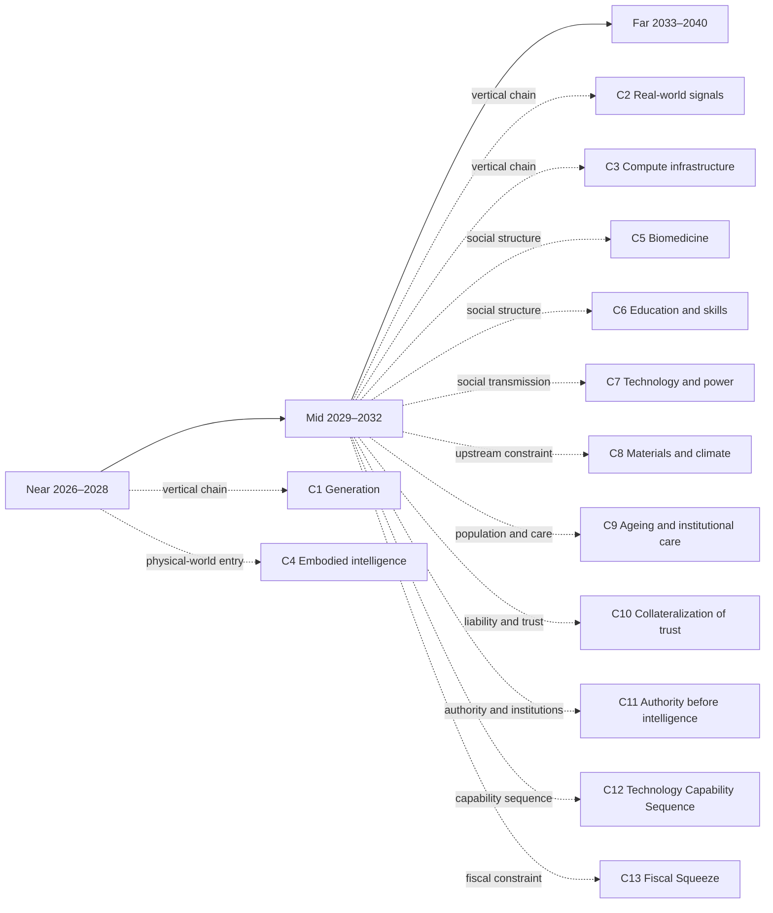

# Mid-term landscape: 2029–2032

[中文版](../zh/20-mid.md)

[Back to README / document map](../../README.en.md)

> In July 2031, a company that handles cross-border returns and claims replaced the dashboard on its wall. The old one showed how many steps had been completed automatically that month; the number kept climbing and stopped meaning anything. The new one keeps a single column, headed “Waiting for a person.” That afternoon the column holds six items, and the one at the top has been waiting nine hours.
>
> Two people in the company can clear that column, and one of them is on parental leave. The other is not short of information: every item arrives with three pages of reasoning the system has written, well organized, better phrased than she would put it herself. What she wants is a different field—what actually happened in the world the last time this procedure ran to the end, rather than what the system expected at the time. That field is often empty. For the empty ones the system can reconstruct a perfectly plausible account, which is good enough for ordering the queue; the moment it goes into a compensation claim, the other side does not accept it.
>
> She is not short of authority either. What she is short of is herself: every item she clears has a line in the contract saying who compensates and up to which tier, and her name goes under that line. That is where the nine hours come from—not a slow system, but her unwillingness to turn something she has not understood into a sentence she is answerable for.
>
> That afternoon she clears four and sends two back. There is still a call to make in the evening: one of the brands lost a great deal this time, and the system has already drafted the email, the compensation plan, and three ways to word it, but the call itself she has to make herself.
>
> That is roughly the shape of the mid term: execution is no longer the bottleneck. The bottleneck becomes that one column—which actions may complete on their own, who decides once one crosses the boundary, and who pays when that decision is wrong. The six dimensions below take that apart. The mid-term is not a jump into science fiction; it carries the written near-term technical judgments into organizational, institutional, and real-world consequences. Every mid-term inference depends on a near-term judgment; if an upstream judgment is falsified, the downstream claim must be reviewed. Full cards live in [`90-ledger.md`](90-ledger.md), and every numbered reference links directly to the ledger, which is the sole source for card fields and status.
>
> This layer spreads one time window out horizontally. To follow a single causal line vertically instead, read [C2 · When Data Is No Longer Free: How Real-World Signals Become Contract Assets](chains/20-real-signals-become-contracts.md)—its argument sits in exactly these years.

> **Methodological re-entry (decision 950)**: The old version used “L1 abundance → scarcity × AI output” as a single skeleton; this page is now organized by each section’s actual starting point. L1 is an optional lens, not the default starting point; see [method §2 “Toolbox of lenses”](00-method.md#2-toolbox-of-lenses).

> **Page**: Starting-point boundary for this layer: The six top-level sections carry recent technical judgments into organizational and institutional consequences. Non-AI starting points—population, care, fiscal pressure, materials, and physical labour—are developed independently in the C4, C8, C9, and C13 passages below. They are not forced into AI as their cause, and no uncalibrated society-wide voice is added merely to make the top-level structure look balanced.

## Reading navigation map (relationship projection)

This map provides reading entrances among the near/mid/far pages and the reasoning chains. It adds no judgment and does not replace the `J-NNN` ledger. Time layers are coarse reading containers; causal dependencies live in the ledger’s `depends-on` fields.

> This is a reading aid, not a new source of facts. Arrows indicate recommended entrances, not necessary causality.

## 1. Compute and tokens: generation stops being the bottleneck; execution boundaries become the bottleneck

> **Starting point**: This section starts from **technical regularity**, with AI capability as a premise: generation expands first, then continuous execution, state, and authorization are tested against real-world consequences.

> **Lens choice**: This section explicitly selects L1: whether more candidate plans shift scarcity toward replayable state, permissions, and recoverable action is its core hypothesis.

If [J-001](ledger/01-10.md#j-001--unit-reasoning-cost-keeps-falling) and [J-006](ledger/01-10.md#j-006--reasoning-throughput-precedes-long-horizon-autonomy) hold, by around 2029 the same budget can search many candidate plans. The mid-term question is no longer whether a system can generate, but whether it can act continuously without transferring trial-and-error costs to the real world.

- **More abundant:** candidate plans, parallel reasoning, and automatic revision.
- **More scarce:** inspectable permissions, replayable state, and recoverable action.
- **Third question:** simple checks will be internalized; cross-system state, physical harm, and liability face physical and legal/liability constraints.
- **Who should change behavior:** organizations should buy observable, pausable, rollback-capable action environments before buying longer autonomous permissions.
- **Window opportunity:** pausable, replayable, rollback-capable action environments.

[J-010](ledger/01-10.md#j-010--long-horizon-autonomy-follows-constrained-continuous-execution) depends on [J-009](ledger/01-10.md#j-009--continuous-execution-in-constrained-workflows-matures-first): if constrained workflows do not stabilize first, both the time window and reliability judgment for long-horizon autonomy weaken. This yields two mid-term judgments: pausable, replayable, rollback-capable action environments become prerequisites ([J-031](ledger/31-40.md#j-031--pausable-replayable-rollback-capable-action-environments-become-admission-conditions-for-long-horizon-ai-execution)), while authorization review becomes scarcer than execution steps ([J-032](ledger/31-40.md#j-032--authorization-review-and-exception-escalation-become-scarcer-than-execution-steps)). If [J-010](ledger/01-10.md#j-010--long-horizon-autonomy-follows-constrained-continuous-execution) is falsified, [J-031](ledger/31-40.md#j-031--pausable-replayable-rollback-capable-action-environments-become-admission-conditions-for-long-horizon-ai-execution)’s boundary for long-horizon action moves later, while [J-032](ledger/31-40.md#j-032--authorization-review-and-exception-escalation-become-scarcer-than-execution-steps) remains only inside constrained workflows. The strongest opposing mechanism is a vendor hiding long tasks inside many invisible short workflows and thereby bypassing explicit environment construction.

> **Scope tag · Gate 1**: The cited J-001, J-006, J-009, J-010, J-031, J-032 are occupational/organizational judgments; their audience ceiling is defined by the cited cards, so this passage makes no society-wide trend claim. See [Historical retrospective · Gate 1](01-retrospect.md#7-running-these-gates-on-what-we-ourselves-have-written) for the criterion and the [ledger review log](90-ledger.md#8-review-log) for card-level evidence.

## 2. Information and content: content becomes feedstock; causality becomes the product

> **Starting point**: This section starts from **supply and demand plus technical regularity**, with AI capability as a premise: as explanations and simulations multiply, real intervention and causal evidence become the constraint to test.

> **Lens choice**: This section explicitly selects L1: whether abundant explanation and simulation move value toward real observation, intervention, and accountable commitments must be tested against reality.

Near-term [J-002](ledger/01-10.md#j-002--selecting-objectively-high-quality-from-abundant-output-is-not-a-durable-scarcity-but-merely-a-24-year-window) says objective selection will be internalized, while [J-005](ledger/01-10.md#j-005--after-generation-becomes-abundant-value-concentrates-in-three-kinds-of-non-recombinable-input-raw-signals-accountable-commitments-and-validated-causality) moves value toward raw signals, accountable commitments, and verified causality. The uncomfortable mid-term shift is that explanations become cheap while changing reality remains expensive.

- **More abundant:** explanations, summaries, forecasts, and simulated plans for existing material.
- **More scarce:** new observations, real interventions, and entities willing to bear the cost of being wrong.
- **Third question:** synthetic material can scale automatically, but it cannot automatically complete a real experiment and a legally accepted commitment; physics, time, and liability are hard constraints.
- **Who should change behavior:** researchers and decision-makers should keep “what the model said” separate from “what reality did,” never substituting an elegant explanation for intervention evidence.
- **Window opportunity:** tooling that separates real-intervention records from synthetic evidence.

[J-005](ledger/01-10.md#j-005--after-generation-becomes-abundant-value-concentrates-in-three-kinds-of-non-recombinable-input-raw-signals-accountable-commitments-and-validated-causality) branches into two mid-term judgments: verifiable records of real interventions become more valuable than explanation itself ([J-033](ledger/31-40.md#j-033--verifiable-records-of-real-interventions-become-more-valuable-than-explanation-itself)), while synthetic evidence is accepted first in low-liability contexts and real trials remain required in high-liability contexts ([J-034](ledger/31-40.md#j-034--synthetic-evidence-is-accepted-first-in-low-liability-contexts-high-liability-contexts-still-require-real-trials)). Both depend on [J-005](ledger/01-10.md#j-005--after-generation-becomes-abundant-value-concentrates-in-three-kinds-of-non-recombinable-input-raw-signals-accountable-commitments-and-validated-causality); if [J-005](ledger/01-10.md#j-005--after-generation-becomes-abundant-value-concentrates-in-three-kinds-of-non-recombinable-input-raw-signals-accountable-commitments-and-validated-causality) is falsified, field signals lose structural premium and both [J-033](ledger/31-40.md#j-033--verifiable-records-of-real-interventions-become-more-valuable-than-explanation-itself) and [J-034](ledger/31-40.md#j-034--synthetic-evidence-is-accepted-first-in-low-liability-contexts-high-liability-contexts-still-require-real-trials) weaken. The external comparison is complete: the direction agrees with the common claim that data becomes more important, but the comparison supports only a narrower range — compliance evidence, model-risk governance, and records of real interventions gain value in high-liability settings (EXT-7, EXT-13, EXT-9), with neither superiority to explanation itself nor a time window established. The project therefore retains the more specific claim: unrecorded signals and compensable commitments, not data volume (per-judgment comparison verdicts are in the "Against consensus" fields of [J-033](ledger/31-40.md#j-033--verifiable-records-of-real-interventions-become-more-valuable-than-explanation-itself) and [J-034](ledger/31-40.md#j-034--synthetic-evidence-is-accepted-first-in-low-liability-contexts-high-liability-contexts-still-require-real-trials)).

The strongest opposing mechanism is a high-fidelity world model combined with institutions that accept synthetic experiments, making real trials unnecessary. If that occurs, [J-005](ledger/01-10.md#j-005--after-generation-becomes-abundant-value-concentrates-in-three-kinds-of-non-recombinable-input-raw-signals-accountable-commitments-and-validated-causality) must be reviewed.

> **Scope tag · Gate 1**: The cited J-002, J-005, J-033, J-034 are occupational/organizational judgments; their audience ceiling is defined by the cited cards, so this passage makes no society-wide trend claim. See [Historical retrospective · Gate 1](01-retrospect.md#7-running-these-gates-on-what-we-ourselves-have-written) for the criterion and the [ledger review log](90-ledger.md#8-review-log) for card-level evidence.

## 3. Attention and trust: credibility moves from expression to collateral

> **Starting point**: This section starts from **human nature and social regularity**, with AI capability as a premise: credibility moves from expression toward long fulfillment, responsibility, and compensation.

Near-term [J-017](ledger/11-20.md#j-017--ai-mediation-expands-weak-tie-coordination-faster-than-strong-relationships) separates weak-tie coordination from strong-tie commitment; [J-005](ledger/01-10.md#j-005--after-generation-becomes-abundant-value-concentrates-in-three-kinds-of-non-recombinable-input-raw-signals-accountable-commitments-and-validated-causality) says accountable entities themselves will appreciate. If both hold, the more real content looks, the more people ask who pays when it is wrong.

**Result from this starting point**: the old version placed “personalized explanations, identity narratives, and simulated intimacy” first; this page now treats it as a result rather than a starting premise, with pressure landing on “consistency over time, accountability, and trust willing to put assets at risk”. **Automation boundary**: faces, language, and instant patience can be copied; repeated exchange, relationship repair, and legal responsibility cannot be generated in one step. **Action boundary**: organizations should build liability, audit, and compensation paths around consequential AI output; individuals should treat credibility as accountability, not natural-sounding tone; a possible window is fulfillment records, responsibility collateral, and audit interfaces.

This produces two mid-term judgments: responsibility collateral enters the transaction structure around consequential AI output ([J-035](ledger/31-40.md#j-035--responsibility-collateral-enters-the-transaction-structure-for-consequential-ai-output)), and long fulfillment records allocate attention better than one-off natural expression ([J-036](ledger/31-40.md#j-036--long-term-fulfillment-records-allocate-attention-better-than-one-off-natural-expression)). If [J-017](ledger/11-20.md#j-017--ai-mediation-expands-weak-tie-coordination-faster-than-strong-relationships) is falsified, the pressure for [J-036](ledger/31-40.md#j-036--long-term-fulfillment-records-allocate-attention-better-than-one-off-natural-expression)’s credential upgrade weakens because weak-tie coordination did not become cheap; if [J-005](ledger/01-10.md#j-005--after-generation-becomes-abundant-value-concentrates-in-three-kinds-of-non-recombinable-input-raw-signals-accountable-commitments-and-validated-causality) is falsified, [J-035](ledger/31-40.md#j-035--responsibility-collateral-enters-the-transaction-structure-for-consequential-ai-output) loses its compensation basis. The strongest opposing mechanism is platforms shifting all responsibility to users while society accepts cheap, low-liability services; then responsibility collateral is a window rather than a structural opportunity.

> **Scope tag · Gate 1**: The cited J-005, J-017, J-035, J-036 are occupational/organizational judgments; their audience ceiling is defined by the cited cards, so this passage makes no society-wide trend claim. See [Historical retrospective · Gate 1](01-retrospect.md#7-running-these-gates-on-what-we-ourselves-have-written) for the criterion and the [ledger review log](90-ledger.md#8-review-log) for card-level evidence.

## 4. Organizations and employment: firm boundaries are set by responsibility, not production capacity

> **Starting point**: This section starts from **social and technical regularity**, with AI capability as a premise: automation first changes the work unit, then organizations must allocate authority and responsibility.

Near-term [J-009](ledger/01-10.md#j-009--continuous-execution-in-constrained-workflows-matures-first) says constrained workflows mature first, and [J-013](ledger/11-20.md#j-013--checkable-tool-calls-precede-open-environment-action) says inspectable tool calls spread first. The mid-term result may not be “no people,” but a smaller number of people managing more verifiable agent processes.

**Result from this starting point**: the old version placed “decomposable, monitorable work steps and the output capacity of small teams” first; this page now treats it as a result rather than a starting premise, with pressure landing on “organizational positions that authorize across teams, escalate exceptions, and own final responsibility”. **Automation boundary**: workflow coordination can be automated; responsibility, relationships, and negotiation after failure remain constrained by law and trust. **Action boundary**: hiring and education should shift from “can you perform the step?” toward “can you define boundaries, judge exceptions, and bear consequences?”; a possible window is permission and exception-escalation layers for small-team agent workflows.

This yields two mid-term judgments: comparable small teams produce more verifiable output ([J-037](ledger/31-40.md#j-037--comparable-small-teams-produce-more-verifiable-output)), while authorization, exception escalation, and responsibility roles do not shrink at the same rate ([J-038](ledger/31-40.md#j-038--authorization-exception-escalation-and-responsibility-roles-do-not-shrink-as-fast-as-execution-steps)). If [J-009](ledger/01-10.md#j-009--continuous-execution-in-constrained-workflows-matures-first) is falsified, [J-037](ledger/31-40.md#j-037--comparable-small-teams-produce-more-verifiable-output) loses its continuous-execution premise; if [J-013](ledger/11-20.md#j-013--checkable-tool-calls-precede-open-environment-action) is falsified, [J-038](ledger/31-40.md#j-038--authorization-exception-escalation-and-responsibility-roles-do-not-shrink-as-fast-as-execution-steps) loses its programmable-permission premise. The strongest opposing mechanism is firms keeping every agent workflow inside vendors and purchasing only outcomes, hiding rather than eliminating boundary change.

> **Scope tag · Gate 1**: The cited J-009, J-013, J-037, J-038 are occupational/organizational judgments; their audience ceiling is defined by the cited cards, so this passage makes no society-wide trend claim. See [Historical retrospective · Gate 1](01-retrospect.md#7-running-these-gates-on-what-we-ourselves-have-written) for the criterion and the [ledger review log](90-ledger.md#8-review-log) for card-level evidence.

## 5. Capital and power: scarcity moves from models to access

> **Starting point**: This section starts from **supply and demand plus technical regularity**, with AI capability as a premise: as model supply expands, complementary constraints—energy, data, channels, and solvency—are priced.

> **Lens choice**: This section explicitly selects L1: whether more model supply raises the value of complementary assets and access rights is the section’s core testable inversion.

If [J-001](ledger/01-10.md#j-001--unit-reasoning-cost-keeps-falling)’s cost decline and [J-005](ledger/01-10.md#j-005--after-generation-becomes-abundant-value-concentrates-in-three-kinds-of-non-recombinable-input-raw-signals-accountable-commitments-and-validated-causality)’s appreciation of real inputs both hold, capital will not only chase the strongest model. It will chase control of energy, data, distribution, licensing, and the ability to compensate for loss.

- **More abundant:** rentable general-purpose reasoning and generation.
- **More scarce:** low-cost energy, exclusive real-world data, critical channels, and balance sheets able to absorb accidents.
- **Third question:** software calls can be copied; ownership, energy access, relationship networks, and liability capacity do not copy at the same speed.
- **Who should change behavior:** founders should value model capability separately from access capability; regulators should watch who privatizes gains and socializes losses.
- **Window opportunity:** access layers for energy, data, channels, and accident solvency.

This yields two mid-term judgments: rented models become abundant while energy, data, and channel control create access rents ([J-039](ledger/31-40.md#j-039--rented-models-become-abundant-while-energy-data-and-channel-control-create-access-rents)), and balance sheets able to absorb accidents become a separate scarcity ([J-040](ledger/31-40.md#j-040--balance-sheets-able-to-absorb-ai-accidents-become-a-separate-scarcity)). If [J-001](ledger/01-10.md#j-001--unit-reasoning-cost-keeps-falling) is falsified, [J-039](ledger/31-40.md#j-039--rented-models-become-abundant-while-energy-data-and-channel-control-create-access-rents) loses its model-abundance premise; if [J-005](ledger/01-10.md#j-005--after-generation-becomes-abundant-value-concentrates-in-three-kinds-of-non-recombinable-input-raw-signals-accountable-commitments-and-validated-causality) is falsified, [J-040](ledger/31-40.md#j-040--balance-sheets-able-to-absorb-ai-accidents-become-a-separate-scarcity)’s liability-absorption premium weakens. This is a medium-confidence structural landscape, not an independent opportunity card. The strongest opposing mechanism is rapid commoditization of compute, energy, and data plus timely institutional dispersal of access rights; if access prices lose structural premiums, reduce confidence.

> **Scope tag · Gate 1**: The cited J-001, J-005, J-039, J-040 are occupational/organizational judgments; their audience ceiling is defined by the cited cards, so this passage makes no society-wide trend claim. See [Historical retrospective · Gate 1](01-retrospect.md#7-running-these-gates-on-what-we-ourselves-have-written) for the criterion and the [ledger review log](90-ledger.md#8-review-log) for card-level evidence.

## 6. Human needs and relationships: AI can mediate coordination, not shared experience

> **Starting point**: This section starts from **human nature and social regularity**; AI is only a coordination tool and cannot replace shared experience or personally borne consequences.

[J-017](ledger/11-20.md#j-017--ai-mediation-expands-weak-tie-coordination-faster-than-strong-relationships) rests on [J-006](ledger/01-10.md#j-006--reasoning-throughput-precedes-long-horizon-autonomy) and [J-007](ledger/01-10.md#j-007--resumable-context-precedes-reliable-long-term-memory): communication and shared context become cheap, while strong-relationship capacity remains constrained by attention, bodies, and repeated responsibility. The most tempting mid-term mistake is treating “someone replies for you” as “someone is present for you.”

**Result from this starting point**: the old version placed “always-available companion replies, relationship-maintenance reminders, and conflict summaries” first; this page now treats it as a result rather than a starting premise, with pressure landing on “unmediated shared experience, genuine reciprocity, and repair that the parties must personally undertake”. **Automation boundary**: language and reminders can be automated; embodied presence, trust, and shared consequences cannot be copied by the same generation force. **Action boundary**: families, schools, and organizations should reserve shared presence for decisions that cannot be delegated, using AI for preparation and reflection rather than substituted responsibility.; a possible window is weak-tie coordination tools; strong-tie presence remains landscape only, not an opportunity.

This yields two mid-term judgments: AI first expands the coordination radius of weak ties ([J-041](ledger/41-50.md#j-041--ai-first-expands-the-coordination-radius-of-weak-ties)), while shared experience and embodied presence remain the capacity ceiling for strong ties ([J-042](ledger/41-50.md#j-042--shared-experience-and-embodied-presence-remain-the-capacity-ceiling-for-strong-ties-landscape-only)). If [J-017](ledger/11-20.md#j-017--ai-mediation-expands-weak-tie-coordination-faster-than-strong-relationships) is falsified, [J-041](ledger/41-50.md#j-041--ai-first-expands-the-coordination-radius-of-weak-ties) loses its coordination-supply premise; if [J-011](ledger/11-20.md#j-011--cross-media-consistency-precedes-long-range-coherence) is falsified, [J-042](ledger/41-50.md#j-042--shared-experience-and-embodied-presence-remain-the-capacity-ceiling-for-strong-ties-landscape-only)’s premise about richer multimodal expression weakens. This is an Exit-B structural landscape with medium-low confidence, not a business opportunity. The strongest opposing mechanism is people treating persistent AI-mediated interaction as sufficiently reciprocal to replace shared experience; if behavior shows stable substitution, rewrite the judgment.

> **Scope tag · Gate 1**: The cited J-006, J-007, J-011, J-017, J-041 are occupational/organizational judgments; their audience ceiling is defined by the cited cards, so this passage makes no society-wide trend claim. See [Historical retrospective · Gate 1](01-retrospect.md#7-running-these-gates-on-what-we-ourselves-have-written) for the criterion and the [ledger review log](90-ledger.md#8-review-log) for card-level evidence.

## Another ten chains in the same window: C4–C13 in 2029–2032

The first six sections carry near-term capability judgments into organizational and real-world consequences; this section places the other ten chains' middle years, 2029–2032, on the same map. Each passage adds only this layer's judgment and intersection; it does not copy audience-scale or diffusion-gate fields from the ledger. Where this layer has only a review date and no new judgment, it says so directly.

### C4 · Embodied Intelligence: non-structured grasping and flexible assembly begin to cross the workstation boundary

[C4 · Embodied Intelligence](chains/40-embodied-intelligence.md) enters its second phase in the mid term: warehouses move from structured transport toward unstructured picking, and manufacturing moves from rigid-part closed loops toward flexible assembly, but both remain mainly single-task, single-station, and recoverable deployments. [J-075](ledger/71-80.md#j-075--warehousings-bottleneck-has-moved-from-moving-to-grasping-unstructured-picking-arrives-first-and-door-to-door-delivery-does-not-hold-inside-this-window) says grasping crosses the bottleneck first, not that door-to-door delivery has arrived; [J-076](ledger/71-80.md#j-076--manufacturings-one-real-scaling-passed-through-gate-4s-local-closed-loop-flexible-assembly-and-high-mix-low-volume-are-still-outside-the-gate) keeps flexible assembly in local closed loops. [J-099](ledger/96-102.md#j-099--embodied-automation-re-bundles-occupational-tasks-before-it-eliminates-occupations) further defines the deployment unit as a task bundle: the machine takes an acceptably specified task, while a person handles exceptions, handoff, and responsibility. Contact transfer in care opens first inside institutions; the home is not a society-level conclusion in this layer ([J-074](ledger/71-80.md#j-074--contact-transfer-in-care-crosses-inside-institutions-first-and-homes-reach-no-society-level-diffusion-inside-this-window)).

Intersection: the mid-term physical world corresponds to the organizational reshuffling in section 4—not “machines replacing occupations,” but occupations being split into deliverable task bundles. Who takes the exception and who signs for the result is the same ledger as the authorization boundaries in C7 and C11.

### C5 · Biology and Medicine: more candidates, while human time remains the gate

[C5 · Biology and Medicine](chains/50-biology-medicine.md) does not skip real causality in the mid term: low-liability medical workflows became routine in the previous phase, and the generation, ranking, and combination of drug and biomedical candidates keep expanding, but [J-081](ledger/81-90.md#j-081--more-drug-candidates-do-not-proportionally-shorten-human-trial-time)'s human-trial time does not shrink in proportion to candidate volume. The window for [J-080](ledger/71-80.md#j-080--low-liability-medical-workflows-diffuse-before-autonomous-care-without-professional-review) closes in 2031, requiring a check on whether professional review still blocks autonomous care; [J-082](ledger/81-90.md#j-082--once-explanation-is-abundant-medical-scarcity-moves-to-authorized-intervention-and-continuity-of-care-landscape-only) remains a structural landscape only, not a claim that more candidates mean more clinical outcomes.

Intersection: this chain pins section 2's “explanation becomes cheap, real intervention remains expensive” to human time; C11's tiered authorization in medicine still has to obey professional review and responsibility assignment.

### C6 · Education and Skill Formation: process evidence takes over from finished artifacts

The mid-term fork in [C6 · Education and Skill Formation](chains/60-education-skill-formation.md) is that explanation and finished artifacts keep multiplying, while schools and institutions shift judgment toward controlled performance and process evidence. [J-085](ledger/81-90.md#j-085--take-home-artifact-signals-weaken-while-controlled-performance-and-process-evidence-gain-weight) says take-home artifacts lose screening power, while performance in controlled settings, oral examination, and process records gain value; [J-086](ledger/81-90.md#j-086--the-explanation-gap-narrows-while-practice-and-verification-gaps-may-widen-landscape-only) remains a landscape only and cannot be written as teacher replacement. The near-term window for [J-083](ledger/81-90.md#j-083--personalized-explanation-becomes-abundant-before-verifiable-mastery) reaches its review point: whether more explanation produces verifiable mastery must be judged by behavior, not content volume.

Intersection: this directly joins section 3's “being seen is not the same as being believed”—when finished work is easy to forge, education moves trust toward process and controlled performance; it also gives C7's human–machine supervision unit a training entry point.

### C7 · Technology Arrives First, Power Later: human–machine supervision units become the organization's default interface

[C7 · Technology Arrives First, Power Later](chains/70-capability-to-social-consequences.md) moves in the mid term from “organizational trial” to “organizational interface.” [J-088](ledger/81-90.md#j-088--junior-production-seats-shrink-before-occupations-as-a-whole-apprenticeship-carriers-become-the-new-bottleneck) points to an uncomfortable feedback: when practice steps in junior positions are automated, organizations may lose the apprenticeship seats that train the next layer of responsible people. [J-089](ledger/81-90.md#j-089--permission-audit-and-appeal-control-planes-become-production-infrastructure-before-broad-autonomous-authority) requires identity, permissions, logs, pause, audit, and appeal to become production infrastructure first. The window for [J-090](ledger/81-90.md#j-090--productivity-gains-first-concentrate-with-scarce-complementary-asset-owners-competition-and-institutions-decide-whether-they-spread) has begun: productivity gains first flow to controllers of scarce complementary assets, which does not automatically mean everyone inside the organization benefits.

Intersection: section 4 says small teams can deliver more verifiable output; C7 asks who receives the gain and who loses the practice entry point. C11's revocable agency is its corresponding interface in the responsibility system.

### C8 · The Fab Before the Chip: supply-chain resilience becomes a conversion path

[C8 · The Fab Before the Chip](chains/80-fab-materials-and-climate.md) makes “upstream shortage” concrete in the mid term as two kinds of inspectable infrastructure. [J-092](ledger/91-95.md#j-092--semiconductor-resilience-spending-shifts-from-raw-stockpiles-to-pre-qualified-conversion-paths) says resilience spending shifts from stockpiling raw materials to qualifying substitute refining, electronic-grade conversion, equipment service, recipes, and process transfer; [J-093](ledger/91-95.md#j-093--advanced-fab-siting-is-priced-as-a-bundle-of-firm-power-water-quality-and-discharge-capacity) checks by 2033 whether advanced fabs are priced by firm power, water quality, water reuse, discharge, and climate-adaptation capacity. The opening windows for [J-094](ledger/91-95.md#j-094--semiconductor-climate-risk-is-priced-through-qualified-output-loss-not-hazard-maps-alone) and [J-095](ledger/91-95.md#j-095--fab-resilience-costs-become-explicit-bargaining-over-who-pays-and-who-is-curtailed-first) mean compute expansion may first form regional clusters with supporting capacity.

Intersection: section 5's “access remains expensive” lands here in water, power, chemicals, and equipment service; C8 and C3 together determine whether rented models can become real-world production capacity.

### C9 · Ageing and Institutional Care: family care is redistributed

[C9 · Ageing and Institutional Care](chains/90-aging-care-and-institutional-substitution.md) pushes the near-term gap into role redistribution in the mid term. [J-096](ledger/96-102.md#j-096--ageing-and-smaller-households-move-part-of-care-toward-formal-and-coordination-layers) expects some care to continue moving toward formal services, insurance or public payment, and cross-institution coordination, but not the exit of family relationships; [J-097](ledger/96-102.md#j-097--care-assistance-stabilises-first-in-institutions-and-controlled-services-open-home-general-purpose-robots-lag) limits the object of substitution to the organization of labour. If devices stabilize in deployment, C4's contact transfer enters the institution-first care chain, but this layer does not turn demonstrations or single-task devices into household-wide automation.

Intersection: C9 places C4's physical capability inside demographic and payment systems. Whether a device can enter the home depends not only on grasping capability, but on insurance, authorization, and who catches responsibility when something goes wrong; this is also a direct downstream of C13's budget constraint.

### C10 · Collateralization of trust: responsibility begins to enter transaction structure

The mid-term core of [C10 · Collateralization of trust](chains/100-trust-collateralization.md) is [J-035](ledger/31-40.md#j-035--responsibility-collateral-enters-the-transaction-structure-for-consequential-ai-output): as consequential AI output increasingly resembles an ordinary service, buyers will ask for traceable fulfillment records, a responsible party, and compensation arrangements rather than comparing demonstrations alone. This does not expand “responsibility collateral” into a universal institution across all industries; it opens first in high-liability, claimable settings that already have contract and insurance language.

Intersection: section 3's judgment about credential upgrading becomes a contract term here; C11 says who may act for whom, while C10 says who provides enforceable compensation when the action is wrong.

### C11 · Authority before intelligence: high-liability agency is tiered and revocable first

The mid-term core of [C11 · Authority before intelligence](chains/110-authority-before-intelligence.md) is [J-098](ledger/96-102.md#j-098--authority-before-intelligence-consequential-settings-form-revocable-tiered-agency-first): in high-liability settings, AI first sits under the responsibility of a person, organization, or public institution, with authorization tiered by task, amount, risk, and exception conditions; an AI as an independent responsible entity is not this layer's judgment. Authorization review, logs, revocation, and appeal become the interface first; continuous execution is no longer the only bottleneck.

Intersection: the pausable, replayable environment in section 1 supplies the operational base for authorization; C10's responsibility collateral puts “who authorized, who compensates” into the transaction, and C7 turns it into an organizational control plane.

### C12 · Technology Capability Sequence: long-horizon autonomy still rests on continuous execution

The mid-term judgment of [C12 · Technology Capability Sequence](chains/120-technology-capability-sequence.md) is not “the model suddenly becomes human,” but that capability continues to cross dependencies in order. [J-011](ledger/11-20.md#j-011--cross-media-consistency-precedes-long-range-coherence), [J-014](ledger/11-20.md#j-014--rehearsable-environments-follow-single-tool-integration), and [J-010](ledger/01-10.md#j-010--long-horizon-autonomy-follows-constrained-continuous-execution) together say that multimodal consistency and rehearsable environments mature first, with long-horizon autonomy then entering constrained settings; [J-012](ledger/11-20.md#j-012--cross-time-coherence-depends-on-state-and-evaluation) and [J-016](ledger/11-20.md#j-016--open-world-evaluation-is-the-final-gate-for-expanding-autonomy) leave the boundary at verifiable state and constrained worlds. Section 1's authorization gate is not decorative: it is the bridge between this technical sequence and social deployment.

Intersection: C12 explains why the mid term can first buy rollback-capable continuous execution, while C4 reminds us that physical actuators and real environments will not mature at the same speed as software capability.

### C13 · Fiscal Squeeze: current recipients hold first; those not yet drawing and external aid yield first

[C13 · Fiscal Squeeze](chains/130-fiscal-squeeze-who-gets-cut.md) has sufficiently hard review points in the mid term. [J-105](ledger/103-108.md#j-105--under-fiscal-squeeze-current-recipients-nominal-pensions-are-the-hardest-to-cut-the-knife-falls-first-on-those-not-yet-drawing) says fiscal pressure is first absorbed by delaying future benefits, changing eligibility, or shifting costs to those not yet drawing; the projected exhaustion of US OASI reserves in Q4 2032 provides a time anchor. [J-107](ledger/103-108.md#j-107--paid-weekly-work-at-65-stops-at-the-d-tier-tens-of-millions-short-of-a-hundred-million) records continued paid work at older ages as a segment-scale phenomenon rather than a society-wide substitute; the review window for [J-106](ledger/103-108.md#j-106--aid-gives-way-to-defence-the-budget-with-no-domestic-periodic-recipients-is-squeezed-out-first) arrives in 2029, testing whether budgets with no domestic periodic recipients yield first to defence.

Intersection: C13 determines how much public payment can support C9's formal care and C4's equipment purchases; if C7's productivity gains concentrate in complementary-asset owners, they may not expand into a usable tax base in time.

## Boundary of this layer

Biology and medicine (C5), educational qualification (C6), physical labour (C4), population and care (C9), technology and power (C7), materials and climate (C8), authorization institutions (C11), and the fiscal side (C13) are now written into this layer by time window; energy and physical infrastructure are still touched only through [C3 · Electrons on the Ground](chains/30-power-land-and-permits.md) and its intersections with C8 and C4, without a standalone treatment. C10's responsibility collateral has opened in this layer, but its observation period still has to continue. Long-horizon feedback remains uncovered; the fiscal side of geopolitics and institutions now has [C13 · Fiscal Squeeze](chains/130-fiscal-squeeze-who-gets-cut.md) (J-105–J-107), while inter-state competition and security themselves remain unreasoned through; law and property rights also do not yet have an independent chain. The passages above use near-term judgments as anchors; if an anchor is falsified, the original certainty must not be preserved. Concrete norms for intimacy between people and AI remain a weaker far-term landscape only and cannot be inferred directly from this layer's technical capabilities.
