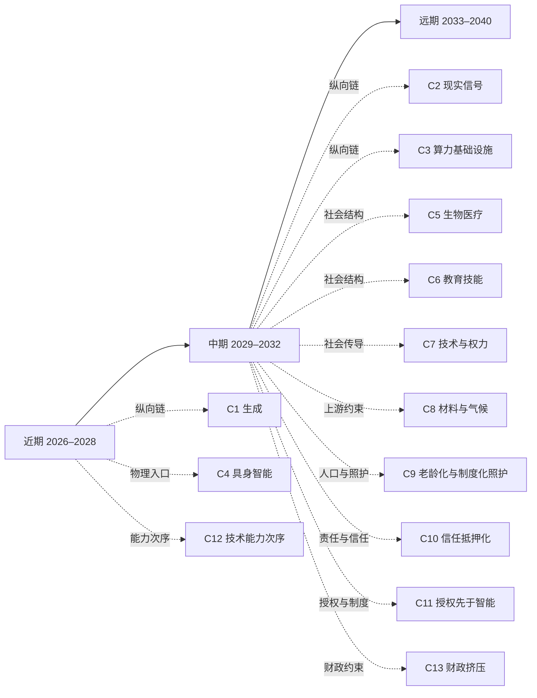

# 近期图景：2026–2028

[English version](../en/10-near.md)

[返回 README／文档地图](../../README.md)

> 2027 年 3 月的一个周一早上，一家做冷链检测的公司只有十一个人，却同时服务两百多家门店。周末系统自己跑完四百多次比对，把出具检测结论的流程压到七个候选版本——没人加班，也没人觉得这件事值得一提。占掉整个上午的是另外三件：最大的客户下周要续约，对方这次要看的不是准确率宣传页，而是过去两年里每一次“三小时内出结论”实际用了多久；下游超市换了采购负责人，新来的那位第一句话是“这份报告谁签字”；而那批被系统标成“必须有人到现场看一眼”的样本，怎么调阈值都还在。十一个人里没有一个还在手写报告，但每个人每天都在做同一个决定：哪些可以自动放行，哪些必须有人亲自担下来。
>
> 近期这三年的形状大致就是这样：生成、比对和筛选这一侧迅速变得便宜而丰富，而“谁的现场、谁的承诺、谁担后果”这一侧第一次被单独拿出来定价。以下六个维度分别拆开这件事——但这不是把“丰富→稀缺”当成结论，而是把它当作待检验的起点：有些稀缺会被同一股生成力量吃掉，有些会被物理、产权、责任、信任或身体在场挡住。六个维度都走完这三步。
>
> 这一层是横向铺开同一个时间窗。想沿一条因果线纵向读到底，见 [C1 · 生成变得免费之后，什么反而买不到了](chains/10-generation-becomes-free.md)。

## 阅读导航图（关系投影）

本图只提供近／中／远三页与推演链的阅读入口，不新增判断，也不替代 `J-NNN` 台账。时间层是粗粒度阅读容器；因果依赖请回到台账的 `depends-on`。

> 本图是阅读辅助，不是新的事实源。箭头表示推荐入口而非必然因果。

## 1. 一次回答，变成一批尝试

单位推理成本下降后，系统会并行生成、比较和修正，而不是只交付一个答案。[J-018](ledger/11-20.md#j-018--并行推理先于长程自主执行) 是这条近期主线；它与常见预期一致，但这里的推理重点是“同一预算能尝试多少次”，不是“模型会不会思考”。

- **变丰富**：同等能力的推理调用、候选方案和自动测试次数。
- **变稀缺**：值得继续的任务边界、私有上下文，以及不可逆动作前的判断。
- **第三问**：客观筛选会被同一股力量自动化，属于窗口；私有上下文受产权与私有性约束，不可逆动作受物理和法律责任约束，不能被简单复制。
- **现在谁该改变什么行为**：把“多生成”改成“生成—比较—验证”，真实动作保留隔离、审批和回滚。

[J-019](ledger/11-20.md#j-019--节省-token-只是窗口) 进一步判断，节省 token 本身只是窗口，不是持久稀缺。我对 [J-018](ledger/11-20.md#j-018--并行推理先于长程自主执行) 押注较重，对 [J-019](ledger/11-20.md#j-019--节省-token-只是窗口) 则保留更多余地。最强反方是能源、芯片供应或服务排队把成本下降锁在单次调用；若并行度不升，这一节的主线就要重审。

> **范围标签 · 闸一**：本段引用的 J-018, J-019 已判为职业／组织性判断；受众天花板由所引卡片定义，不作社会级趋势断言。完整判据见[历史回顾 · 闸一](01-retrospect.md#七用这道闸检验我们自己写过的东西)，逐卡依据见[判断台账 · 检查日志](90-ledger.md#八检查日志)。

## 2. 找东西比造东西贵

代码、图像、视频和文案的合成速度继续上升。[J-020](ledger/11-20.md#j-020--可复制内容的价格继续下降) 检验一个容易被夸大的答案：客观质量筛选大部分会被生成系统内置，而不是永久留下一个独立市场。

- **变丰富**：格式正确、风格相似、可复制的内容。
- **变稀缺**：尚未被记录的真实观测、明确语境和可追责的事实来源。
- **第三问**：模型能删掉形式错误，却不能凭重组生成新的现场观测；物理在场、产权和法律责任构成硬约束，因此残留稀缺不能被同一股力量完全制造丰富。
- **现在谁该改变什么行为**：发布者把来源、时间、观察条件和不确定性放到正文旁，而不是只展示成品。

[J-021](ledger/21-30.md#j-021--一手现场信号先获得溢价) 判断一手信号会比二手表达更早获得溢价。这与“内容会过剩”的常见方向一致，但本项目更具体地押注“未被记录的现场”而非抽象的高质量。最强反方是高保真模拟被广泛接受，替代真实观测；若买方不再区分现场与重组，[J-021](ledger/21-30.md#j-021--一手现场信号先获得溢价) 应降级。

> **范围标签 · 闸一**：本段引用的 J-020, J-021 已判为职业／组织性判断；受众天花板由所引卡片定义，不作社会级趋势断言。完整判据见[历史回顾 · 闸一](01-retrospect.md#七用这道闸检验我们自己写过的东西)，逐卡依据见[判断台账 · 检查日志](90-ledger.md#八检查日志)。

## 3. 看见不等于相信

当每个人都能得到个性化内容，注意力不再只是“有没有内容”，而是“谁值得把时间交给他”。[J-022](ledger/21-30.md#j-022--可伪造信号推动凭据升级) 判断可伪造信号会把筛选推向更昂贵的凭据；这个方向与“信任会变重要”的共识一致，但机制和时间窗是本项目自己的下注。

- **变丰富**：个性化消息、推荐和看似真实的互动。
- **变稀缺**：持续一致的身份、可追责承诺与长期关系。
- **第三问**：生成器可以复制表面信号，却不能一次生成多年重复博弈；信任、关系和法律责任是硬约束，不能靠更多 token 自动补齐。
- **现在谁该改变什么行为**：组织少追逐曝光量，多记录承诺兑现率；个人把重要判断从“说得像”移向“谁承担后果”。

[J-023](ledger/21-30.md#j-023--注意力转向兑现承诺) 认为注意力会从表达转向关系与承诺，[J-024](ledger/21-30.md#j-024--身份凭据重新分层仅图景) 则只保留为较弱图景：身份凭据可能重新分层，但制度落点不明。最强反方是平台把可靠身份和责任全部内置，用户无需新凭据；若平台内置责任后筛选成本持续下降，[J-023](ledger/21-30.md#j-023--注意力转向兑现承诺) 需要重写。

> **范围标签 · 闸一**：本段引用的 J-022, J-023, J-024 已判为职业／组织性判断；受众天花板由所引卡片定义，不作社会级趋势断言。完整判据见[历史回顾 · 闸一](01-retrospect.md#七用这道闸检验我们自己写过的东西)，逐卡依据见[判断台账 · 检查日志](90-ledger.md#八检查日志)。

## 4. 做步骤的人变少，协调更密

AI 先压低文档、排程、翻译和方案制作成本，再把瓶颈推向授权、审查和承担后果。[J-025](ledger/21-30.md#j-025--小团队产出能力上升) 押注小团队能完成更多可验证产出；这条与“知识工作被自动化”的共识方向一致，但不等于“公司里不再需要人”。

- **变丰富**：可外包、可自动化、可监控的知识工作步骤。
- **变稀缺**：能定义目标、分配权限、处理异常并为结果负责的人。
- **第三问**：流程编排会被自动化；法律责任与组织信任不能由一段生成文本承担，因此责任位置不会同步丰富。
- **现在谁该改变什么行为**：职位描述从“产出文件”改为“定义边界、检查证据、承担决定”。

[J-026](ledger/21-30.md#j-026--责任边界不会同步消失) 判断责任边界不会与产能同步消失，属于较稳的结构后果而不是就业人数预测。最强反方是监管把责任统一归给平台，使组织无需重新设计边界；若高价值场景普遍由平台承担全部后果，[J-026](ledger/21-30.md#j-026--责任边界不会同步消失) 应降置信度。

> **范围标签 · 闸一**：本段引用的 J-025, J-026 已判为职业／组织性判断；受众天花板由所引卡片定义，不作社会级趋势断言。完整判据见[历史回顾 · 闸一](01-retrospect.md#七用这道闸检验我们自己写过的东西)，逐卡依据见[判断台账 · 检查日志](90-ledger.md#八检查日志)。

## 5. 算力便宜，入口仍贵

推理成本下降不会平均分配收益。[J-027](ledger/21-30.md#j-027--租用算力扩大能力扩散) 判断算力租用会扩大能力扩散；这与“模型能力会普及”的常见预期一致，但不意味着权力同时扩散。

- **变丰富**：小组织可租用的计算与生成能力。
- **变稀缺**：稳定能源、专有数据、用户入口，以及能承担损失的资产负债表。
- **第三问**：算力调用可复制；能源、产权、法律责任和分发关系不能同速复制，因此这一部分不是同一股软件力量可以无限制造的丰富。
- **现在谁该改变什么行为**：评估 AI 项目时同时问“谁控制输入、出口和事故损失”，不要只看模型能力。

[J-028](ledger/21-30.md#j-028--入口成为议价节点仅图景) 认为数据、分发和责任入口可能形成新的议价节点，但它目前只是较弱图景，不应直接当商机。最强反方是模型、能源和分发全部商品化，入口租金无法持续；若准入价格不再有结构性溢价，[J-028](ledger/21-30.md#j-028--入口成为议价节点仅图景) 失效。

> **范围标签 · 闸一**：本段引用的 J-027, J-028 已判为职业／组织性判断；受众天花板由所引卡片定义，不作社会级趋势断言。完整判据见[历史回顾 · 闸一](01-retrospect.md#七用这道闸检验我们自己写过的东西)，逐卡依据见[判断台账 · 检查日志](90-ledger.md#八检查日志)。

## 6. 选择变多，不等于欲望变新

[J-029](ledger/21-30.md#j-029--需求侧锚点保持) 把地位、确定性、真实在场和责任归属当作需求侧锚点，而不是把“人性永恒”当证明。它与“技术改变工具、不自动改变全部需求”的保守共识相容。

> **范围标签 · 降级（2026-10-09 隔离盲判复审）**：本节引用的 J-029 是进入复审时唯一仍持有社会级书写许可的卡；盲判（首轮 `R1-65`，未认出原判断）以闸二否决——它是需求侧锚点判断，不替代任何既有动作——处置为**口径降级**：卡片状态改为 `REVISED`，命题、证伪条件与检查日原样保留。本节因此只按制度／人性常数类判断阅读，不作「整个社会」「普遍」口吻的趋势断言，也不得据此推出社会级后果。依据见 [J-029 卡片](ledger/21-30.md#j-029--需求侧锚点保持)与[隔离盲判复审第 5 节](../evidence/blind-review-reaudit-2026-10-09.md#5-唯一的新降级j-029)。

- **变丰富**：可试的身份、作品和生活方案。
- **变稀缺**：愿意共同承担后果的关系、真实经历和被看见的承诺。
- **第三问**：表面表达可自动生成；共同经历、身体在场和重复关系受物理、信任和身体约束，不能被同一股生成力量完整替代。
- **现在谁该改变什么行为**：不要把更多选择当成更多意义，为不可替代的在场和承诺留出时间。

[J-030](ledger/21-30.md#j-030--ai-代理协调而非共同经历仅图景) 进一步描绘 AI 能代理协调、却不能代理共同经历；这是一条较弱但值得保留的结构图景。最强反方是新一代人真的把持续的 AI 互动视为足够真实的互惠关系；若纵向行为显示代理关系稳定替代共同经历，[J-030](ledger/21-30.md#j-030--ai-代理协调而非共同经历仅图景) 应重写。

> **范围标签 · 闸一**：本段引用的 J-030 已判为职业／组织性判断；受众天花板由所引卡片定义，不作社会级趋势断言。完整判据见[历史回顾 · 闸一](01-retrospect.md#七用这道闸检验我们自己写过的东西)，逐卡依据见[判断台账 · 检查日志](90-ledger.md#八检查日志)。

## 同一时间窗里的另外十条链：C4–C13 在 2026–2028

上面六节都从 [C1](chains/10-generation-becomes-free.md) 横切出来，起点是「生成变便宜」。后来登记的十条链各有自己的起点——物理劳动、身体与证明、技能形成、组织、材料、人口、代理制度、能力次序、财政——这里把它们落在 2026–2028 的那一截摆在一起。每段只写叙事和链接：各卡的受众规模与普及闸结论只存放在台账卡上，这里不复述，也不以社会级口吻书写；某条链在这三年里没有判断，就写明为什么没有。

### C4 具身智能：先算得过账的是挤奶、托盘和固定工位

上面六节写的都是只能动信息的 AI。[C4 · 具身智能](chains/40-embodied-intelligence.md) 替这一层补上分母：AI 只能动信息时，它碰到的只是以屏幕为工作面的那部分人；要碰到仓库、牧场、车间和护理院里的劳动，必须有一具能在现实中移动质量、触碰身体的设备——而有了身体，也只解开第一道闸，后面四道不随模型能力自动打开（[J-073](ledger/71-80.md#j-073--具身智能是-ai-触及物理劳动人口的必要补足不是普及的充分条件)）。所以 2026–2028 年真正在扩散的，只是 C4 到达次序里的「第一段」：结构化搬运、托盘作业与货到人（[J-075](ledger/71-80.md#j-075--仓储的瓶颈已从移动移到抓取非结构化拣选先到门到门交付在本窗口内不成立)），刚性件的搬运与焊接（[J-076](ledger/71-80.md#j-076--制造业已经发生的规模化过的是闸四的局部闭环柔性装配与小批量多品种仍在闸外)），自动挤奶（[J-077](ledger/71-80.md#j-077--农业里穿越的是挤奶不是采摘季节性与碎片化把单位任务成本卡在人工之上)）。它们共同的条件不是机器更聪明，而是动作每天重复、地点固定、失败可控，而且一个牧场主、一个厂长或一个仓库业主就能单方拍板。照护里也已经有设备，但停在送物、监测、提醒这类不碰人体的辅助上（[J-074](ledger/71-80.md#j-074--照护里的接触式转移先在机构穿越居家在本窗口内不构成社会级普及)）；接触式转移、非结构化单件拣选和开放的家务，都不属于这三年。值得记下的不是演示视频，而是按件、按亩计费的合同有没有出现——厂商愿意为长尾失败定价，才说明这一格真的算得过账。

交汇：这是第 4 节的物理版本——信息工作里先被拆掉的是步骤，物理工作里先被拆掉的只是最结构化的那几种动作；而照护需求最急、设备最难进门的那一格，会在下面的 C9 里再出现。

### C5 生物与医疗：先成为常规配置的是摘要、编码和排程

[C5 · 生物与医疗](chains/50-biology-medicine.md) 在这三年里最先落地的是 [J-080](ledger/71-80.md#j-080--低责任医疗工作流先于无专业复核的自主诊疗扩散)：摘要、编码、排程和复核型决策支持，先于无专业复核的自主诊疗成为常规配置。同一时间，[J-079](ledger/71-80.md#j-079--生物医学候选生成与临床级因果证明会分叉) 描述的分叉开始出现：生物医学候选的生成与排序越来越便宜，临床级因果证明却仍要穿过真实样本、随访时间和受试者保护，不按同一比例提速；进入实验室的候选变多，也不等于获批药物等比例增加（[J-081](ledger/81-90.md#j-081--药物候选更丰富不等于人体试验时间同步缩短)）。C5 开篇那位凌晨三点的急诊医生，屏幕给出二十种解释，缺的仍是另一件事：如果错了，谁能发现、停止并承担后果。

交汇：这是第 2 节「找东西比造东西贵」落到身体上的版本——解释可以无限生成，作用于身体的干预不能；它也是 [C11 · 授权先于智能](chains/110-authority-before-intelligence.md) 所说的分级授权最早要面对的高责任场景之一。

### C6 教育与技能形成：讲解先变丰富，掌握没有跟上

[C6 · 教育与技能形成](chains/60-education-skill-formation.md) 在近期的两张卡都已开窗。[J-083](ledger/81-90.md#j-083--个性化讲解先于可验证掌握变丰富)：按个人水平生成的解释、例题和即时反馈成为常规能力，但可验证的掌握不同比增长——讲解可以复制，练习仍要求注意、时间和反馈之后的行为改变。[J-084](ledger/81-90.md#j-084--ai-辅导先嵌入教师与机构而不是替代学校)：AI 辅导先在教师布置、课程对齐和机构监督中稳定扩散，而不是替代学校，因为学校同时承载着身份、课程、同伴、评价与资格。C6 的开篇就是这三年的画面：一个学生交出完美的作业，却答不出下一问。

交汇：这与第 3 节「看见不等于相信」是同一个机制——成品可以外包之后，筛选会转向更难转包的过程证据；这一步在中期由 [J-085](ledger/81-90.md#j-085--居家成品信号变弱受控表现与过程证据增值) 接上。

### C7 技术先到，权力后到：先重组的是工作单元

[C7 · 技术先到，权力后到](chains/70-capability-to-social-consequences.md) 把能力到达之后的社会后果拆成五段传导，这三年能看见的是头几段的开端。[J-087](ledger/81-90.md#j-087--人机监督单元先于无人组织成为主流部署单位)：采用生成与工具调用的组织，先把工作拆成机器默认执行、人类处理例外、责任人设定边界，而不是形成无人组织。[J-089](ledger/81-90.md#j-089--权限审计与申诉控制面先于广泛自主授权成为生产基础设施)：在能持续调用工具的 AI 获得高责任自主权之前，身份、权限、日志、暂停、审计与申诉先进入核心生产系统。两条都是组织内部的重排，不是岗位总数的预测。

交汇：这是第 4 节「做步骤的人变少，协调更密」的承重结构；它与 C11 的分级代理在同一时间开窗，一个从组织内部写，一个从委托制度写。

### C8 芯片之前的晶圆厂：韧性从囤货转向验证

[C8 · 芯片之前的晶圆厂](chains/80-fab-materials-and-climate.md) 从算力往上游看：先进芯片之前是晶圆厂，晶圆厂之前是精炼、化学品、设备服务和一束公用工程。近期开窗的是两张卡。[J-092](ledger/91-95.md#j-092--半导体韧性投入从原料库存转向已验证转化路径)：先进半导体的韧性投入，从增加原料和成品库存，转向提前验证替代精炼、电子级转化、设备服务、配方与工艺转移路径——仓库里囤满原料，却没有一条验证过的替代路径，到时仍会停产。[J-093](ledger/91-95.md#j-093--先进晶圆厂选址按稳定电力水质与排放能力的组合定价)：先进晶圆厂的选址与公共支持，越来越按稳定电力、电能质量、进水水质、水回用、排放与气候适应的组合来定价，而不是分别比较土地、税率和平均公用事业价格。

交汇：第 5 节说「算力便宜，入口仍贵」，C8 把入口再往上推了一层；它与 [C3 · 电子落地](chains/30-power-land-and-permits.md) 在同一张电网与同一个审批窗口上相遇。

### C9 人口老龄化与制度化照护：照护开始从家里分出去一部分

[C9 · 人口老龄化与制度化照护](chains/90-aging-care-and-institutional-substitution.md) 不从 AI 起手，而从人口结构起手：寿命延长使照护需求上升，家庭缩小使家里能亲手照护的人手减少。[J-096](ledger/96-102.md#j-096--老龄化与家庭缩小把部分照护推向正式服务与协调层) 的窗口从 2027 年打开：部分照护会从家庭内部的隐性义务转向正式服务、保险或公共支付与跨机构协调，但家庭亲手照护不会因此退出。近期能看见的只是开端：长期护理保险、家政机构、远程报警这些载体早已存在，它们承接的份额是否持续上升，要到中期才看得出。

交汇：C4 的照护设备在这三年只做不碰人体的辅助，所以近期的照护压力几乎全落在人和制度身上，不在机器身上；这份正式支付能撑多大，又取决于下面 C13 的预算算术。

### C10 信任抵押化：本层无专属判断，只有前夜

本层无专属判断，因为 [C10 · 信任抵押化](chains/100-trust-collateralization.md) 唯一的判断锚点 [J-035](ledger/31-40.md#j-035--责任抵押进入重要-ai-输出的交易结构) 的时间窗从 2028 年才开始，链页自己的观察窗是 2028–2035，这三年最多走到窗口门口。近期能对应的，是 C10 开篇那个采购前夜：供应商的演示无可挑剔，采购人问的却是「如果报告错了，谁赔」。这句问话把一次性表达的说服力，换成了可追责的履约与赔付——它变成可定价的合同条款，是中期页的事。

交汇：这句问话的前提，正是第 3 节 [J-022](ledger/21-30.md#j-022--可伪造信号推动凭据升级) 所说的凭据升级：表达越容易伪造，筛选越要找更贵的凭据。

### C11 授权先于智能：可撤回的代理开始成形

[C11 · 授权先于智能](chains/110-authority-before-intelligence.md) 也不从 AI 起手，而从代理制度起手：法人、受托人和高风险行业早就允许「别人以你的名义行事」，条件是授权可以撤回、责任有人接住。[J-098](ledger/96-102.md#j-098--授权先于智能高责任场景先形成可撤回的分级代理) 的窗口从 2027 年打开：高责任场景里的人与 AI 关系，先稳定为挂在个人、组织或公共机构责任之下的分级代理，授权、撤回、日志和申诉先成为可见接口；被广泛承认为独立责任主体的 AI 不在这个窗口里。这三年要看的，是代理事故的责任归属与保险除外条款是否开始单列。

交汇：[J-103](ledger/103-110.md#j-103--社会级的-ai-动作是问不是拍板亿级周频靠免费档撑住) 记下的分界——人们向通用助手提问、交办低后果任务，却不让它替自己拍板付钱——是这条链在日常里的版本；C7 的 J-089 则是同一件事在组织内部的写法。

### C12 技术能力演进链：先到的是吞吐、上下文和可检查的工具

[C12 · 技术能力演进链](chains/120-technology-capability-sequence.md) 回答「什么能力先到」。近期这一截是它的前半段：推理吞吐先于长程自主性（[J-006](ledger/01-10.md#j-006--推理吞吐先于长程自主性)），可接续的上下文先于可靠的长期记忆（[J-007](ledger/01-10.md#j-007--可接续上下文先于可靠长期记忆)），可执行的形式化验证先于开放世界评估（[J-015](ledger/11-20.md#j-015--形式化验证先于开放世界评估)），受限工作流里的连续执行与可检查的工具调用开始成熟（[J-009](ledger/01-10.md#j-009--受限工作流中的连续执行先成熟)、[J-013](ledger/11-20.md#j-013--可检查的工具调用先于开放环境行动)）。第 1 节「一次回答，变成一批尝试」就站在这一截上。C12 只说能力何时可靠，不说谁会用、用多少：能力到了之后，要穿过组织、授权和成本账才会变成社会后果，那是 C7 与 C4 的问题。

交汇：C4 的第一条反方提醒，模型能力沿软件曲线走，执行器、减速器和电池沿工业制造曲线走——C12 的这一截在物理世界没有同速的对应物。

### C13 财政挤压：刀先落在没有国内按期领取者的那一行

[C13 · 财政挤压](chains/130-fiscal-squeeze-who-gets-cut.md) 从预算算术起手：领取公共养老金的人越来越多、缴费的人增长更慢，国防目标又在抬高，这条链不以 AI 为前提。这三年最先能检验的是 [J-106](ledger/103-110.md#j-106--援外让位于国防没有国内按期领取者的预算先被挤出)：没有国内按期领取者的预算先被挤出——援外让位于国防，按 2029 年发布的 2028 年数据复核。[J-105](ledger/103-110.md#j-105--财政挤压时现领取者的名义养老金最难动刀先落在还没开始领的人身上) 的窗口也已打开：现领取者的名义养老金最难动，刀先落在还没开始领的人身上；[J-107](ledger/103-110.md#j-107--65-岁以上的每周有酬工作停在分众档千万级不到亿级) 则数了一次被推后领取的那一面：65 岁以上仍每周有酬工作的人。

交汇：如果 C7 所说的生产率收益真的抬高增长率，挤压会减轻；如果收益先集中到少数资产所有者（[J-090](ledger/81-90.md#j-090--生产率收益先向稀缺互补资产所有者集中再由竞争与制度决定是否扩散)），税基未必同步扩大——两个方向都只改变挤压的强度，不改变刀落下的先后。

## 本层边界

生物医疗（C5）、教育资格（C6）、物理劳动（C4）、人口与照护（C9）已在上一节按本层时间窗写入正文。本层正文仍没有展开能源基础设施、地缘制度、法律与产权以及人与 AI 的亲密关系。能源基础设施有一条纵向链 [C3 · 电子落地](chains/30-power-land-and-permits.md)，本层只经第 5 节与上一节的 C8 段碰到它，没有为它单列段落。地缘制度的财政一侧已有一条不以 AI 为前提的链：[C13 · 财政挤压](chains/130-fiscal-squeeze-who-gets-cut.md)（J-105–J-107），它的近期一截已写进上一节；国家间竞争与安全本身仍未推演。它们在全仓的覆盖档位各不相同，不要从本层的缺席推断全仓的状态：逐项见[全景覆盖矩阵](../../README.md#全景覆盖矩阵当前边界)与[台账「六、未覆盖维度缺口清单」](90-ledger.md#六未覆盖维度缺口清单)；其中人与 AI 的亲密关系仍只有远期的「仅图景」卡片。本层不把可自动化的窗口机会包装成结构性商机，也不把较弱图景写成事实；完整五件套与正式置信度只在台账中登记。
