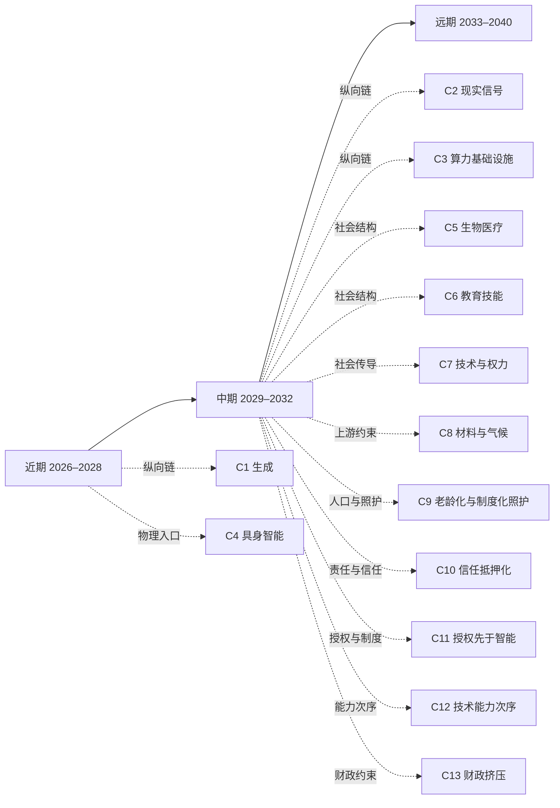

# 中期图景：2029–2032

[English version](../en/20-mid.md)

[返回 README／文档地图](../../README.md)

> 2031 年 7 月，一家处理跨境退货与理赔的公司换掉了墙上的仪表盘。旧的那块显示这个月自动完成了多少步，数字一直在涨，看久了没有意义；新的那块只留一列，标题是“等一个人”。那天下午这一列里有六项，排在最前面的已经等了九个小时。
>
> 公司里能按下这一列的只有两个人，其中一个在休产假。剩下的那位不缺信息：每一项都附着系统写好的三页理由，条理清楚，措辞比她自己写的好。她要翻的是另一栏——这条流程上一次走完之后，现实里到底发生了什么，而不是当时系统预计会发生什么。这一栏常常是空的。空着的那几项，系统能补出一段看上去很合理的复盘，用来排队足够了；可一旦要拿去申请赔付，对方不认。
>
> 她也不缺权限。她缺的是她自己：按下去的每一项，合同里都有一行写着“错了赔到哪一档”，而那一行下面署的是她的名字。九个小时就是这么来的——不是系统慢，是她不愿意把一件自己没看懂的事，变成一句自己要负责的话。
>
> 那天下午她按了四项，退回两项。晚上还有一通电话要打：其中一家品牌这次损失不小，系统已经把邮件、赔付方案和三种措辞都拟好了，但那通电话得她自己打。
>
> 中期的形状大致就是这样：执行本身不再是瓶颈，瓶颈换成了那一列“等一个人”——哪些动作允许自动做完、越过边界之后由谁决定、决定错了谁赔。以下六个维度分别拆开这件事。中期不是凭空跳到科幻未来，而是把近期已写下的技术判断向组织、制度和真实世界后果推进；每条中期推论都依赖近期判断，若上游被证伪，下游必须重审。完整卡片见 [`90-ledger.md`](90-ledger.md)，正文中的编号均直接回到台账，台账是字段与状态的唯一来源。
>
> 这一层是横向铺开同一个时间窗。想沿一条因果线纵向读到底，见 [C2 · 当数据不再免费：现实信号如何变成合同资产](chains/20-real-signals-become-contracts.md)——它的论证正落在这几年。

> **方法论回流（decision 950）**：旧版曾以「L1 丰富→稀缺 × AI 产出」作为统一骨架；本页现按每节实际起点组织。L1 是可选透镜，不是默认起点，详见[方法论 §2「透镜工具箱」](00-method.md#2-透镜工具箱)。

> **本页**：本层起点边界：本层六个顶层节把近期技术判断推向组织与制度后果；人口、照护、财政、材料和物理劳动等非 AI 起点在下方 C4、C8、C9、C13 段落中独立展开。这里不把它们强行改写成 AI 的下游，也不为填平顶层结构而新增未经校准的社会级口吻。

## 阅读导航图（关系投影）

本图只提供近／中／远三页与推演链的阅读入口，不新增判断，也不替代 `J-NNN` 台账。时间层是粗粒度阅读容器；因果依赖请回到台账的 `depends-on`。

> 本图是阅读辅助，不是新的事实源。箭头表示推荐入口而非必然因果。

## 1. 算力与 token：生成不再是瓶颈，执行边界成为瓶颈

> **起点**：本节从**技术规律**起步，并以 AI 能力为前提：生成能力先扩张，再检验连续执行、状态与授权能否承受现实后果。

> **本节透镜选择**：本节明确选用 L1：候选方案的供给增加是否把稀缺推向可回放状态、权限和可恢复行动，是本节的核心假设。

如果 [J-001](ledger/01-10.md#j-001--同等能力的单位推理成本继续下降) 和 [J-006](ledger/01-10.md#j-006--推理吞吐先于长程自主性) 成立，2029 年前后同一预算已经能搜索大量方案。中期问题不再是“能不能生成”，而是能否让系统连续行动而不把试错成本转嫁给现实世界。

- **变丰富**：候选计划、并行推理和自动修正。
- **变稀缺**：可检查的权限、可回放的状态和可恢复的行动。
- **第三问**：简单验证会被内置；跨系统状态、物理损害和责任归属受物理与法律／责任约束。
- **所以谁改变行为**：组织应先购买“可观察、可暂停、可回滚”的行动环境，再购买更长的自主权限。
- **窗口机会**：可暂停、可回放、可回滚的行动环境。

[J-010](ledger/01-10.md#j-010--长程自主执行晚于受限连续执行) 依赖 [J-009](ledger/01-10.md#j-009--受限工作流中的连续执行先成熟)：若受限工作流没有先稳定，长程自主执行的时间窗和可靠性判断一起动摇。中期由此分出两条判断：可暂停、可回放、可回滚的行动环境会先成为必要条件（[J-031](ledger/31-40.md#j-031--可暂停可回放可回滚的行动环境成为长程-ai-执行的准入条件)），而授权审查会比执行步骤更稀缺（[J-032](ledger/31-40.md#j-032--授权审查与异常升级比执行步骤更稀缺)）。若 [J-010](ledger/01-10.md#j-010--长程自主执行晚于受限连续执行) 被证伪，[J-031](ledger/31-40.md#j-031--可暂停可回放可回滚的行动环境成为长程-ai-执行的准入条件) 对长程行动的需求边界会后移，[J-032](ledger/31-40.md#j-032--授权审查与异常升级比执行步骤更稀缺) 则只保留在受限工作流内。其强反方是供应商把长任务切成大量不可见的短流程，从而绕过显式环境建设。

> **范围标签 · 闸一**：本段引用的 J-001, J-006, J-009, J-010, J-031, J-032 已判为职业／组织性判断；受众天花板由所引卡片定义，不作社会级趋势断言。完整判据见[历史回顾 · 闸一](01-retrospect.md#七用这道闸检验我们自己写过的东西)，逐卡依据见[判断台账 · 检查日志](90-ledger.md#八检查日志)。

## 2. 信息与内容：内容成为原料，因果成为产品

> **起点**：本节从**供需关系与技术规律**起步，并以 AI 能力为前提：解释和模拟的供给上升之后，真实干预与因果证据是否成为约束。

> **本节透镜选择**：本节明确选用 L1：解释与模拟的丰富是否把价值推向真实观测、干预和责任承诺，需要用现实证据检验。

近期的 [J-002](ledger/01-10.md#j-002--从海量产出中筛出客观高质量不是持久稀缺只是-24-年的窗口) 判断客观择优会被内化，[J-005](ledger/01-10.md#j-005--生成丰富之后价值向三类不可重组的输入集中原始信号可追责承诺被验证因果) 则把价值推向原始信号、可追责承诺和被验证因果。中期会出现一个不舒服的转折：解释越来越便宜，改变现实仍然昂贵。

- **变丰富**：对任何既有资料的解释、摘要、预测和模拟方案。
- **变稀缺**：新的观测、真实干预和愿意承担错误代价的主体。
- **第三问**：合成资料能自动扩张，但不能自动完成被监管接受的真实实验与责任承诺；物理、时间和法律责任构成硬约束。
- **所以谁改变行为**：研发和决策者把“模型说什么”与“现实做了什么”分成两套记录，不能用漂亮解释替代干预证据。
- **窗口机会**：真实干预记录与合成证据分层工具。

[J-005](ledger/01-10.md#j-005--生成丰富之后价值向三类不可重组的输入集中原始信号可追责承诺被验证因果) 的推论分成两个中期判断：真实干预的可验证记录会比解释本身更值钱（[J-033](ledger/31-40.md#j-033--真实干预的可验证记录比解释本身更有价值)），而合成证据会先在低责任场景被接受、高责任场景仍要求现实试验（[J-034](ledger/31-40.md#j-034--合成证据先在低责任场景获准高责任场景仍要求现实试验)）。两条都依赖 [J-005](ledger/01-10.md#j-005--生成丰富之后价值向三类不可重组的输入集中原始信号可追责承诺被验证因果)；若 [J-005](ledger/01-10.md#j-005--生成丰富之后价值向三类不可重组的输入集中原始信号可追责承诺被验证因果) 被证伪，现场信号不再有结构性溢价，[J-033](ledger/31-40.md#j-033--真实干预的可验证记录比解释本身更有价值) 与 [J-034](ledger/31-40.md#j-034--合成证据先在低责任场景获准高责任场景仍要求现实试验) 都会动摇。外部对照已完成：方向上与“数据越来越重要”的常见说法一致，但对照只能支持到更窄的范围——合规证据、模型风险治理与现实干预记录的价值在高责任场景上升（EXT-7、EXT-13、EXT-9），既未证明它必然高于解释本身，也未给出时间窗。因此本项目仍坚持更具体的押注：“未被记录的信号”和“可赔付承诺”，而不是数据总量（逐条对照结论见 [J-033](ledger/31-40.md#j-033--真实干预的可验证记录比解释本身更有价值)、[J-034](ledger/31-40.md#j-034--合成证据先在低责任场景获准高责任场景仍要求现实试验) 的「与共识」字段）。

最强反方是高保真世界模型和监管制度共同接受合成实验，令真实试验不再是必需输入；若发生，[J-005](ledger/01-10.md#j-005--生成丰富之后价值向三类不可重组的输入集中原始信号可追责承诺被验证因果) 必须重审。

> **范围标签 · 闸一**：本段引用的 J-002, J-005, J-033, J-034 已判为职业／组织性判断；受众天花板由所引卡片定义，不作社会级趋势断言。完整判据见[历史回顾 · 闸一](01-retrospect.md#七用这道闸检验我们自己写过的东西)，逐卡依据见[判断台账 · 检查日志](90-ledger.md#八检查日志)。

## 3. 注意力与信任：可信度从表达迁移到抵押

> **起点**：本节从**人性规律与社会规律**起步，并以 AI 能力为前提：可信度的关键从表达转向长期履约、责任和赔付。

近期 [J-017](ledger/11-20.md#j-017--ai-中介会比强关系更快扩大弱关系协调) 把弱关系协调与强关系承诺拆开；[J-005](ledger/01-10.md#j-005--生成丰富之后价值向三类不可重组的输入集中原始信号可追责承诺被验证因果) 则指出责任主体本身会升值。若两条成立，内容越像真的，读者越需要问“错了谁赔”。

**从该起点得到的结果**：旧版把「个性化解释、身份叙事和仿真的亲密互动」放在本节开头；本节现将它作为结果而非起点，并把压力落在「长期一致、可追责、愿意押上资产的信任」。**自动化边界**：表情、语言和即时耐心能被复制；重复博弈、关系修复、法律责任不能一次生成。 **行动边界**：组织为重要 AI 输出建立责任、审计和赔付路径；个人把“可信”理解为可追责的关系，而不只是语气自然；可能的窗口是履约记录、责任抵押与审计接口。

由此形成两条中期判断：责任抵押会进入重要 AI 输出的交易结构（[J-035](ledger/31-40.md#j-035--责任抵押进入重要-ai-输出的交易结构)），长期履约记录会比一次性的自然表达更能分配注意力（[J-036](ledger/31-40.md#j-036--长期履约记录比一次自然表达更能分配注意力)）。若 [J-017](ledger/11-20.md#j-017--ai-中介会比强关系更快扩大弱关系协调) 被证伪，弱关系协调并未变便宜，[J-036](ledger/31-40.md#j-036--长期履约记录比一次自然表达更能分配注意力) 的凭据升级会失去压力；若 [J-005](ledger/01-10.md#j-005--生成丰富之后价值向三类不可重组的输入集中原始信号可追责承诺被验证因果) 被证伪，[J-035](ledger/31-40.md#j-035--责任抵押进入重要-ai-输出的交易结构) 的赔付基础也会消失。强反方是平台把所有责任外包给使用者，社会接受低责任的廉价服务；那会让责任抵押变成窗口而非结构机会。

> **范围标签 · 闸一**：本段引用的 J-005, J-017, J-035, J-036 已判为职业／组织性判断；受众天花板由所引卡片定义，不作社会级趋势断言。完整判据见[历史回顾 · 闸一](01-retrospect.md#七用这道闸检验我们自己写过的东西)，逐卡依据见[判断台账 · 检查日志](90-ledger.md#八检查日志)。

## 4. 组织与就业：公司边界由责任而非产能决定

> **起点**：本节从**社会规律与技术规律**起步，并以 AI 能力为前提：自动化先改变工作单元，再检验组织如何分配授权与责任。

近期 [J-009](ledger/01-10.md#j-009--受限工作流中的连续执行先成熟) 认为受限工作流先成熟，[J-013](ledger/11-20.md#j-013--可检查的工具调用先于开放环境行动) 认为可检查工具调用先普及。由此推演，中期组织不一定变成“没有人”，而更可能变成少数人管理更多可验证的代理流程。

**从该起点得到的结果**：旧版把「可拆分、可监控的工作步骤和小团队的产出能力」放在本节开头；本节现将它作为结果而非起点，并把压力落在「跨团队授权、异常升级和最终责任的组织位置」。**自动化边界**：流程协调可以自动化；责任、关系和失败后的谈判仍受法律与信任约束。 **行动边界**：招聘与教育从“会不会做步骤”移向“会不会定义边界、判断异常、承担后果”；可能的窗口是小团队代理流程的权限与异常升级层。

由此形成两条中期判断：同规模小团队的可验证产出会提高（[J-037](ledger/31-40.md#j-037--同规模小团队的可验证产出提高)），而授权、异常升级和责任岗位不会按同样速度减少（[J-038](ledger/31-40.md#j-038--授权异常升级和责任岗位不会与执行步骤同速减少)）。若 [J-009](ledger/01-10.md#j-009--受限工作流中的连续执行先成熟) 被证伪，[J-037](ledger/31-40.md#j-037--同规模小团队的可验证产出提高) 的连续执行前提消失；若 [J-013](ledger/11-20.md#j-013--可检查的工具调用先于开放环境行动) 被证伪，[J-038](ledger/31-40.md#j-038--授权异常升级和责任岗位不会与执行步骤同速减少) 的可编程权限前提消失。强反方是企业选择把所有代理流程留在供应商内部，客户只购买结果，导致组织边界变化被隐藏而非消失。

> **范围标签 · 闸一**：本段引用的 J-009, J-013, J-037, J-038 已判为职业／组织性判断；受众天花板由所引卡片定义，不作社会级趋势断言。完整判据见[历史回顾 · 闸一](01-retrospect.md#七用这道闸检验我们自己写过的东西)，逐卡依据见[判断台账 · 检查日志](90-ledger.md#八检查日志)。

## 5. 资本与权力：稀缺从模型转向准入

> **起点**：本节从**供需关系与技术规律**起步，并以 AI 能力为前提：模型供给增加后，能源、数据、渠道和偿付能力等互补约束如何定价。

> **本节透镜选择**：本节明确选用 L1：模型供给增加是否抬高互补资产与准入权的价值，是本节的核心待检验翻转。

如果 [J-001](ledger/01-10.md#j-001--同等能力的单位推理成本继续下降) 的成本下降和 [J-005](ledger/01-10.md#j-005--生成丰富之后价值向三类不可重组的输入集中原始信号可追责承诺被验证因果) 的真实输入升值同时成立，资本不会只追逐“最强模型”，而会追逐能源、数据、分发、许可与赔付能力的控制权。

- **变丰富**：可租用的通用推理和生成能力。
- **变稀缺**：低成本能源、独家现实数据、关键渠道以及能吸收事故的资产负债表。
- **第三问**：软件调用可复制；产权、能源接入、关系网络和责任能力不能同速复制。
- **所以谁改变行为**：创业者把“模型能力”与“准入能力”分开估值；监管者观察谁能把收益私有化、把损失社会化。
- **窗口机会**：能源、数据、渠道与事故偿付能力的准入层。

由此形成两条中期判断：租用模型本身会更丰富，但能源、数据与渠道控制形成准入租金（[J-039](ledger/31-40.md#j-039--模型租用更丰富但能源数据和渠道控制形成准入租金)），能吸收事故的资产负债表成为另一种稀缺（[J-040](ledger/31-40.md#j-040--能吸收-ai-事故的资产负债表成为独立稀缺)）。若 [J-001](ledger/01-10.md#j-001--同等能力的单位推理成本继续下降) 被证伪，[J-039](ledger/31-40.md#j-039--模型租用更丰富但能源数据和渠道控制形成准入租金) 的模型丰裕前提消失；若 [J-005](ledger/01-10.md#j-005--生成丰富之后价值向三类不可重组的输入集中原始信号可追责承诺被验证因果) 被证伪，[J-040](ledger/31-40.md#j-040--能吸收-ai-事故的资产负债表成为独立稀缺) 的责任吸收溢价会动摇。这只是中置信度结构图景，不作为独立商机卡。强反方是算力、能源和数据都快速商品化，制度也及时分散准入权；若准入价格不再有结构性溢价，本图景降置信度。

> **范围标签 · 闸一**：本段引用的 J-001, J-005, J-039, J-040 已判为职业／组织性判断；受众天花板由所引卡片定义，不作社会级趋势断言。完整判据见[历史回顾 · 闸一](01-retrospect.md#七用这道闸检验我们自己写过的东西)，逐卡依据见[判断台账 · 检查日志](90-ledger.md#八检查日志)。

## 6. 人性与关系：AI 可以代理协调，不能代理共同经历

> **起点**：本节从**人性规律与社会规律**起步；AI 只作为协调工具，不能替代共同经历与亲自承担后果。

[J-017](ledger/11-20.md#j-017--ai-中介会比强关系更快扩大弱关系协调) 建立在 [J-006](ledger/01-10.md#j-006--推理吞吐先于长程自主性) 和 [J-007](ledger/01-10.md#j-007--可接续上下文先于可靠长期记忆) 上：沟通与共享背景变便宜，但强关系容量受注意力、身体和重复承担约束。中期最容易犯的错误，是把“有人替你回复”误读成“有人替你在场”。

**从该起点得到的结果**：旧版把「随时可用的陪伴式回复、关系维护提醒和冲突摘要」放在本节开头；本节现将它作为结果而非起点，并把压力落在「非代理的共同经历、真正的互惠和需要当事人承担的修复」。**自动化边界**：语言和提醒可自动化；身体在场、信任关系和共同后果不能被同一股生成力量复制。 **行动边界**：家庭、学校和组织为不能代理的决定保留共同在场，把 AI 用于准备和回顾而不是替代承担；可能的窗口是弱关系协调工具；强关系在场仅作图景，不是商机。

由此形成两条中期判断：AI 会先扩大弱关系的协调半径（[J-041](ledger/41-50.md#j-041--ai-先扩大弱关系的协调半径)），但共同经历与身体在场仍构成强关系的容量上限（[J-042](ledger/41-50.md#j-042--共同经历与身体在场仍是强关系容量上限仅图景)）。若 [J-017](ledger/11-20.md#j-017--ai-中介会比强关系更快扩大弱关系协调) 被证伪，前者的协调供给前提消失；若 [J-011](ledger/11-20.md#j-011--跨媒介一致性先于长时连贯性) 被证伪，后者关于多模态表达扩张的前提减弱。这是出口 B 的结构性图景，置信度中低，不能包装成商业机会。强反方是人类把 AI 代理的持续互动视为足够真实的互惠关系；若行为显示代理关系能稳定替代共同经历，本条需要改写。

> **范围标签 · 闸一**：本段引用的 J-006, J-007, J-011, J-017, J-041 已判为职业／组织性判断；受众天花板由所引卡片定义，不作社会级趋势断言。完整判据见[历史回顾 · 闸一](01-retrospect.md#七用这道闸检验我们自己写过的东西)，逐卡依据见[判断台账 · 检查日志](90-ledger.md#八检查日志)。

## 同一时间窗里的另外十条链：C4–C13 在 2029–2032

前六节把近期的能力判断推到组织与现实后果；这里把另外十条链在 2029–2032 年的中段放回同一张图。每段只补本层的正文判断和交汇，不复制台账卡的受众规模与普及闸字段；若本层只有检查日而没有新判断，也直接写明。

### C4 具身智能：非结构化抓取与柔性装配开始穿过工位边界

[C4 · 具身智能](chains/40-embodied-intelligence.md) 到中期进入第二段：仓储里从结构化搬运转向非结构化拣选，制造业从刚性件闭环转向柔性装配，但两者都仍以单任务、单工位和可回退的部署为主。[J-075](ledger/71-80.md#j-075--仓储的瓶颈已从移动移到抓取非结构化拣选先到门到门交付在本窗口内不成立) 说的是抓取先穿过瓶颈，不是门到门交付已成立；[J-076](ledger/71-80.md#j-076--制造业已经发生的规模化过的是闸四的局部闭环柔性装配与小批量多品种仍在闸外) 则把柔性装配留在局部闭环。[J-099](ledger/96-102.md#j-099--具身自动化先重排职业任务包而非同步消灭整个职业) 进一步把部署单位写成任务包：机器接一段可验收的任务，人负责异常、交接和责任。照护里的接触式转移仍先在机构里开窗，居家不是本层的社会级结论（[J-074](ledger/71-80.md#j-074--照护里的接触式转移先在机构穿越居家在本窗口内不构成社会级普及)）。

交汇：中期的物理世界对应第 4 节的组织重排——不是“机器替代职业”，而是把职业拆成可交付任务包；谁接异常、谁签收结果，和 C7、C11 的授权边界是同一笔账。

### C5 生物与医疗：候选更多，人体时间仍是闸

[C5 · 生物与医疗](chains/50-biology-medicine.md) 在中期没有跳过真实因果：低责任医疗工作流在前一阶段已成为常规配置，药物和生物医学候选的生成、排序与组合继续变多，但 [J-081](ledger/81-90.md#j-081--药物候选更丰富不等于人体试验时间同步缩短) 的人体试验时间不会按候选数量等比例缩短。[J-080](ledger/71-80.md#j-080--低责任医疗工作流先于无专业复核的自主诊疗扩散) 的窗口在 2031 年收口，意味着要检查自主诊疗是否仍被专业复核挡住；[J-082](ledger/81-90.md#j-082--解释变多后医疗稀缺移向获授权的干预与连续照护仅图景) 只保留为结构图景，不把候选增长写成临床结果增长。

交汇：这条链把第 2 节的“解释变便宜、现实干预昂贵”钉在人体时间上；C11 的分级授权在医疗场景里仍要服从专业复核与责任归属。

### C6 教育与技能形成：过程证据接管成品证据

[C6 · 教育与技能形成](chains/60-education-skill-formation.md) 的中期分叉是：讲解和成品继续丰富，学校与机构把判断转向受控表现和过程证据。[J-085](ledger/81-90.md#j-085--居家成品信号变弱受控表现与过程证据增值) 判断居家成品的筛选力下降，受控环境中的表现、口试或过程记录增值；[J-086](ledger/81-90.md#j-086--解释鸿沟缩小但练习与验证鸿沟可能扩大仅图景) 仍是仅图景，不能写成教师已被替代。[J-083](ledger/81-90.md#j-083--个性化讲解先于可验证掌握变丰富) 的近期窗口已到检查点：解释数量上升是否带来可验证掌握，必须看行为而不是内容产量。

交汇：这与第 3 节“看见不等于相信”直接相接——当成品容易伪造，教育把信任移向过程和受控表现；它也给 C7 的人机监督单元提供了训练入口。

### C7 技术先到，权力后到：人机监督单元成为组织的默认接口

[C7 · 技术先到，权力后到](chains/70-capability-to-social-consequences.md) 在中期从“组织试用”进入“组织接口”。[J-088](ledger/81-90.md#j-088--初级产出席位先于职业整体收缩学徒载体成为新瓶颈) 指向一个不舒服的反馈：当初级岗位里的练习步骤被自动化，组织可能同时失去培养下一层责任人的学徒席位；[J-089](ledger/81-90.md#j-089--权限审计与申诉控制面先于广泛自主授权成为生产基础设施) 则要求身份、权限、日志、暂停、审计和申诉先成为生产基础设施。[J-090](ledger/81-90.md#j-090--生产率收益先向稀缺互补资产所有者集中再由竞争与制度决定是否扩散) 的窗口已开始：生产率收益先流向稀缺互补资产的控制者，并不自动等于组织内人人受益。

交汇：第 4 节说小团队能交付更多可核验产出，C7 追问谁获得收益、谁失去练习入口；C11 的可撤回代理是它在责任制度上的对应接口。

### C8 芯片之前的晶圆厂：供应链韧性变成转化路径

[C8 · 芯片之前的晶圆厂](chains/80-fab-materials-and-climate.md) 在中期把“上游短缺”具体化为两种可检查的基础设施。[J-092](ledger/91-95.md#j-092--半导体韧性投入从原料库存转向已验证转化路径) 的判断是，韧性投入从囤原料转向验证替代精炼、电子级转化、设备服务、配方与工艺转移；[J-093](ledger/91-95.md#j-093--先进晶圆厂选址按稳定电力水质与排放能力的组合定价) 则在 2033 年前检查先进晶圆厂是否按稳定电力、水质、水回用、排放和气候适应能力定价。[J-094](ledger/91-95.md#j-094--半导体气候风险按已验证产出损失而非风险地图被定价) 与 [J-095](ledger/91-95.md#j-095--晶圆厂韧性成本变成谁付钱与谁先被限供的显式谈判) 的开窗，意味着算力扩张可能先形成有配套能力的区域集群。

交汇：第 5 节的“入口仍贵”在这里落到水、电、化学品与设备服务；C8 与 C3 共同决定算力能否从租用的模型变成现实产能。

### C9 人口老龄化与制度化照护：家庭照护被重新分工

[C9 · 人口老龄化与制度化照护](chains/90-aging-care-and-institutional-substitution.md) 在中期把近期的缺口推到角色重分配。[J-096](ledger/96-102.md#j-096--老龄化与家庭缩小把部分照护推向正式服务与协调层) 预计部分照护继续转向正式服务、保险或公共支付与跨机构协调，但不是家庭关系退出；[J-097](ledger/96-102.md#j-097--照护辅助先在机构与受控服务中稳定开放家庭通用机器人滞后) 把替代对象限定为劳动的组织方式。设备若稳定部署，C4 的接触式转移会进入机构先行的照护链，但本层不把演示或单任务设备写成家庭整体自动化。

交汇：C9 把 C4 的物理能力放进人口与支付制度：设备能不能进门，不只取决于抓取能力，还取决于保险、授权和谁在异常时接住责任；这也是 C13 预算约束的直接下游。

### C10 信任抵押化：责任开始进入交易结构

[C10 · 信任抵押化](chains/100-trust-collateralization.md) 的中期核心是 [J-035](ledger/31-40.md#j-035--责任抵押进入重要-ai-输出的交易结构)：当重要 AI 输出越来越像普通服务，采购方会要求可追踪的履约记录、责任主体与赔付安排，而不是只比较演示效果。这里不把“责任抵押”扩写成所有行业的统一制度；它首先在高责任、可索赔、已有合同与保险语言的场景里开窗。

交汇：第 3 节关于凭据升级的判断在这里成为合同条款；C11 说明谁可以代表谁行动，C10 说明行动错了之后谁拿出可执行的赔付。

### C11 授权先于智能：高责任代理先分级、可撤回

[C11 · 授权先于智能](chains/110-authority-before-intelligence.md) 的中期核心是 [J-098](ledger/96-102.md#j-098--授权先于智能高责任场景先形成可撤回的分级代理)：在高责任场景里，AI 先挂在个人、组织或公共机构的责任之下，按任务、金额、风险和异常条件分级授权；独立责任主体的 AI 不是本层判断。授权审查、日志、撤回和申诉先成为接口，连续执行能力反而不是唯一瓶颈。

交汇：第 1 节所说的可暂停、可回放环境给授权提供了操作底座；C10 的责任抵押则让“谁授权、谁赔付”进入交易，而 C7 把它变成组织的控制面。

### C12 技术能力演进链：长程自主性仍踩在连续执行上

[C12 · 技术能力演进链](chains/120-technology-capability-sequence.md) 的中期判断不是“模型突然变成人”，而是能力沿依赖顺序继续穿越。[J-011](ledger/11-20.md#j-011--跨媒介一致性先于长时连贯性)、[J-014](ledger/11-20.md#j-014--可演练环境晚于单工具接入) 和 [J-010](ledger/01-10.md#j-010--长程自主执行晚于受限连续执行) 共同说明：多模态一致性与可演练环境先成熟，长程自主性随后进入受限场景；[J-012](ledger/11-20.md#j-012--跨时间连贯生成依赖状态与验证) 和 [J-016](ledger/11-20.md#j-016--开放世界评估是自主边界扩张的最后门槛) 把边界留在可验证状态与受限世界。第 1 节的授权闸不是附加装饰，而是这条技术次序到社会部署之间的过桥。

交汇：C12 解释为什么中期只能先买可回滚的连续执行，C4 则提醒物理执行器和现实环境不会按软件能力同速成熟。

### C13 财政挤压：现领取者先稳住，未领取者与外援先让位

[C13 · 财政挤压](chains/130-fiscal-squeeze-who-gets-cut.md) 在中期已有足够硬的检查点。[J-105](ledger/103-108.md#j-105--财政挤压时现领取者的名义养老金最难动刀先落在还没开始领的人身上) 判断，财政压力先通过推迟未来领取、改变资格或把成本转给尚未领取者来消化；美国 OASI 预计在 2032 年第四季度耗尽储备，构成时间锚。[J-107](ledger/103-108.md#j-107--65-岁以上的每周有酬工作停在分众档千万级不到亿级) 则记录高龄继续工作是分众层级而非全社会性替代；[J-106](ledger/103-108.md#j-106--援外让位于国防没有国内按期领取者的预算先被挤出) 的复核窗口到 2029 年，检验没有国内按期领取者的预算是否先让位于国防。

交汇：C13 决定 C9 的正式照护与 C4 的设备采购能得到多厚的公共支付；C7 的生产率收益若集中到互补资产，未必能及时扩成可用税基。

## 本层边界

生物医疗（C5）、教育资格（C6）、物理劳动（C4）、人口与照护（C9）、技术与权力（C7）、材料与气候（C8）、授权制度（C11）和财政一侧（C13）已在本层按时间窗写入正文；能源与物理基础设施仍只通过 [C3 · 电子落地](chains/30-power-land-and-permits.md) 与 C8、C4 的交汇被触及，没有独立展开。C10 的责任抵押在本层已开窗，但其观察期仍需继续。远期反馈仍未覆盖；地缘制度的财政一侧已有 [C13 · 财政挤压](chains/130-fiscal-squeeze-who-gets-cut.md)（J-105–J-107），国家间竞争与安全本身仍未推演；法律与产权也仍未形成独立链条。上述段落使用近期判断作支点；若支点被证伪，不保留原文的确定语气。人与 AI 的亲密关系具体规范仍只在远期保留为较弱图景，不能从本层技术能力直接推出。
